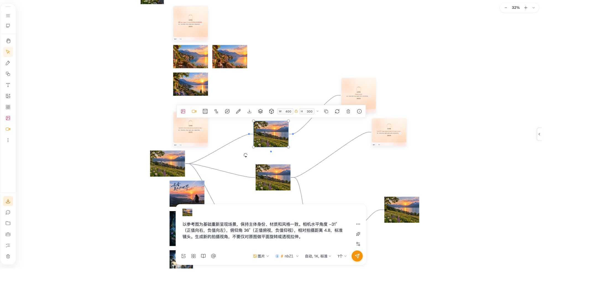
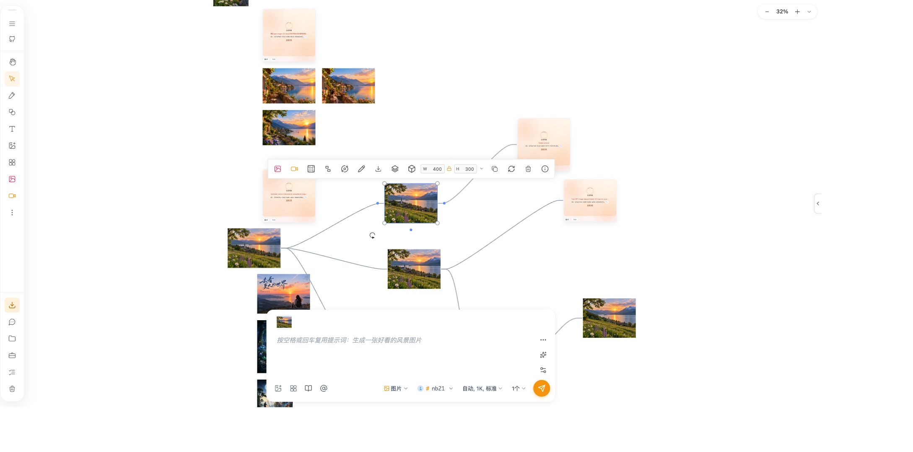
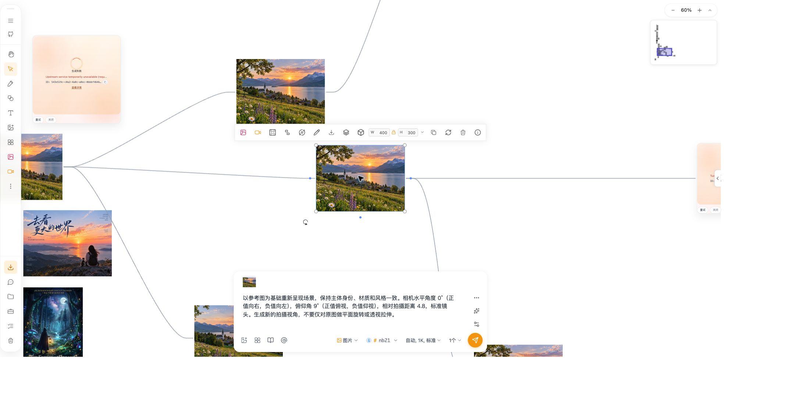
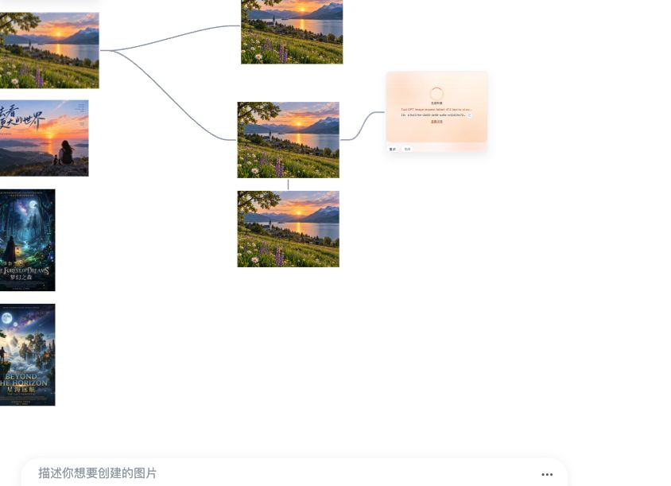

# 主画布整合与工作流模式删除 QA

## 2026-10-25：视角回填后输入栏被清空

- 根因：视角弹窗通过 Portal 挂载在画布容器内，点击“填入”的 `pointerup` 被当成真实画布点击。50ms 延迟选区回调触发原图片草稿恢复，覆盖刚回填的视角指令，造成成功提示与空输入栏同时出现。
- 修复：实际画布点击判定排除 `.Dialog-overlay`、`[role="dialog"]` 和 `.ai-input-bar`，沿用原有附属元素排除逻辑。保持上节临时视角草稿、原提示词复用及单张参考图合并规则。
- 同路径兼容：当前截图中的 6624×4960 图片来自本地缩放，原提示词仅存于 `localImageOperation.sourcePrompt`。图片缺少自身生成提示词时增加此来源兜底；自身 `generationPrompt`、`aiPrompt`、`prompt` 优先，非图片目标不读取该字段。没有新增存储结构或迁移，仍沿用既有目标绑定元数据回填生命周期。
- 回归：先用真实选区监听器新增弹窗/输入栏点击用例，修改前 2 项失败、13 项通过；修正后，选区监听、工具草稿、参考合并、目标状态和视角弹窗共 5 文件、90 项通过。本地缩放提示词测试覆盖来源读取、自身优先、非图片和无效来源值。命令沿用上节 5 个测试文件，日志 `/tmp/opentu1-prefill-pointer-{red,tests,types,lint,build}.log`。Drawnix TypeScript、4 份相关文件 ESLint（0 错误，AIInputBar 18 项已有警告）、生产 Vite 构建和 `git diff --check` 通过。
- 页面验收：沿用用户已批准的 7201 查看、选图、打开视角编辑和确认回填范围。两轮按 -31° / 36° / 4.8 回填后，文案均保留；点击输入栏后仍保留，参考缩略图一张。再次点击原图可见“按空格或回车复用提示词：生成一张好看的风景图片”。空格处理器仅做自动逻辑验证，本次未在页面按空格。页面最终停在已回填视角文案的状态；未点击发送/重试、未调用生成接口，未移动或删除图片。
- 证据：下方保存回填和原提示词候选两种状态。此前只检查缩略图数量的验收不足以覆盖本问题；以上结果替代相关未执行页面验证状态。未做 Windows、其他浏览器或线上验证。复用既有 QA/DOC，不提交、推送或更新 PR。





## 2026-10-25：恢复原图片提示词复用逻辑

- 用户要求：点击原图片继续显示原生成提示词的复用提示，按空格才填入；视角工具指令不能覆盖原图片的草稿，重复参考图修复继续保留。
- 根因及边界：视角回填复用了当前图片的草稿所有权，回填后再次选择会读取视角文案，抑制原提示词建议。此前页面验收只检查了缩略图数量，未覆盖这一兼容行为，本节补充该验证范围。
- 修复：来源匹配的画布工具回填先保存原图片草稿，再解除草稿绑定；回填写入临时输入。选区监听区分实际画布点击和视口刷新，同一图片的鼠标移动/缩放刷新保留回填内容，实际点击则回到原图片草稿及原提示词建议。取消覆盖时不改变归属，原有手写草稿保留。不更改原图片生成元数据、不新增持久化格式，不改空格复用处理器或发送逻辑。
- 自动验证：macOS、Node v26.8.1、pnpm 10.21.0，在 `packages/drawnix` 执行 `NODE_OPTIONS=--no-experimental-webstorage pnpm exec vitest run --config vitest.config.ts`，指定 `src/components/ai-input-bar/AIInputBar.toolbar-draft.test.ts`、`AIInputBar.prefill-images.test.ts`、`AIInputBar.selection.test.tsx`、`target-bound-taskbar-state.test.ts`（后三项同目录）及 `src/components/toolbar/popup-toolbar/canvas-image-tools-dialog.test.tsx`，5 文件、87 项通过。新用例联合执行真实回填、解除绑定和目标切换回调，覆盖原提示词建议、空格复用判断、用户手写草稿、视口刷新、取消选择/重选、取消覆盖。先前单图引用去重测试通过。
- 页面验收状态已由上方“视角回填后输入栏被清空”章节更新：回填保留及原图候选提示均完成页面验证，空格复用仅完成自动逻辑验证。不调用生成接口。
- 静态与构建：Drawnix TypeScript、3 份变更 TS 文件的 ESLint、生产 Vite 构建、`git diff --check` 通过。AIInputBar 的 18 项已有 Lint 警告与本次修改前逐项一致，新测试无新增警告。日志为 `/tmp/opentu1-original-prompt-{tests,types,lint,build}.log`。旧会话中已经写入的错误图片草稿属于内存状态；刷新后重新打开画板进行验收，不按文案内容猜测或删除用户草稿。
- 复用既有 QA/DOC，无依赖、配置、迁移变化；保留其他本地修改，未提交、推送或更新 PR。未验证 Windows、其他浏览器、线上及真实供应商。

## 2026-10-25：视角编辑重复参考图

- 问题路径：单张图片选择后通过绑定参考图进入输入栏，视角确认又将原图回填到上传列表；原有普通选区抑制未覆盖绑定图片，显示和生成列表直接拼接造成重复。
- 修复：视角回填增加可选 `sourceElementId`，输入栏保留该来源。普通选区、绑定预览、生成参考三个合并入口识别同一来源 ID、规范化 URL 和相同蒙版，仅保留回填的一份。保留上传索引顺序，不合并不同画布对象或不同图片/蒙版版本；语义替换背景路径保持独立。覆盖确认和发送行为不变。
- 环境：macOS、Node v26.8.1、pnpm 10.21.0，目录 `/Users/lkj/Desktop/working/opentu1`，分支 `dev/fix-selected-previews-and-model-discovery`。保留之前本地修改，本次不提交、不推送、不调用生成接口。
- 自动测试：在 `packages/drawnix` 使用 `NODE_OPTIONS=--no-experimental-webstorage pnpm exec vitest run --config vitest.config.ts`，指定 `src/components/ai-input-bar/AIInputBar.prefill-images.test.ts`、`src/components/ai-input-bar/AIInputBar.selection.test.tsx`、`src/components/ai-input-bar/AIInputBar.image-lineage.test.ts`、`src/components/toolbar/popup-toolbar/canvas-image-tools-dialog.test.tsx`、`src/services/canvas-operations/image-generation-references.test.ts`，5 文件、51 项通过。新用例执行实际回填映射和列表合并声明，覆盖选图后回填、异步选区/重选、重试 URL、不同对象共用 URL、图片与蒙版差异、多参考图顺序、语义替换背景、取消选择和删除回填项后的选中引用；弹窗测试验证来源 ID 出口。
- 静态与构建：Drawnix TypeScript、针对 5 份 TS 文件的 ESLint、生产 Vite 构建通过。ESLint 0 错误；AIInputBar 的 18 项警告与本次修改前逐项对照完全一致，无新增诊断。构建保留原有 Sass、Browserslist、混合导入与 chunk 体积提示。日志为 `/tmp/opentu1-angle-duplicate-{tests,types,lint,build}.log`。
- 页面验收：用户明确授权后，在 7201 原有 Chrome 画板选中截图中的 6624×4960 原图，打开 AI 视角编辑，按 -31° / 36° / 4.8 确认回填。输入栏仅显示一张“视角参考图”，提示词正确；再次打开编辑并确认覆盖后仍为一张。最后页面保持选中原图与一张回填缩略图，见下方截图（最终界面参数为 0° / 9° / 4.8）。未点击发送、重试，未调用生成接口，未移动或删除图片。
- 验收边界：未做 Windows、其他浏览器、真实供应商或线上验证。自动测试验证的是引用合并和来源传递；不同目标之间草稿切换及持久化不属于本次页面验收范围。


- QA/DOC：复用现有文件，无新增依赖、配置、持久化格式或迁移。

## 范围与环境

分支 `dev/consolidate-canvas-remove-workflow-mode`，目标分支 `develop`。用户于 2026-10-21 授权解决冲突并提交 PR；最终同步与验证见文末。本文件此前各阶段的结果按当时范围记录。环境为 macOS、Node.js 26.8.1、pnpm 10.21.0、Vitest 3.2.4/JSDOM。使用合成旧数据与模拟服务；没有读取用户实际浏览器数据库，没有真实生成请求，未部署。

删除独立模式目录和构建入口；复用主画布任务、输入、提示词、素材与批量工具，新增图片快捷设置、手动拆图、本地放大、视角回填及旧数据兼容。使用和维护说明见 [整合说明](./canvas-consolidation.md)。

## 已执行检查

- 修改前：库 TypeScript 无错误；提示词回填、关联、引用、蒙版基线 5 个文件 154 项通过。
- 当前：库 `pnpm exec tsc -p packages/drawnix/tsconfig.lib.json --noEmit` 和 Web `pnpm exec tsc -p apps/web/tsconfig.app.json --noEmit` 已通过。
- `NX_DAEMON=false pnpm exec nx run web:build-app`、`web:build-sw` 及 `node scripts/validate-startup-bundle.js` 已通过。最终构建产物不含旧模式资源目录、样式根标记或专属宿主标记。
- 定向回归在 `packages/drawnix` 运行 `pnpm exec vitest run --config vitest.config.ts`，指定新图片工具/数据/组件测试，以及 `image-task-prefill`、`canvas-association-state`、`canvas-association-resolver`、`image-mask-submission`、`canvas-association`、`target-bound-taskbar-state`、`bound-taskbar-layout`、`canvas-insertion`、`backup-utils`、`backup-crypto`、`workflow-engine`、`prompt-history-service`、`canvas-insertion-layout`、`xlsx-embedded-images`、`xlsx-image-export`。初次扩大验证 18 文件 287 项通过、1 项跳过；后续增加隐藏工具可达性和 ZIP 媒体往返测试，最终结果见本文后续记录。
- 受影响文件 lint 初次复核保留 4 个基线错误，使用 `git show HEAD:<file>` 输入相同 eslint 规则核实：`app-menu-items.tsx` 和 `unified-toolbar.tsx` 原有空回调、`popup-toolbar.tsx` 原有模块边界错误和受限全局 `location` 使用。新增文件无 lint 错误。最终数量见后续记录。
- 冻结离线锁文件检查通过；依赖清理只删除旧版本图中的不再可达项，保留依赖版本。实际离线安装在最终状态复核。

## 场景与预期

- 拆分边界：重复、乱序、接近边缘的分割线归一化，不生成零宽/零高图片；非法百分比拒绝。宽高比例、正数尺寸校验通过计算测试。
- 视角操作：确认前无回填，确认后仅调用输入回填，不插入或提交生成；切换画布后拒绝旧操作，图片读取失败禁用确认。JSDOM 组件逻辑测试覆盖，非真实页面验收。
- 快捷设置：隐藏工具仍在更多菜单可用；单图设置不影响文本等其他选择对象。
- 旧备份：结构化凭据、JSON 内配置、常见 URL 认证信息脱敏；未知版本、重复清单记录、越界文件路径和缺失媒体拒绝转换；本地媒体不触发远程下载。
- 旧导入：文本坐标、尺寸、提示词保留；重复导入创建新画布且源清单不变；无效节点导致该项目不写入；最终保存失败回滚当前新画布并报告中断；整个转换不发生成 POST。
- 旧路由：精确匹配 `/workflow` 和其下路径，转主画布并提供旧数据入口；不匹配相似前缀。

## 已知问题与未执行项

未执行浏览器自动化、页面点击/视觉、真实供应商、线上部署、Windows、超大图或大量旧记录压力测试；未验证真实旧浏览器数据导入。JSDOM 测试不能证明浏览器 IndexedDB/Cache 实际环境的完整恢复。代码只读旧库，兼容仍需用户在备份后验证。

配置节点、专属插件和旧 Canvas Agent 退役，不恢复执行语义；聊天与多图节点非主图槽位保留备份，不直接恢复为主画布会话或多图节点。没有本地文件的过期远程媒体无法恢复。共享在途任务能否查询依赖原始路由、账号和供应商契约，转换不重发。

构建保留 Sass 旧 API、大 chunk/动态导入等既有警告；Vitest 共享引擎在 JSDOM 输出缺少 IndexedDB 的已知日志但测试通过。环境 `.npmrc` 的 NPM_TOKEN 替换提示和旧 Browserslist 数据提示未修改。OpenSpec CLI 不在 PATH 或本地 bin，strict 未执行；手工/脚本检查不能替代 strict。

## 人工验收

在主画布选择图片，检查更多菜单的固定/取消固定、文字显示，再分别预览拆分、本地放大和视角回填；确认原图、引用及再次生成仍可使用。使用合成或已备份的旧数据验证导出文件、可转换画布和报告，确认未出现自动生成任务。以上为后续人工验收步骤，不表示本次已执行页面测试。

## 最终验证结果

- 清理依赖后的最终定向回归：19 个文件、291 项全部通过，无跳过；包含设置 `BATCH_XLSX_TEST_FILE` 后实际 XLSX 文件的内嵌图片回归，以及新增 ZIP 媒体/MIME 往返。测试数据文件只读。
- 一轮同时运行构建、类型和 lint 时，共享 workflow 引擎的首次动态导入超过既有 5 秒测试限制，其余 290 项通过；所有检查结束后用相同命令串行重跑，291 项通过，引擎首次导入约 2.9 秒。未修改测试超时、重试次数或业务限制。
- 最终库与 Web TypeScript 均 exit 0；主应用和 SW 构建均通过；启动 bundle 验证通过。
- 运行代码、配置和脚本引用扫描通过：无旧模式目录、专属宿主、路由 hook、资源路径、构建/测试命令引用。生产 JS/CSS 中无 `workflow-app-root`、`WorkflowModeHost` 或旧资源标记；旧模式资源目录不存在。
- 主画布共享 workflow 引擎、上下文、提交服务及 SW 协议文件仍存在，相关回归通过。
- 受影响文件 lint 为 4 个已与 HEAD 验证一致的原有错误、48 条警告，新增文件无错误；部分警告属于原有 any、hook 依赖及忽略文件提示。未以全量 lint 全绿交付。
- 实际 `NPM_TOKEN='' pnpm install --offline --frozen-lockfile --ignore-scripts` 通过，删除 21 个独占直接依赖及 319 个安装包。脚本验证当前锁文件每一行均来自原锁文件，没有增加/升级保留依赖版本；仅修剪不可达项。
- `git diff --check` 通过。OpenSpec 3 条需求及对应场景格式检查通过，CLI strict 仍未执行。

页面/真实数据验收仍按上述未执行项处理。本次 QA 和使用 DOC 已完成，不新增独立根目录 QA.md/DOC.md，不重建已删除模式的内部进度文件。

## 用户要求的扩展测试

在最终代码与清理后的依赖上执行主画布核心库全量测试，并补充两个组件测试：本地拆分通过既有插入服务一次提交四个分片、保持源元素不变；本地放大保持比例、插入失败显示错误且不关闭编辑器。未修改业务代码或测试超时。

| 检查 | 本轮结果 |
| --- | --- |
| 主画布核心库全量，318 个文件 | 3,538 项：3,487 通过、50 失败、1 跳过；另有 1 个文件加载错误，共 8 个失败文件 |
| 本次新增功能相关定向测试，4 个文件 | 27 项全部通过 |
| 共享工具库全量，25 个文件 | 473 项全部通过 |
| Service Worker，7 个文件 | 43 项全部通过 |
| drawnix、Web、utils TypeScript | 全部通过 |
| 主应用、SW 生产构建与启动 bundle 检查 | 全部通过 |
| 工作流目录/生产资源删除检查、共享 workflow 文件保留检查 | 通过 |
| 新增组件测试 ESLint、最终差异格式检查 | 通过 |

全量运行命令：在 `packages/drawnix` 执行 `NODE_OPTIONS='--no-experimental-webstorage' BATCH_XLSX_TEST_FILE='/Users/lkj/Downloads/批量生图测试.xlsx' pnpm exec vitest run --config vitest.config.ts --maxWorkers=2 --reporter=json --outputFile=/tmp/opentu-mode-expanded-final.json`。共享工具在 `packages/utils` 执行 `NODE_OPTIONS='--no-experimental-webstorage' pnpm test --maxWorkers=2`；SW 在仓库根执行 `NODE_OPTIONS='--no-experimental-webstorage' pnpm exec vitest run --root apps/web src/sw --maxWorkers=2`。实际 XLSX 输入只读，没有执行页面测试。

初次全量未关闭 Node 26 实验性 WebStorage 时有 121 项失败；大量测试的 JSDOM localStorage 被 Node 实验特性干扰。关闭该特性仅用于测试进程，不更改产品配置；后续全量以表中结果为准。

### 全量失败的基线核对

使用 `git archive HEAD` 创建独立临时源代码快照，复用当前安装依赖，使用相同 Node 参数与 Vitest 配置重跑所有失败文件；没有切换、重置或覆盖当前工作区。原 HEAD 的 PostCSS 需要本次已移除的独占 `postcss-selector-parser`，因此提示词组件的单独基线验证在临时快照中关闭 CSS 插件处理，业务代码、断言和 mock 保持 HEAD 原样。其余失败可直接核对。

| HEAD 可复现失败项 | 数量与原因 |
| --- | --- |
| `data/image.test.ts` | 1 项，测试 Blob 缺少 `arrayBuffer` |
| `PromptHistoryTool.test.tsx` | 4 项，消息提示 mock 未收到预期调用 |
| `ai-generation-preferences-service.test.ts` | 1 项，旧 Seedance 偏好断言与现行为不符 |
| `video-binding-utils.test.ts` | 2 项，视频时长/分辨率选项断言不符 |
| `workspace-rename-validation.test.ts` | 19 项，测试工作区存储初始化失败 |
| `ai-input-parser.test.ts` | 22 项，旧输入解析/路由断言不符 |
| `workflow-generation-utils.test.ts` | 1 项，音频导出文件断言不符 |
| `mcp/tools/ai-analyze.test.ts` | 文件加载失败，settings-manager mock 缺少 `providerPricingCacheSettings` |

逐项比较失败用例名称与首条错误信息，50 项断言失败及 1 个文件加载错误均在 HEAD 复现，未发现新增或变化的失败。跳过的是 `CanvasAudioPlayer.test.tsx` 已标记待 JSDOM 稳定的交互用例，不是本次跳过。全量测试仍然失败，不能表述为全量通过，也未顺带修复上述无关问题。

本轮没有执行真实页面、用户浏览器数据库、Windows、真实供应商或压力验收；新增组件测试使用模拟 Canvas 编码和插入服务，不等同于浏览器实际像素处理验收。OpenSpec strict 与原有 lint 问题保持前述状态。

## 2026-10-21 远程 develop 同步复验

- 显式 fetch 后，将 `origin/develop` 的 `7b3aa15e`（1.2.0）合入当前分支，生成本地合并提交 `8eb22d7f`。画布整合改动仍未提交，未推送或创建 PR。
- 同步前使用包含未跟踪文件的 stash 保存完整改动，恢复后保留该备份。上游合并无冲突；恢复本地修改时仅 `CHANGELOG.md` 冲突，保留 Unreleased 整合说明及 1.2.0 发布记录。
- 对照 stash 核对：627 个原有受版本控制的改动路径和 17 个未跟踪文件全部恢复；与上游重叠的是 CHANGELOG、package.json 和 drawnix.tsx，保留远程版本号与新增逻辑及本地模式删除改动。
- drawnix 和 Web TypeScript 检查通过；9 文件 223 项定向回归通过，覆盖新增图片工具、旧数据兼容、目标绑定状态、Image 2.5 适配与尺寸解析、运行时模型发现和模型目录。
- `NX_DAEMON=false pnpm exec nx run web:build-app`、`web:build-sw`、`node scripts/validate-startup-bundle.js` 全部通过；`git diff --check` 通过，没有剩余冲突。构建未修改已跟踪版本、changelog 或 SW 产物。
- 本轮为同步后的定向验证，没有重跑核心库全量、浏览器页面、Windows 或真实供应商测试；之前的全量结果属于同步前基线，不代表 1.2.0 全量测试结果。本次无需新增使用 DOC，继续沿用整合说明及上游已有文档。

## 本地放大处理反馈

- 确认后先让浏览器绘制“第 1 / 2 步：正在放大图片”，再执行 Canvas 放大和 PNG 编码；之后绘制“第 2 / 2 步：正在保存并加入画布”，再调用既有插入服务。显示目标尺寸和无百分比进度条，成功后通过既有消息组件提示输出尺寸和原图保留。
- 处理期间禁用尺寸、插值选择与确认/取消按钮，使用现有锁拦截重复提交。新增等待点之后检查原画布仍有效；失败提示错误并恢复操作。
- 组件回归使用可控动画帧和延迟插入 Promise，确认编码前可见第一步、插入前可见第二步，插入完成前不报告成功；覆盖 1920 × 1920 到 3840 × 3840、重复点击、保存失败和等待期间切换画布取消。原有拆图与视角回填测试继续通过。
- 实际结果：3 文件 19 项测试通过；drawnix 与 Web TypeScript 通过；本次组件及测试 ESLint 无错误和警告；Web 主应用生产构建通过；`git diff --check` 通过。命令使用前述 Node 26 WebStorage 测试开关，日志为 `/tmp/opentu-resize-progress-{tests,types,lint,build}.log`。
- 更新既有使用说明与本 QA，不新增文档。未执行页面点击、视觉、真实像素编码或压力测试。浏览器主线程在同步编码期间仍可能短暂忙碌，不能保证进度条动画持续流畅，也没有引入额外延时伪造进度。截图中的图片预览加载问题不属于本次处理反馈改动，尚未修复或完成页面验证。

## 图片预览、弹窗界面与工具栏设置迁移

- 预览改为将已解码原图绘制到 Canvas，避免重新加载缓存虚拟地址或已释放的 Blob URL。原图与输出处理仍使用完整图片。新增缓存地址、已释放临时 URL 和预览失败的组件回归；此前“尚未修复”的记录仅指上一阶段。
- 图片工具弹窗采用宽屏双列、窄屏单列布局，分离预览、设置、尺寸对照与底部操作区，新增关闭按钮和图片读取状态。沿用主题变量和键盘焦点样式。界面优化后的 23 项相关测试、类型检查、ESLint 和主应用构建通过。
- 将固定图片工具清单和“显示工具文字”迁到“设置 → 画布显示 → 图片工具栏”。独立设置组件与工具栏共用原存储键，保存成功后发送同窗口事件更新已挂载的工具栏；保存失败保留已保存状态并提示。更多菜单只保留未固定工具，全部固定时不显示该菜单。
- 本次最终 4 文件 27 项测试通过，覆盖保留旧配置、保存和通知、存储失败、已挂载工具栏同步、隐藏工具可操作和非图片工具不受影响，以及图片弹窗原有回归。drawnix/Web TypeScript、相关新增/修改组件 ESLint、Web 主应用生产构建、`git diff --check` 均通过。日志为 `/tmp/opentu-image-toolbar-{tests-final,types-final,lint,build}.log`。
- 更新既有使用说明与 QA，不新增根目录文档。本次未执行浏览器自动化、页面点击、视觉、Windows、真实媒体编码或供应商测试；响应式布局与像素预览仍需页面人工验收。开发服务保持 7202。

## 本地放大结果的图片详情

- 本地放大通过插入服务写入新图片的 `localImageOperation`，记录处理时间、完整源像素、输出像素、插值方式和已有原图提示词。插入服务只投影支持字段，不复制其他配置。记录经过尺寸、时间及插值枚举校验，持久化为画布元素属性。
- 图片详情识别本地放大记录后直接显示处理时间、“本地放大（非 AI）”、输出尺寸、源尺寸、插值和长边倍率；有原图提示词时单独展示。不查询生成任务，不显示“未找到生成记录”，不将画布显示尺寸作为图片像素，也不编造生成模型、参数和提示词。普通生成/上传图片仍沿用原行为；中文和英文展示均覆盖。
- 验证：5 文件 60 项测试通过。覆盖放大提交携带记录、插入服务持久化和白名单过滤、JSON 往返后读取记录、无效记录拒绝、实际像素优先、无关任务不污染本地详情、中文/英文面板及原有生成记录回归。drawnix/Web 类型检查和 Web 主应用构建通过；相关业务文件 ESLint 无错误，插入服务保留 HEAD 原有未使用接口的 1 条警告；`git diff --check` 通过。日志为 `/tmp/opentu-local-resize-details-{tests,types,lint,build}.log`。
- 本次沿用户截图定位实际入口和数据流，未执行浏览器页面、真实用户数据、真实编码、Windows或供应商测试。更新前未记录的放大图片不能准确补回来源尺寸、插值和处理时间，重新放大后才有完整记录。未增加数据库版本或修改已有图片。

### 放大后详情仍显示无记录

- 对照截图复查发现，插入服务为 AI 自动插入保留原选择项的行为也被手动放大复用。结果图片虽已插入并携带记录，工具栏仍可能对应原图，因而详情弹窗读到原图的生成记录字段。
- 手动放大完成后现在根据插入结果 ID 找到结果图片并选中它；详情来源读取所选画布元素的 `localImageOperation`。自动插入仍保持原来的选择行为。
- 验证覆盖放大提交记录、结果选择、选择项到详情来源/详情模型的完整链路，以及插入服务字段持久化和详情中英文展示。5 文件 61 项测试通过，drawnix TypeScript 检查通过。未执行浏览器页面；用户当前浏览器中的现场验证仍待使用 7202 页面重新放大确认。

### 放大结果的旋转手柄与选中层不同步

- 对照截图中的圆箭头确认其为 Plait 的旋转手柄，继续追踪发现之前直接修改选择缓存未走完整选择通知流程；同时 DrawTransforms 插图排队的临时选择保留了写入放大元数据之前的旧节点引用。旧定时器会覆盖刚选中的新节点，导致详情数据或选中层仍使用过期节点。此前仅检查提交完成时的选择缓存，未覆盖这个异步覆盖过程。
- 放大完成后清理旧临时选择及定时器，使用 `Transforms.addSelectionWithTemporaryElements` 选中 `board.children` 中的最新结果节点，统一通知画布重绘和工具栏。改动仅限手动放大结束路径。
- 回归改用真实 Plait `withSelection` 和不可变 `Transforms.setNode`，覆盖插入临时选择尚未执行、已经执行两种时序，并检查定时器结束后选中项与实际节点引用一致、onChange 收到最新选择、放大详情仍保留。修复前新增用例失败，修复后 5 文件 62 项测试通过；drawnix TypeScript 检查通过。未执行浏览器页面或截图像素验证，不将此组件/选择插件回归视为用户现场视觉验收。
- 最终验证：上述 62 项回归通过，最后清理测试代码后单独重跑组件 13 项全部通过；drawnix/Web TypeScript、这次两个代码文件 ESLint（零错误、零规则警告）、Web 主应用 Vite 生产构建及 `git diff --check` 通过。构建仍输出 Sass 旧语法、混合静态/动态导入与 chunk 体积提示。日志 `/tmp/opentu-resize-selection-{tests,tests-final,types,web-types,lint,build}.log`。测试环境有未配置 IndexedDB 的初始化提示，未验证真实浏览器存储。

## 来源关联线加粗

- 线宽从 2 调为 3 个画布单位，保留黑色曲线和既有缩放行为。新建线条与旧画布加载/复用时的样式归一化共用该常量；无需重新创建图片或连线。
- 复用现有关联线测试并更新期望，覆盖新线、旧 1/2 单位线宽加载、画布实例复用和关联线维护；32 项全部通过。drawnix TypeScript、两个关联线文件 ESLint 和 `git diff --check` 通过。日志 `/tmp/opentu-association-width-{tests,types,lint}.log`。本次为局部样式参数调整，未重跑构建或执行页面视觉测试；更新现有 DOC/QA。

## 我的提示词保留当前参考内容

- 截图对应底部三点菜单。原回调调用覆盖确认和 `applyCanvasAssociationPromptOverwrite`，会替换正文并清空画布引用；浮层通过 Portal 挂到画布外且未标记为附属界面，Plait 全局 pointerup 还可能清掉选中图片，进而丢失选中参考或切回其他草稿。
- 回调改为在末尾追加提示词正文并立即保存当前草稿，保留引用、上传媒体及蒙版、知识上下文和当前生成配置；空条目忽略，不根据历史类型切换模式。Portal 使用 `ATTACHED_ELEMENT_CLASS_NAME`，让画布选择插件识别菜单为附属界面。只改变该快捷菜单，其他明确的完整任务回填入口仍保持原流程。
- 4 文件 148 项通过：提取真实回调沿用已有 AST/React hook 测试方式验证空正文、追加、空白分隔、连续选择、空历史内容和引用保留；浮层测试结合真实 Plait `withSelection` 执行菜单条目的 pointerup 和点击，确认选中图片仍在，且提示词选择回调执行；同时回归 85 项画布引用状态和 45 项目标草稿/任务栏逻辑。drawnix/Web TypeScript、Web 主应用生产构建和 `git diff --check` 通过。ESLint 零错误，AIInputBar 的 18 条旧警告经 HEAD 同规则核对，弹窗测试保留原有 Fragment 警告；未新增规则警告。
- 日志 `/tmp/opentu-history-preserve-{tests,types,web-types,lint,lint-baseline,build}.log`。未执行浏览器页面、用户真实数据、供应商调用或收费生成；验收方式为选中两张参考图、输入一段正文、从三点菜单选择提示词，确认正文追加、两张图和当前模式/模型参数保留，再自行发送。更新现有 DOC/QA。

## 参考图来源与方向布局统一

- 用户确认“有参考向右、上传参考先入画布、无参考向下”的方案后实施，规格与任务位于 `openspec/changes/unify-image-reference-lineage/`。改动限主输入栏普通图片生成；语义主体替换、Frame 和其他媒体保留原流程。
- 来源服务按本次输入记录已有图片身份，缺少的图片先缓存、解码并暂存，全部成功且画板/已有来源仍有效才批次插入。保留原图、原坐标，新增来源最大显示边 400；用规范化 URL 的 SHA-256 摘要复用已持久化来源，不把大段原始 Base64 再复制到元素元数据。超过已有 20 个来源上限时中止，不静默丢弃连线。
- 来源整体右侧留 120 个画布单位，结果同列向下避让、槽间至少 40；已有兄弟连线用于同来源后续追加。无参考时依据来源/独立创作节点计算下方主列，不依赖历史选择。占位持久化 `reservedInsertSize`，预留至少 400×600 的结果包络，保持卡片原有显示比例；画布已有元素和保留失败卡片参与避让。
- 普通单图不再向请求写入原图替换目标；真正的语义替换路径保留。所有独立图片批次占位均建立来源线，完成时按任务自己的 anchorId 交接；没有自己的占位时直接连接结果，不接走其他批次占位的线。无效批次编号、跨画板和无来源继续拒绝。
- 最终 13 文件 283 项通过，包含 10 项参考准备、8 项方向布局、真实主提交声明/连线行为、59 项自动插入、75 项工作流转换、蒙版、Frame/批次原布局、占位同步、关联线、目标草稿及上一轮提示词保留回归。覆盖现有/上传/混合来源、重复及 JSON 恢复、重复 URL、传输重试参数、后图失败不部分写入、切换画板、来源删除、缓存失败、无效尺寸、横竖参考、多来源、同列/下一列、无参考、预留避让、乱序完成后的连线交接，以及默认新增与明确替换的区别。
- drawnix/Web TypeScript、Web 主应用 Vite 生产构建、`git diff --check` 通过。ESLint 零错误；新增文件零规则警告，受影响旧文件保留 54 条警告（AIInputBar 18、自动插入 32 等），自动插入与 AIInputBar 已用 HEAD 同规则核对。日志 `/tmp/opentu-image-lineage-{tests,tests-final,types,web-types,lint-final,new-lint,hook-lint-baseline,build}.log`。
- OpenSpec CLI 未安装，`pnpm exec openspec validate ... --strict` 返回命令不存在；另行检查新规格的 requirement、WHEN/THEN scenario 与任务清单结构，不将其描述为 CLI 严格校验通过。没有安装额外依赖。
- 7202 本地入口 HTTP 200。未做浏览器页面、Windows、真实用户数据库或真实供应商生成；未调用付费 API。人工验收可依次发送画布竖图、多图、上传图、混合图和无参考图，检查位置与连线，再重复同来源与从结果继续生成。旧已完成任务不会重新布局；用户手动移位保持原行为。生产部署及供应商结果比例仍需后续现场验收。

## 两张参考图共用地址时只连接一张

- 可复现根因：主输入栏原先用 URL 查找第一个选中元素 ID；两个不同画布元素使用同一图片地址时，都被映射到第一张，后续来源按 ID 去重后只剩一条线。现在在选中内容提取时携带原始图片元素 ID，输入栏直接沿用该身份，不再按地址反查。上传图片按地址复用的行为不变。
- 增加同地址、不同元素 ID 的提取回归，以及真实选中提取 → 主输入栏实际映射代码 → 来源准备 → 原生 Plait 占位建线的联动回归，断言两条线分别从两张图片指向同一占位。覆盖选中顺序与画布排序不同的情况。
- Node 26.8.1、pnpm 10.21.0，Vitest 使用 `NODE_OPTIONS=--no-experimental-webstorage`。相关 14 文件 299 项通过，包含选中/蒙版、来源准备、主输入栏、方向布局、自动插入、占位交接与提示词保留回归。drawnix/Web TypeScript、Web Vite 生产构建、`git diff --check` 通过。
- ESLint 共 13 个原有错误、48 条原有警告；selection-utils 源码与测试分别用 HEAD 源码 stdin 对照，同规则诊断没有新增；主输入栏保留原有 18 条警告，联动测试零错误/警告。日志 `/tmp/opentu-two-reference-lines-{regression,types,web-types,build,lint}.log`，静态检查对照另存同前缀 JSON 文件。
- 7202 入口 HTTP 200。未执行浏览器页面、Windows 或真实供应商请求。人工验收：选中两张共用地址的画布图片后重新发送，检查新占位有两条来源线，完成后的结果仍保留两条。旧任务已经丢失的来源身份不自动补回；截图中 `Unknown parameter: 'resolution'` 的生成失败属于另一问题，本次没有修改供应商参数。

## PR 前最终同步与验证（2026-10-21）

- 本地功能提交 `f1dbfc60` 后显式执行 `git fetch origin`，再执行 `git merge origin/develop`。上游目标为 `7b3aa15e`（1.2.0），返回 Already up to date，本轮没有冲突；不重置、不变基、不强制推送。此前功能开发前的同步记录见本文历史章节。
- 提交前功能回归为 37 文件 606 项通过。同步后，应用构建与测试并行时共享 workflow 引擎首次导入超过既有 5 秒限制（605 通过、1 超时）；构建结束后以相同命令、相同 2 workers、无额外重试参数完整重跑，37 文件 606 项全部通过。没有更改产品逻辑或测试超时规避失败。
- 最终共享工具库 25 文件 473 项、SW 7 文件 43 项通过，合计 69 文件 1,122 项通过。此为受影响功能 + utils/SW 回归，不代表当前核心库全量通过；前面记录的全量基线失败仍保留。
- 最终命令：drawnix 使用 `NODE_OPTIONS=--no-experimental-webstorage pnpm exec vitest run --config vitest.config.ts <37 个文件> --maxWorkers=2`，文件清单 `/tmp/opentu-pr-test-paths.txt`；utils 使用相同 Node 参数执行 `pnpm test --maxWorkers=2`；SW 在根目录使用 `pnpm exec vitest run --root apps/web src/sw --maxWorkers=2`。本机存在只读 XLSX 样本时为 drawnix 测试设置 `BATCH_XLSX_TEST_FILE`。
- drawnix `tsconfig.lib.json`、Web `tsconfig.app.json`、utils `tsconfig.json` 的 `tsc --noEmit` 全部通过。最初误用 utils 不存在的 `tsconfig.lib.json` 返回 TS5058，改用该包实际配置后通过。应用和 SW 分别通过 `node ../../node_modules/vite/bin/vite.js build` 与 `build -c vite.sw.config.ts`；`node scripts/validate-startup-bundle.js` 通过。
- 对 54 个受影响 drawnix TypeScript/TSX 文件运行 ESLint，并对有诊断的旧文件使用 `git show origin/develop:<file>` 经同路径 stdin 核对。清理本次测试里一个多余 `any` 后，最终 19 错误、184 警告均为上游已有诊断，未新增。未将现有仓库 lint 描述为全绿。
- 删除检查确认源码目录、生产工作流资源目录和 JS/CSS 专属模式标记均不存在；共享 workflow 引擎与上下文仍保留。最终差异空白检查通过，新增行私钥/常见令牌模式扫描未命中。构建未变更跟踪版本或生成产物。
- 日志 `/tmp/opentu-pr-before-sync-tests.log`、`/tmp/opentu-pr-final-tests{,-serial}.log`、`/tmp/opentu-pr-final-{utils-tests,sw-tests,types,web-types,utils-types,build,sw-build,startup}.log`；lint 当前结果与上游对照见 `/tmp/opentu-pr-final-lint.json` 和 `/tmp/opentu-pr-lint-comparison.json`（清理前记录的唯一新增 any 警告已消除）。
- QA/DOC 沿用并更新本文件和 `canvas-consolidation.md`。OpenSpec CLI strict 未执行；未执行页面、Windows、真实旧数据库、真实供应商或压力测试。删除独立模式是有意的兼容变化，旧数据只读保留，导入需用户在原站点备份后操作；回滚代码不会撤销用户已导入的新画布。截图的 resolution 参数错误仍不在本次修复范围。PR 仅供审查，未合并、未部署。

## #315 / #316 冲突处理（2026-10-21）

- 用户最终明确只要求处理两个 PR 的冲突，由上级合并；未合并 #315 或 #316，未部署。将 #315 分支 `codex/opentu-client-channel-v22` 的 `e340a6d6` 合入 #316 功能分支，保留合并历史，目标 PR 仍为 `develop`。
- 10 个冲突分别为 CHANGELOG 内容冲突，以及旧模式的 6 个业务代码、2 个内部文档、1 个恢复测试的修改/删除冲突。合并两条 Unreleased 记录，沿用已批准的工作流退役决定删除 9 个旧模式文件；同时移除 #315 新增、不会自动报冲突的 `native-client-channel.test.ts`，避免复活旧目录。
- #315 在模式外的 11 个共享源码/测试文件与原分支逐字节比较一致，保留渠道判定、请求注入、Request 重写、取消信号、恢复和传输语义；没有在冲突处理中重写其实现。旧模式专属实现及测试不继续运行。
- 联动回归 43 文件 838 项通过，涵盖上一轮 606 项功能回归及渠道/传输相关 232 项；utils 25 文件 473 项、SW 7 文件 43 项通过，合计 75 文件 1,354 项通过。drawnix/Web TypeScript、应用/SW 构建、源目录与构建资源删除、启动 bundle 和差异检查通过；无页面、真实供应商或收费请求。
- 对渠道相关 6 个源码/测试文件执行 ESLint，保留 #315 原有 6 个错误、7 条警告；对有诊断的文件用 #315 源码按同路径 stdin 对照，无新增诊断。此前本 PR 已核实的旧 lint 问题仍保留，不声称 lint 全绿。
- 日志与文件清单位于 `/tmp/opentu-pr315-316-{test-paths.txt,tests.log,utils-tests.log,sw-tests.log,types.log,web-types.log,build.log,sw-build.log,lint.json,lint-comparison.json}`。两个 PR 原远程 CI 和 Netlify 失败未在本次扩大修复，后续状态以新提交检查为准。
- 审查与合并建议：#316 已包含 #315 的提交，当前相对 develop 的差异会显示渠道归因的依赖改动。上级先对 #315 使用 Create a merge commit，再合并 #316，可保留本次冲突处理的共同祖先；如对 #315 使用 Squash/Rebase，提交身份会变化，需要在 #315 合并后再次同步 develop，不能保证无需再处理修改/删除冲突。

## 历史有结果但画布停在“正在显现”

- 沿自动插入、生成占位 readiness、画布 Image/RetryImage 与缓存读取路径排查，修复两种可复现的等待问题：同一历史任务旧副本阻止当前结果交接；浏览器图片已经解码，但组件未收到新的 load 事件而未确认就绪。
- readiness 优先使用当前 anchor 绑定和明确结果 ID，忽略同任务其他旧副本；无明确绑定时保留兼容回退。本次多图结果仍全部检查，不以任务历史缩略图代替画布加载成功。RetryImage 检查当前 DOM 图片 complete 且 naturalWidth 大于 0 后确认加载，保留原 ref 与成功只回调一次、换图隔离和失败重试行为。
- 基于 HEAD 和当前 readiness 函数做同输入对照：当前结果已加载、旧副本未加载时，HEAD 返回 false，修复后 true；当前结果未加载时仍 false。组件和 hook 回归覆盖缓存已解码无 load 事件、损坏图片不能误报、旧副本不阻止占位完成与移除、本次多图完整性。
- 6 文件 109 项测试通过，包含自动插入、占位内容/同步、图片重试和实际画布图片确认。drawnix/Web TypeScript、Web 主应用构建和 `git diff --check` 通过。ESLint 为 retry-image 原有 1 个 Nx 模块边界错误和 1 条无用 Fragment 警告，已用 HEAD 源码 stdin 运行相同规则核对，本次没有新 lint 问题。日志为 `/tmp/opentu-canvas-display-{tests,types,build,lint,lint-baseline}.log`。
- 本次未执行真实页面、用户浏览器数据库、供应商请求或网络计时，未证明截图现场必然由上述条件触发。修复可消除这些前端状态等待；原图下载、缓存缺失/损坏等其他环境问题仍可能导致等待。更新既有 DOC/QA，不新增文档。开发服务保持 7202。


## 2026-10-24：来源关联线基础样式优化

- 用户确认先调整基础线型。目录 `/Users/lkj/Desktop/working/opentu1`，分支 `dev/fix-selected-previews-and-model-discovery`，HEAD `b532337f`，macOS、Node v26.8.1、pnpm 10.21.0。实施前备份全部 28 个已有修改/新增文件；保留缩放、拆分、编辑器预览、复选框和其他本地改动。
- 现有系统来源线继续使用同一 `arrow-line`、两个持久端点和版本 1 的来源元数据，统一颜色改为 `#9ca3af`、宽度 1.5。插件仅为合法来源关联线注册 `CanvasAssociationLineComponent`，沿用 Plait 元素与生成器生命周期，只替换该实例的图形绘制为原生 SVG 平滑路径；普通箭头和手绘线继续走原渲染器。
- 路径保留侧边连接语义：横向分离时水平出入，即使纵向偏移较大；上下连接时沿竖直方向出入。端点与图片保留最多 6 个画布单位间隙，再沿出线方向伸出最多 32 单位，之后使用水平/竖直切向的三次曲线，末端有对应短直线。空间足够的同源同侧分支共享出线段；短间距缩短留白和引线，避免向后折返。圆头圆角、`non-scaling-stroke` 保持约 1.5 屏幕像素，已存画板通过现有无 Undo 历史的规范化应用新样式。
- 实际验证：首轮关联数据与新路径/渲染测试 2 文件 41 项通过；最终追加缩放/拆分插入、参考来源提取、结果布局与实际编辑器集成回归，8 文件 85 项全部通过。包含双分支共同出线段、左右/上下方向、大纵向偏移、短间距、非法端点、SVG 属性、不修改节点、仅替换关联线渲染，以及既有拖动同步、删除清理、重新指向、Undo/Redo 和无关节点不重复测量。

```sh
# 从 packages/drawnix 执行
NODE_OPTIONS=--no-experimental-webstorage pnpm exec vitest run --config vitest.config.ts \
  src/plugins/canvas-association.test.ts \
  src/plugins/canvas-association-line.test.ts \
  src/services/canvas-operations/resize-canvas-image.test.ts \
  src/services/canvas-operations/insert-split-images.test.ts \
  src/components/toolbar/popup-toolbar/canvas-image-tools-dialog.test.tsx \
  src/components/ai-input-bar/AIInputBar.image-lineage.test.ts \
  src/services/canvas-operations/image-generation-references.test.ts \
  src/utils/__tests__/image-generation-lineage-placement.test.ts --silent
```

- Drawnix TypeScript、相关 4 个 TS 文件 ESLint（零错误/警告）、Vite 主应用生产构建（34.44 秒）和差异检查通过。构建既有 Sass、Browserslist、导入分块和大 chunk 等提示保留。本次没有重跑全仓库测试或扩大修复其他 lint 基线问题。
- 经用户明确授权在原 7201 页面验收。确认两个输入草稿为空后刷新页面，使已挂载的旧插件实例加载新渲染器；读取现场 4 条 SVG 路径，颜色和宽度正确，两条同源线共享相同的起始直线，竖向相邻结果的连接仍为竖直路径，原图片布局保留。截图如下。未移动、删除或新增图片，未调用生成接口；刷新应用了系统线条样式规范化。页面仅查看，移动/删除/Undo 行为通过既有自动化回归验证，不声称现场执行了这些操作。
- 基础版只调整默认线型、出入方向和分叉引线，不新增失败状态虚线、悬停高亮、跨图避障或自动重排；大量交叉仍需调整布局。未执行 Windows/Safari/Firefox、超大量连线压力或独立 SVG/PNG 导出验收，导出端对屏幕固定线宽的缩放效果仍需后续实际文件验收。无新增依赖、环境变量或来源数据结构迁移；回滚可撤回本次渲染与统一样式常量，来源关系保留。复用既有 QA/DOC，未提交、推送、更新 PR 或部署。



## 2026-10-24：像素缩放支持缩小

- 用户确认将“放大”改为“缩放”，目标长边小于原图时缩小、大于原图时放大，保持比例、创建新图并保留原图。实施前再次备份全部 25 个已有修改/新增文件，保留编辑器整合、预览恢复、复选框样式及无关图片测试改动。
- 仅调整编辑器/处理函数的尺寸校验及相关提示，沿用现有 `imageResizeDimensions` 的正数检查、比例计算、整数像素取整和最小 1 像素边界。目标输出与原图完全相同时拒绝处理；零、负数、非有限值继续拒绝。继续使用完整原图和三种既有插值，不改变编码格式、画布显示尺寸、插入/来源关联/取消保护或并发规则。
- 详情面板统一显示“本地缩放（非 AI）”“缩放参数”“缩放倍数（长边）”；现有 `type: resize` 和元数据格式保持兼容，历史放大记录与新增缩小记录都能读取，缩小结果可显示 0.5×，不再被称为放大。
- 最终自动化：沿用下一节 13 文件回归命令，146 项全部通过。新增或更新测试覆盖 4000×3000 → 2000×1500、竖图比例、极窄图最小像素、编辑器较小目标提交、三种插值下的较小输出/元数据与原图保留、相同尺寸拦截，以及详情中的小于 1 倍数。此前放大、失败重试、取消、来源关联、结果选择、裁剪/拆分/滤镜和工具偏好回归通过。
- Drawnix TypeScript、Vite 主应用生产构建（44.14 秒）及差异检查通过。本次 9 个 TS/TSX 文件 ESLint 为核心编辑器原有的 2 errors、1 warning；使用本次实施前备份经同路径 stdin 对照，无新增规则诊断。其余相关文件零诊断；未修改 lint 配置，既有打包、Sass、Browserslist、sourcemap、IndexedDB 与 `.npmrc` 提示保留。
- 本次没有执行实际图片缩小写入、收费生成、全仓库测试、Windows、线上验证或部署；读取当前页面时用户正在设置页，未关闭其设置或更改偏好，也未重复交互验收。实际输出像素与保留原图由组件/业务测试验证，页面手工验收可使用备份图片输入较小长边后确认。仍需留意极大原图的浏览器内存与编码限制；输出为原有 PNG，不保证文件大小随像素数严格同比下降。
- 无新依赖、环境变量或数据迁移，无需清理缓存；更新本 QA 和现有使用说明，不新建重复文档。本次改动保留本地，未提交、推送或更新 PR。

### 倍数快捷选择补充

- 缩放面板增加 0.25×、0.5×、1×（原尺寸）、2×、4× 选择，按原图长边换算并取整到至少 1 像素；继续使用原有目标长边与比例预览，无新增写入或处理路径。手动像素匹配预设时同步显示倍数，否则显示“自定义（手动输入长边）”；切换工具保留参数，处理期间倍数选择禁用，1× 沿用相同尺寸拦截。
- 本次在 `packages/drawnix` 执行既有 Vitest 命令并指定 `src/components/image-editor/ImageEditor.test.tsx` 和 `src/components/toolbar/popup-toolbar/canvas-image-tools-dialog.test.tsx`：2 文件、32 项全部通过，包含四档有效倍数、手动像素双向同步、工具切换、原尺寸拦截、奇数尺寸取整与处理中禁用的新增覆盖。Drawnix TypeScript、两个修改 TSX 的 ESLint 和差异检查通过；仅改面板与对应测试，未重跑生产构建、完整仓库测试或页面交互，未生成/修改真实图片，未提交或推送。更新既有 QA/使用说明，无新增依赖或数据迁移。


## 2026-10-24：本地放大并入图片编辑器

- 范围：主画布图片工具栏及其设置移除独立“本地放大”，统一从“编辑图片 → 放大”进入；四个编辑页签显示在同一面板。无批量插入/放大回调的其他编辑器调用方不显示对应页签。保留当前所有尚未提交的拆分、图片预览恢复和其他本地修改。
- 实现：`ImageResizePanel` 提供目标长边、插值方式、原图/输出像素对照及两阶段处理状态，使用编辑器已解码原图进行预览，不重复读取虚拟地址。画布放大移至 `resize-canvas-image.ts`，沿用原始像素插值、统一插入、处理记录、来源关联和最终结果选择生命周期；原图保留，未调用 AI。旧单独弹窗只保留 AI 视角编辑。
- 交互与保护：裁剪、滤镜和放大各自保留参数，放大处理使用完整原图；处理期间禁止重复提交、切换工具和关闭（含遮罩）。插入失败显示原因并保留参数，可直接重试。画板切换、原图删除/替换及卸载取消会阻止后续编码/插入或关联；统一插入服务仍负责等待期间的画板保护。成功后提示输出像素并选中当前含处理记录的新节点，保留延迟选择/不可变节点替换兼容。
- 环境：macOS、Node v26.8.1、pnpm 10.21.0；HEAD `b532337f`，分支 `dev/fix-selected-previews-and-model-discovery`。最终定向回归 13 文件、139 项全部通过。旧放大回归迁到实际编辑器和共享处理函数，保留两阶段进度、重复点击、保存失败、画板切换以及实际 Plait 选择插件的两种时序验证；新增页签可用性、参数/其他编辑状态保留、无效尺寸、失败重试、关闭/卸载取消、原图替换/删除和编码失败覆盖。

```sh
# 从 packages/drawnix 执行
NODE_OPTIONS=--no-experimental-webstorage pnpm exec vitest run --config vitest.config.ts \
  src/components/image-editor/ImageEditor.test.tsx \
  src/services/canvas-operations/resize-canvas-image.test.ts \
  src/services/canvas-operations/insert-split-images.test.ts \
  src/components/toolbar/popup-toolbar/canvas-image-tools-dialog.test.tsx \
  src/components/settings-dialog/image-toolbar-settings.test.tsx \
  src/components/toolbar/popup-toolbar/image-toolbar-contents.test.tsx \
  src/utils/canvas-image-tools.test.ts \
  src/utils/canvas-image-details.test.ts \
  src/utils/canvas-generation-details-source.test.ts \
  src/components/toolbar/popup-toolbar/image-details-button.test.tsx \
  src/services/canvas-operations/canvas-insertion.test.ts \
  src/components/retry-image.test.tsx \
  src/components/ai-input-bar/AIInputBar.selection.test.tsx --silent
```

- Drawnix/Web TypeScript、Vite 主应用生产构建和差异检查通过，构建 50.63 秒。针对 12 个 TS/TSX 文件执行 ESLint，最终为 4 个原有错误、35 条原有警告，分别位于核心编辑器和 popup-toolbar；以实施前完整备份源码通过同路径 stdin 比较规则和消息，无新增诊断。其余本次文件零诊断，不修改规则规避错误。保留既有 Sass、Browserslist、混合导入、大 chunk、IndexedDB/sourcemap 与 `.npmrc` 提示。
- 页面查看沿用用户已授权的 7201 编辑器排查/验收范围：工具栏无独立本地放大按钮，打开编辑图片后四个页签并列可见；点击“放大”显示同一原图、目标长边、三种插值和原图/输出像素。截图中原图为 6624×4960，默认目标 13248，输出 13248×9920。只打开、切换查看和关闭，没有点击放大确认、写入画板或调用生成。真实插入、错误与进度由组件/业务测试验证，不以页面只读验收替代实际生成结果验证。
- 无新增依赖、环境变量、数据迁移或部署顺序；旧独立按钮的偏好键保留在已有设置数据中但不再生成入口，不需清缓存。大图本地编码仍受浏览器内存和 Canvas 能力限制，未做压力测试、全仓库测试、Windows 或线上验证。本次不提交、不推送或更新 PR；复用既有 QA/DOC，不新增重复文档。手工验收可在用户自己的备份图片上进入放大、确认，检查新图像素、原图保留、来源线及详情中的本地放大记录。


## 2026-10-24：图片编辑器裁剪原图与滤镜预览恢复

- 环境与基线：目录 `/Users/lkj/Desktop/working/opentu1`，分支 `dev/fix-selected-previews-and-model-discovery`，HEAD `b532337f`，macOS、Node v26.8.1、pnpm 10.21.0。本次起点包含尚未提交的“拆分并入编辑器”等 16 个修改/新增文件；实施前完整备份并记录哈希，保留这些改动，仅增补预览恢复及对应测试、维护记录。未提交、推送或更新 PR。
- 页面复现：用户明确授权在 7201 检查和验收，只打开、查看、关闭编辑器。截图对应图片的裁剪 `` 直接读取 `/__aitu_cache__/image/...png`，`complete=true` 但 `naturalWidth=0`；统一原图读取已成功得到 2176×1632 像素。裁剪、滤镜预览及 CSS 背景仍重新请求原始虚拟地址，未使用缓存解码结果；加载器产生的临时 Blob 地址也会在解码后释放，不能拿该 `src` 再创建图片节点。
- 修复：新增 `DecodedImagePreview`，裁剪底图/选区、滤镜主图/预设及原图对比直接绘制已解码源，不重发虚拟路径请求、不复用已释放 URL。加载状态与当前源绑定，换源及卸载后的迟到结果丢弃；读图失败显式显示错误，未读到原图时保存禁用。修正原有 `none scale(...)` 无效变换组合并防止滤镜预览被 flex 压缩，保证适配比例有效。预览长边最多 2048、预设最多 96 像素，卸载清空缓冲区；裁剪、保存和拆分继续使用完整原始图像，不改变持久化地址或原图像素。
- 最终组件与逻辑回归：在 `packages/drawnix` 执行以下命令，8 文件、85 项全部通过，其中编辑器 14 项。新增覆盖已释放 URL 的解码源绘制、裁剪选区、滤镜预设、裁剪前后对比、加载与失败提示、换源/卸载迟到结果、预览尺寸上限/释放以及原始像素输出；既有拆分、失败恢复、工具切换、工具栏、选区监听与图片重试回归通过。

```sh
NODE_OPTIONS=--no-experimental-webstorage pnpm exec vitest run --config vitest.config.ts \
  src/components/image-editor/ImageEditor.test.tsx \
  src/services/canvas-operations/insert-split-images.test.ts \
  src/components/toolbar/popup-toolbar/canvas-image-tools-dialog.test.tsx \
  src/components/settings-dialog/image-toolbar-settings.test.tsx \
  src/utils/canvas-image-tools.test.ts \
  src/components/retry-image.test.tsx \
  src/components/ai-input-bar/AIInputBar.selection.test.tsx \
  src/utils/image-operation-timeout.test.ts --silent
```

- 根目录 Drawnix TypeScript 检查与 Vite 主应用生产构建通过，构建 40.42 秒；`git diff --check` 通过。本次四个 TS/TSX 文件完整 ESLint 为 2 errors、1 warning，均位于核心编辑器；使用实施前备份源码经相同路径 stdin 验证相同的两个 `prefer-const` 和一个历史 effect 依赖诊断，未引入新 lint 诊断，未修改仓库规则。既有 Sass、Browserslist、混合导入、大 chunk、sourcemap 和 `.npmrc` 提示保留。
- 最终页面验收：在原 7201 画板进入图片编辑器，裁剪显示原图与选区；切换滤镜后主预览和 9 个预设缩略图显示正常，变换为有效的 `scale(0.488358)`；拆分预览 Canvas 宽为 560，切回裁剪仍正常。关闭后重新选择同一图片并打开，裁剪仍恢复。最终裁剪 Canvas 为 2048×1536，对应原始 2176×1632。没有保存裁剪、应用滤镜、插入分片、替换/删除图片或调用生成接口。最终截图见下。
- 边界：未执行全仓库测试、Windows/Safari/Firefox、线上部署或超大图压力测试；页面未实际写入编辑结果，保存原始像素与批量插入依赖组件/逻辑测试。没有新增依赖、环境变量或数据迁移；无需清理缓存和画板。继续更新既有 QA/DOC，不新建重复文档。回滚可撤回本次解码预览改动，既有本地拆分功能保持原样。


## 手动拆图并入图片编辑器

- 范围：主画布选中单张图片后只保留“编辑图片”入口，在同一窗口切换裁剪、拆分和滤镜；删除旧拆图弹窗模式及工具栏配置项。批量输出继续保留原图和来源关联，不调用生成 API，不新增依赖、配置或数据迁移。
- 环境：macOS，Node 26.8.1、pnpm 10.21.0；沿用现有依赖。Vitest 使用 `NODE_OPTIONS=--no-experimental-webstorage`，在 `packages/drawnix` 执行 `pnpm exec vitest run --config vitest.config.ts`，指定 `src/components/image-editor/ImageEditor.test.tsx`、`src/services/canvas-operations/insert-split-images.test.ts`、`src/components/toolbar/popup-toolbar/canvas-image-tools-dialog.test.tsx`、`src/utils/canvas-image-tools.test.ts`、`src/components/toolbar/popup-toolbar/image-toolbar-contents.test.tsx`、`src/components/settings-dialog/image-toolbar-settings.test.tsx`、`src/services/canvas-operations/canvas-insertion.test.ts`、`src/data/image.test.ts`。8 文件、63 项通过。
- 成功与兼容：验证原有单图裁剪保存、默认四块和自定义三块的原始像素边界、缓存图片解码像素预览、切换工具后保留编辑状态、无批量插入能力的其他编辑器调用方不显示拆分。放大、视角回填、工具栏偏好和画布插入原有回归通过。
- 异常与边界：验证无效分割线禁用确认、读图和编码失败不插入、插入失败保留窗口并可重试、处理中禁止重复提交和切换工具、打开编辑器后原图被替换或画布切换时拒绝插入，等待期间由统一插入服务的画布保护阻止跨画布写入。
- `pnpm exec tsc -p packages/drawnix/tsconfig.lib.json --noEmit`、`pnpm exec tsc -p apps/web/tsconfig.app.json --noEmit` 通过；在 `apps/web` 执行 `node ../../node_modules/vite/bin/vite.js build` 通过。构建保留 Sass 弃用与 chunk 体积提示。初次使用 `pnpm exec vite build` 未正确定位入口，改用上述显式命令后通过。
- ESLint：新增文件零错误和警告；ImageEditorCore、popup-toolbar 合计 4 个原有错误，与 HEAD 源码用相同规则对照，没有新增诊断。`git diff --check` 通过。日志和对照记录为 `/tmp/opentu-merge-image-tools-{tests-final,types,build}.log`、`/tmp/opentu-merge-image-tools-lint{,-comparison}.json`、`/tmp/opentu-merge-image-tools-new-lint.json`。
- 未执行浏览器页面测试、Windows 验证、真实供应商调用和大图压力测试。人工验收：刷新本地 7201 页面，选中单图，只看到统一编辑入口；进入后选择“拆分”，查看默认四块，清空横向并将纵向填写为 `25,75` 后应显示三张，确认后原图保留且出现三张新图片。已有裁剪或滤镜修改不会应用到拆分结果，切回原工具时修改保留。


## 2026-10-24：AI 视角编辑输入约束

- 范围：沿用当前提示词构造的数值约束，不增加未经模型契约确认的角度上限。水平/俯仰角度要求非空有限数值，允许负数和小数；相对拍摄距离要求有限且大于 0。输入框显示方向和距离规则，使用 `required`、距离下界提示及字段级无障碍错误关联；正数下界不含 0，由自定义校验补充原生 `min=0`。`step=any` 保留任意有效小数。
- 行为：无效字段立即提示并禁用“填入生成输入栏”，提交函数保留兜底校验；空角度保持空白，不转成 0。无效距离失焦时恢复本次弹窗上一次有效距离（初始为 4.8）。只生成提示词并回填原图，不发送生成请求。
- 环境：macOS、Node v26.8.1、pnpm 10.21.0，目录 `/Users/lkj/Desktop/working/opentu1`，分支 `dev/fix-selected-previews-and-model-discovery`；保留之前的本地未提交改动。
- 自动验证：在 `packages/drawnix` 使用 `NODE_OPTIONS=--no-experimental-webstorage pnpm exec vitest run --config vitest.config.ts src/components/toolbar/popup-toolbar/canvas-image-tools-dialog.test.tsx src/utils/canvas-image-tools.test.ts --silent`，2 文件、26 项通过。新增覆盖负距离、零、空距离、失焦恢复上次有效值、空角度禁用提交、修正后回填、负角度及 0.05 小数距离的原生有效性；原有预览、画布切换保护、缩放及回填回归通过。
- 静态/构建验证：`pnpm exec tsc -p packages/drawnix/tsconfig.lib.json --noEmit`、两份变更 TS 文件的 ESLint、`pnpm exec vite build --config apps/web/vite.config.ts` 和 `git diff --check` 均通过。构建保留现有 Sass、Browserslist、混合导入和 chunk 体积提示，未做无关修复。
- 未执行本次浏览器页面验收、Windows/其他浏览器和真实供应商调用；此前连线页面验收授权不扩展到本弹窗。手工验收：打开 AI 视角编辑，距离填写 -5.5 或 0 时应立即提示并禁用回填，移开焦点应恢复上次有效距离；清空角度后按钮禁用，改回有效数值后恢复。
- 无新增依赖、配置、数据迁移；更新既有 QA/DOC，不新增重复文件。不提交、推送或更新 PR。
