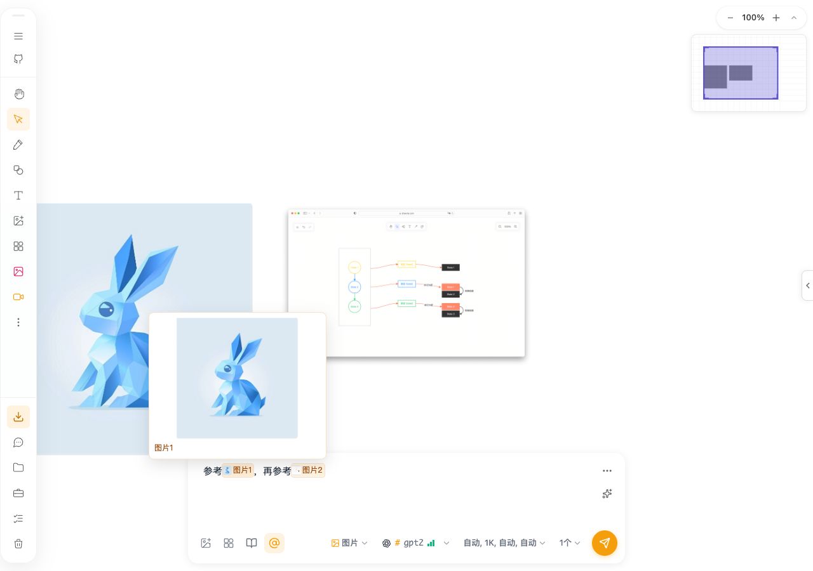
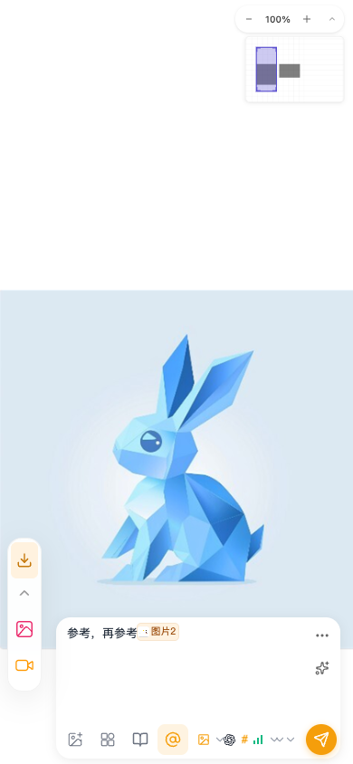

# 画布引用缩略图与悬停预览 QA

## 范围与环境

2026-10-18，macOS，Node 26.8.1，pnpm 10.21.0，Vitest 3.2.4，隔离 Chromium 浏览器。

功能分支 `dev/canvas-mention-preview-20261017` 已显式执行 `git fetch upstream develop` 和 `git merge --no-edit upstream/develop`。上游为 `3d84bb7c`，合并结果 Already up to date，无文本冲突；GitHub 分支 API 返回同一提交。

范围仅为普通画布 AI 输入栏的可信 `@` 引用显示，以及共享 HoverCard 的可选焦点配置。测试使用仓库内两张本地 PNG，经实际画布拖放与 `@` 点击拾取建立引用，没有调用模型生成接口。

## 自动化验证

从 `packages/drawnix` 执行：

```sh
NODE_OPTIONS=--no-experimental-webstorage pnpm exec vitest run \
  --config vitest.config.ts \
  src/components/ai-input-bar/CanvasAssociationHighlight.test.tsx \
  src/components/ai-input-bar/canvas-association-state.test.ts \
  src/components/ai-input-bar/canvas-association-resolver.test.ts \
  src/components/ai-input-bar/canvas-association-picking.test.ts \
  src/components/shared/hover/HoverCard.test.tsx \
  src/components/shared/hover/hover-utils.test.tsx --silent
```

结果：6 个文件、129 项测试全部通过。覆盖可信与手打同名文本的区分、元素 ID 和画板归属、嵌套图片查找、缺失/非图片降级、悬停与键盘预览、Escape、选中原文、提交时禁用及现有引用编辑/解析/拾取规则。共享组件回归同时验证默认焦点转移与 `autoFocus=false` 保持编辑焦点。

从仓库根目录执行：

```sh
pnpm exec tsc -p packages/drawnix/tsconfig.lib.json --noEmit
pnpm exec vite build --config apps/web/vite.config.ts
pnpm exec eslint \
  packages/drawnix/src/components/ai-input-bar/CanvasAssociationHighlight.tsx \
  packages/drawnix/src/components/ai-input-bar/CanvasAssociationHighlight.test.tsx \
  packages/drawnix/src/components/ai-input-bar/AIInputBar.tsx \
  packages/drawnix/src/components/shared/hover/HoverCard.tsx \
  packages/drawnix/src/components/shared/hover/HoverCard.test.tsx \
  packages/drawnix/src/components/popover/popover.tsx
git diff --check
```

类型检查、生产 Web 构建和差异检查通过。改动文件 ESLint 为 0 errors，AIInputBar 保留 18 条既有 unused/any/non-null/hook 告警；新增模块与共享组件单独检查无告警。Nx 缺少缓存 ProjectGraph，模块边界规则跳过，因此不宣称全仓库 lint 通过。构建仍有现存 Sass 弃用、CSS `:export`、Browserslist、混合导入和大 chunk 告警；`.npmrc` 的 NPM_TOKEN 占位符提示不影响本地验证。

## 本地页面验收

地址 `http://127.0.0.1:7200/`，桌面 1280×900、窄屏 390×844；使用隔离浏览器存储，没有导入用户认证。

| 场景 | 实际结果 |
| --- | --- |
| 拖放两张图片，开启联想，分别输入新 `@` 并点击图片 | 生成独立 `图片1`、`图片2` 标签和正确缩略图 |
| 悬停图片标签 | 对应大图成功加载，textarea 仍保持焦点 |
| 键盘聚焦标签，按 Escape | 显示预览，Escape 后预览关闭 |
| 点击 `图片1` 标签并按 Cmd+C | 剪贴板为原始 `@图片1` |
| 光标位于引用末尾时退格 | 完整删除该引用，其他引用保留 |
| 窄屏标签 | 图片编号完整，标签文本未产生省略 |
| 在引用前输入正文使引用跨行 | 降级为文本高亮，悬停仍加载对应预览 |
| 插入 40 行正文并滚至末尾 | 覆盖层与 textarea 均为 scrollTop 722、宽 270、高 125，标签跟随正文 |
| 设置暗色主题属性 | 标签背景为 rgb(73, 51, 33)，文字为 rgb(255, 208, 154)；仅验证该组件暗色样式 |

桌面悬停截图：



窄屏截图：



## 限制与后续验收

- 跨行引用保留原始文字高亮与预览，缩略图只在单行容纳时展示。这是保留原生光标和输入法编辑行为的取舍。
- 缺失、跨画板和非图片降级有组件测试；没有在页面上覆盖所有媒体类型或损坏图片网络响应。
- 没有执行完整仓库测试、真实中文输入法人工操作、Windows/Safari/Firefox、真实手机触控、生产部署或供应商生成验证；本地窄屏检查不等同真机测试。
- 用户刷新已打开页面即可加载新代码；不需要配置、权限变更或数据清理。回滚本次显示组件与可选焦点配置即可，原提示词和引用存储格式保持兼容。
- 使用和维护说明更新到现有画布联想交接文档，不另建 DOC.md。
