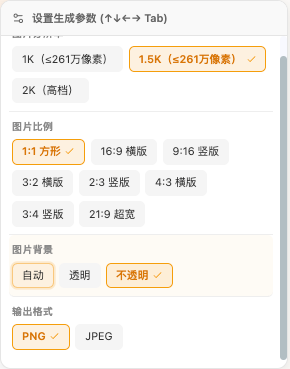
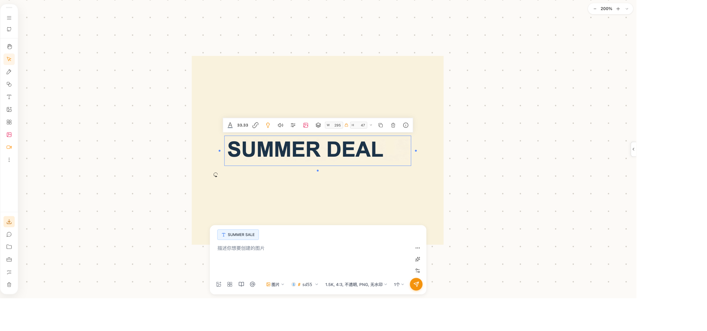

# Seedream 5.5 接入与本地验收

日期：2026-11-14。模型：`doubao-seedream-5-5-261028`。

当前范围更新（2026-11-16）：用户因需要修改 Nginx 而撤回“原图缓存失败修复”。同源下载工具、缓存消费方改动及对应测试、Vite/Vercel/Netlify/Nginx 新增规则和专用部署文档均已移除；缓存行为恢复为上游实现。保留连续编辑、分辨率档位修复、分层/OCR 与 GET-only 查询。以下缓存修复、部署步骤及原图离线验收属于撤回前历史记录，不作为当前交付结论；当前无需为这些保留功能新增 Nginx 配置，跨域读取和分层 GET 缺元数据仍是已知限制。PR #340 已关闭，用户随后授权本地复测并提交；不推送或重新打开 PR。

## 使用与实现

- 在供应商设置中获取模型，选择该模型后使用图片生成入口。
- Tuzi 模型绑定使用 `POST /api/v3/images/generations`，通过 `trim-v1` 去除 API 地址末尾的 `/v1`。参考图以 JSON `image` 提交，沿用生成接口。
- Seedream 5.5 当前请求 `response_format: "url"`，优先读取返回的 URL，再由现有远程图片缓存流程处理；服务商意外返回 base64 时仍兼容解析。下文初次接入及页面模拟记录中的 `b64_json` 为切换前的历史请求。
- Tuzi v3 提交携带同一任务的 `X-Request-Id`；网络失败或 2xx 响应读取中断时，接入现有结果恢复流程，使用 `GET /v1/images/generations/result?request_id=...` 查询已有结果，沿用 15 分钟恢复期限、并发与缓存规则，不重发生成 POST。
- 分辨率档位为 `1K`、`1.5K`、`2K`，默认 `2K`；独立比例支持 `1:1`（默认）、`16:9`、`9:16`、`3:2`、`2:3`、`4:3`、`3:4`、`21:9`。普通生图菜单不再显示拆图专用 `auto`。
- UI 分辨率保存在 `size`、比例保存在 `aspect_ratio`，适配器组合为 v3 的像素 `size`，不发送额外的 `aspect_ratio` 字段。沿用现有 2K 比例尺寸，1K/1.5K 分别按宽高 0.5/0.75 缩放；例如 `1.5K + 16:9` 为 `1920x1080`，`2K + 9:16` 为 `1440x2560`。
- 未传独立比例的旧调用仍保留原生档位；旧比例输入仍映射为 2K 像素尺寸，明确像素尺寸优先且不被独立比例覆盖。拆图仍支持程序化 `auto`；已保存的普通生图 `auto` 偏好恢复为 `2K + 1:1`。
- 支持透明/不透明背景、PNG/JPEG 输出、最多 10 张参考图。透明背景应使用 PNG；该模型不提供 OpenAI mask 编辑能力。
- 图片水印支持“无水印”（默认）和“有水印”；偏好以字符串 `false`/`true` 保存，v3 请求转换为布尔值 `watermark`。即使调用方没有设置该参数，也明确发送 `watermark: false`；已保存的主动开启设置保留。
- 原生图层 Provider 识别 5.5，并提交 `layer_decomposition_options.max_images`，兼容不含质量评分的原生响应。2026-11-15 新增独立「Seedream 5.5 分层」入口、1–99 个前景图层设置及 OCR 转文字；原「AI 分层」本地优先和 5.0 Pro 回退路径保留。详见本文末尾的新增能力验收。
- 模型目录和参数位于 `model-config.ts`；路由由 `binding-inference.ts` 产生；请求由 `seedream-adapter.ts` 构造。
- MCP 图片工具保留该模型的原生尺寸，避免把 `1.5K` 转成通用 `1x1`。
- 不硬编码价格；价格依赖供应商目录及实际账单。比例组合中 1K/1.5K 不超过 261 万像素，2K 大于 261 万且不超过 463 万像素；拆图不按各图层实际像素逐张定档。

## 初次接入验证环境与结果

本地 checkout：`opentu5`，`develop`，Node 26.8.1，ego-browser 技能指南 2.2.1。
启动命令：`OPENTU_PORT=7205 pnpm start`，页面 `http://localhost:7205`。
浏览器已有供应商配置，本轮没有读取或输出 API Key。

| 检查 | 结果 |
| --- | --- |
| 模型选择与参数控件 | 页面可选择 5.5，显示原生尺寸、透明背景和 PNG/JPEG |
| 首次模拟提交 | 发现 1.5K 被转换为 1x1；修复 MCP 尺寸归一化及适配器比例解析顺序 |
| 文字生图复测 | 拦截请求为 `https://api.tu-zi.com/api/v3/images/generations?ch=2`，`model` 精确 ID、`size: 1.5K`、`background: transparent`、`output_format: png`、`response_format: b64_json` |
| 参考图复测 | 本地产生测试 PNG 并上传；模拟请求含 JSON `image`，路径和参数保持一致 |
| 结果展示 | 模拟任务完成；本地产生的 512×512 PNG 可打开预览并显示，文件标有 LOCAL MOCK QA |
| 刷新恢复 | 页面仍选择 5.5、1.5K、透明、PNG |
| 单元测试 | 下述 5 个文件共 230 项通过，覆盖旧模型参数/路由、原生尺寸、超量参考图拒绝和现有异常响应 |
| 类型检查 | `pnpm exec tsc -p packages/drawnix/tsconfig.lib.json --noEmit` 通过 |
| 差异检查 | `git diff --check` 通过 |

```sh
pnpm exec vitest run \
  packages/drawnix/src/constants/__tests__/model-config.test.ts \
  packages/drawnix/src/services/__tests__/provider-routing.test.ts \
  packages/drawnix/src/services/layer-decomposition/provider.test.ts \
  packages/drawnix/src/services/model-adapters/__tests__/seedream-response.test.ts \
  packages/drawnix/src/mcp/tools/__tests__/image-generation.test.ts
```

## 边界与未执行项

- 浏览器生成请求在发送前被 fetch 模拟和网络阻断保护拦截，没有真实生成费用；模拟只能验证页面、请求构造、缓存与展示，不能证明真实上游生成、收费或图层响应可用。
- 测试结束前移除模拟与网络阻断，并刷新页面。浏览器保留 3 条以“本地模拟测试”标记的完成任务及测试产物。
- 未执行真实 v3 生图/拆图、OCR、mask、生产部署或远程 CI；未修改服务端。真实图层响应仍受既有解析与质量门禁约束。
- 模拟结果在队列中显示“未知尺寸”，但预览可以解码显示；尺寸元数据展示尚未单独补齐。
- 先前执行的全量测试存在失败，尚未通过干净基线逐项对照归因，不将其报告为本次全量通过。
- 回退时撤回本任务的模型、路由、适配器、MCP 尺寸及对应测试改动，保留其他工作。Git 提交和 PR 状态以仓库记录为准。

接口依据：[Tuzi 模型说明](https://api.tu-zi.com/pricing?model=doubao-seedream-5-5-261028)；实际可用性以所选服务商为准。

## PR 前最终验证

- 功能分支：`codex/seedream-55-v3`；目标：`develop`。
- 已显式 `git fetch origin develop` 并合并 `origin/develop` 的 `73f6e925`（1.2.10），自动合并完成，无冲突。
- 合并后再次执行上述 5 个文件的 230 项测试，全部通过；补充覆盖 5.5 不含质量评分字段的原生图层响应。
- Drawnix 与 Web TypeScript 检查通过：`pnpm exec tsc -p packages/drawnix/tsconfig.lib.json --noEmit`、`pnpm exec tsc -p apps/web/tsconfig.app.json --noEmit`。
- Web 主应用构建通过：在 `apps/web` 运行 `node ../../node_modules/vite/bin/vite.js build --outDir /tmp/opentu5-seedream55-pr-build`，耗时 41.99 秒；保留现有大 chunk 等构建提示。本次未另外执行生产 SW 构建。
- 10 个修改的 TS 文件分别通过 stdin 与 `origin/develop` 同路径版本对照 ESLint，诊断完全一致、无新增；原有 module-boundaries 错误及 warning 未在本任务中修改。
- 原始 `pnpm check:cycles` 和 `pnpm check:cycles:types` 因脚本直接 `JSON.parse` 读取含尾逗号的 `tsconfig.base.json` 失败。用临时内存脚本改为 TypeScript JSONC 解析后，当前与 `origin/develop` 对比结果完全一致：2 组运行时循环、3 组含类型循环，无新增。未修改仓库检查脚本或配置。
- QA 与接入说明合并记录在本文；无新增依赖、环境变量或迁移。未进行真实收费接口验证，未部署。

## 比例选择补充验收（2026-11-14）

- 环境：`codex/seedream-55-v3`，基于 `432b2006` 本地修改；Node 26.8.1，沿用现有依赖。
- 执行前述 5 个 Vitest 文件，并增加 `packages/drawnix/src/components/ai-input-bar/ParametersDropdown.test.tsx` 和 `packages/drawnix/src/services/__tests__/ai-generation-preferences-service.test.ts`：共 328 项，327 通过、1 失败。
- 本次相关测试全部通过：24 种档位/比例组合的整数尺寸、准确比例和像素档位范围；v3 路径；不发送独立比例字段；冒号比例兼容；明确像素尺寸与拆图 auto 兼容；无效比例在发送前拒绝；菜单比例与分辨率独立选择；偏好恢复；异步/队列保留比例参数。
- 唯一失败为“迁移 Seedance 2.5 的旧组合偏好时移除不受支持的分辨率”：预期空尺寸，实际 `1080p`。在临时目录解压干净 `git archive 432b2006`、复用当前依赖后，以相同测试名运行，复现相同断言失败；未修改视频偏好逻辑或测试预期。
- Drawnix/Web 类型检查（沿用上文两个 `tsc --noEmit` 命令）通过；`git diff --check` 通过。
- 本次未新增依赖或配置；QA 与使用说明更新本文，无需单独新增 DOC。未做页面交互测试、真实接口生成、生产构建或部署；以上像素组合仅经本地请求构造验证，真实上游尺寸接受情况尚未验证。
- 人工验收：刷新页面，选择 Seedream 5.5，在参数菜单分别选择分辨率和图片比例，确认两者可以独立设置并在刷新后恢复。真实提交可能计费，本轮未执行。

## 水印参数补充验收（2026-11-14）

- 参数菜单新增“图片水印”：默认“无水印”，允许主动切换“有水印”并保存。仅作用于 Seedream 5.5，旧模型请求不新增水印字段。
- 执行 `pnpm exec vitest run packages/drawnix/src/constants/__tests__/model-config.test.ts packages/drawnix/src/services/model-adapters/__tests__/seedream-response.test.ts packages/drawnix/src/components/ai-input-bar/ParametersDropdown.test.tsx`：140 项通过。
- 执行 `pnpm exec vitest run packages/drawnix/src/services/__tests__/ai-generation-preferences-service.test.ts -t 'Seedream 5.5'`：2 项通过、50 项不在筛选范围。本次未重跑上文已确认的 Seedance 既有失败。
- 覆盖缺省关闭、字符串/布尔开关值、无效值回退关闭、菜单切换、偏好默认及恢复、旧模型不新增字段；Drawnix TypeScript 检查与 `git diff --check` 通过。
- 更新本文作为 QA/使用说明，无新增独立 DOC、依赖或环境配置。未进行页面测试或真实收费接口验证；本次改动未提交、未推送。

## 比例与水印页面复测（2026-11-14）

- 按用户要求使用 ego-browser 2.2.1，复用 TaskSpace 2、`http://localhost:7205` 的原画板；本轮未改动实现代码。
- 页面可切换“有水印”和“无水印”，最终恢复无水印。水印位于参数菜单底部，需要向下滚动；普通菜单不显示拆图专用 auto。
- 设置 `1.5K + 16:9 + 不透明 + PNG + 无水印`，刷新后能够恢复；本轮末次等待画板完整加载后再次确认同一设置。模拟结果自动插入后、后续刷新时曾观察到比例摘要恢复为 1:1；重新选择 16:9 后刷新正常，生成完成与选择联动下的比例恢复仍需进一步确认，不据此宣称全流程偏好始终保持。
- 新建 1 条“本地模拟测试-比例水印”任务：使用页面 fetch 模拟，并通过 CDP 阻断生成/编辑 URL 作为保护；捕获且仅捕获 1 次请求，未发送真实生图请求。
- 捕获 `POST https://api.tu-zi.com/api/v3/images/generations?ch=2`，精确模型 ID，`size: "1920x1080"`、`watermark: false`（布尔值）、`background: "opaque"`、`output_format: "png"`、`response_format: "b64_json"`。认证仅检查 header 名称，未读取或输出密钥。
- 模拟任务约 5 秒完成，自动插入本地生成的 1920×1080 PNG，预览正常显示 `LOCAL MOCK QA 16:9`。截图：`/tmp/opentu5-seedream55-ratio-watermark-preview.png`。队列仍显示“未知尺寸”，沿用此前已记录问题。
- 检查用户截图对应的两条实际失败任务：路由为 v3，已标记尝试提交；耗时分别约 152 秒、145 秒，日志只有 `Failed to fetch`，没有 HTTP 状态或响应内容。不能凭此确定 CORS、网络或上游连接原因，也不能确定上游是否接受；本轮未重试原任务。
- 测试结束已移除 fetch 模拟、清空 CDP URL 阻断并刷新确认无残留模拟，保留原页面和标注的模拟任务供用户查看。未进行真实收费验证、提交、推送或部署；真实失败原因仍未解决。

## 切换 URL 返回格式（2026-11-14）

- 按用户要求，Seedream 5.5 的 `response_format` 从固定 `b64_json` 改为 `url`，以减小生成接口响应体；同时返回两种字段时优先 URL。仅有 base64 的响应仍兼容，旧 Seedream 模型保持原有请求格式与解析优先级；图层 Provider 本来已请求 URL。
- URL 原样交给现有缓存流程，包含签名查询参数；不新增请求或重试生图。签名 URL 的有效期、可访问性和 CORS 仍取决于图片服务，不能据此宣称此前 `Failed to fetch` 已解决。
- 本地验证：`pnpm exec vitest run --environment jsdom packages/drawnix/src/services/model-adapters/__tests__/seedream-response.test.ts packages/drawnix/src/services/media-executor/fallback-utils.test.ts`，2 个文件共 74 项通过。覆盖多图 URL/签名保留、URL 优先、base64 回退、旧模型格式、异常响应，以及现有远程缓存与失败警告流程。
- 首次用根目录默认 Node 环境执行时，缓存测试因缺少 `FileReader` 失败；改用与 Drawnix 项目配置一致的 jsdom 环境后全部通过，未修改测试预期或浏览器 API 实现。
- Drawnix `tsc --noEmit` 与 `git diff --check` 通过。QA 与使用说明更新本文，无需新增独立 DOC；本次未做浏览器测试或真实收费生图，尚未提交、推送或部署。

## v3 结果查询恢复补充验收（2026-11-14）

- 根因：传输层同步图片提交路径匹配未包含 `/api/v3/images/generations`，导致该路径不带 `X-Request-Id`，网络/响应流中断也不进入“提交结果未知”的既有恢复分支。修复仅在该匹配中增加原生 v3 generations 路径；查询器、恢复期限和任务并发均复用已有实现。
- 新增适配器到恢复服务的本地集成用例：模拟 Seedream 5.5 原生 v3 POST 断线，随后通过 v1 结果 GET 返回成功及带签名的图片 URL。确认仅 1 次 POST、1 次 GET，两个请求 ID 一致，回调成功且没有重复生图；补充 v3 2xx 响应流中断分类覆盖。
- 执行 `pnpm exec vitest run --environment jsdom packages/drawnix/src/services/__tests__/provider-routing.test.ts packages/drawnix/src/services/__tests__/image-generation-recovery-service.test.ts packages/drawnix/src/services/model-adapters/__tests__/seedream-response.test.ts packages/drawnix/src/hooks/__tests__/useTaskExecutor-image-recovery.test.ts`：4 个文件共 222 项全部通过。首次根目录默认 Node 环境运行有 3 项失败；使用与项目配置一致的 jsdom 后全部通过，未修改原有断言预期。
- Drawnix `tsc --noEmit` 与 `git diff --check` 通过。
- 只读线上检查：对 v3 generations 发送 OPTIONS，本地 `http://localhost:7205` 和正式 `https://opentu.ai` 两种 Origin 均返回 HTTP 200，允许相应 Origin 和 `X-Request-Id`、Authorization、Content-Type 等请求头。没有发送真实生成 POST。
- 用本地测试凭据按用户提供的后台请求 ID 查询 v1 结果接口，返回 HTTP 200、`processing_or_not_found`、空 data；未把它解释为生成失败，未修改旧任务状态。旧请求缺失客户端请求 ID 的情况不会因本次改动自动补齐。
- 查询成功只表示获得已有图片 URL，不会绕过原图站点的 CORS。火山直链的显示、缓存和导出限制仍需单独处理；本轮未重新生图、做页面测试、修改服务端、推送或部署。QA 与使用说明统一更新本文，无需单独新增 DOC。

## 比例菜单截图

取自用户提供的本地页面截图，仅保留参数菜单区域；展示比例与分辨率的独立选择。截图拍摄时水印选项尚未补齐，最终水印选项已通过后续页面操作与组件测试验证。



## 本次 PR 更新最终验收（2026-11-14）

- PR：`#334`，功能分支 `codex/seedream-55-v3`，目标 `develop`。新增功能先提交为 `d889ea8e`，再显式 fetch 并 merge `origin/develop`；上游最新为 `73f6e925`，已经包含，merge 返回 `Already up to date`，无冲突、未改写历史。
- 同步后在 jsdom 环境重跑 9 个完整测试文件（模型配置、参数菜单、分层 Provider、传输路由、恢复服务、Seedream 适配器、MCP、任务执行恢复、远程缓存）共 403 项，以及 Seedream 5.5 偏好筛选测试 2 项，共 405 项全部通过。筛选外的 50 项偏好测试未在本次最终验证重跑；前文记录的 Seedance 既有失败未修改。
- 清理新增测试中的非空断言警告后，重跑对应 2 个文件共 79 项通过，Drawnix 类型检查再次通过。没有修改测试预期或生产行为。
- Drawnix/Web `tsc --noEmit` 通过；Web 主应用构建通过，输出至 `/tmp/opentu5-seedream55-pr-update-build`，耗时 43.05 秒，保留现有大 chunk 提示。本轮未单独构建生产 SW。
- 对 PR 全部 14 个 TS/TSX 修改文件，以同一路径 stdin 内容分别对照最新 `origin/develop` 做 ESLint：当前和基线均为 3 个错误、15 个警告，无新增诊断。未宣称仓库 ESLint 全量通过；`git diff --check` 通过。
- 对用户提供的已有火山图片链接做读取测试：服务器 HTTP 200、PNG、5433857 字节，普通图片元素加载为 1728×1296；响应缺少 `Access-Control-Allow-Origin`，页面 fetch 失败、Canvas 导出报 `SecurityError`。没有重生图，未将签名 URL 或用户任务 ID 写入提交。该限制未在本 PR 修复。
- 最终效果与兼容方式见本文“使用与实现”。QA 与 DOC 采用此已有文件统一维护，不新增依赖、配置、迁移或服务端变更；比例菜单截图仅含控件区域。分阶段段落中的“未提交/未推送”仅描述当时状态，最终提交与远程状态以 Git/PR 为准。
- 仍未执行真实收费生图、真实断线恢复或生产部署；页面所见比例恢复偶发现象、队列“未知尺寸”和原图 CORS 限制继续作为已知边界披露。回滚可撤回本 PR，旧任务及已有产物不删除。

## 参数摘要显示修复（2026-11-15）

- 用户截图中图片详情显示完整：原图 `1728 × 1296 px`，画布 `400 × 300`，均为 `4:3`；图片本身没有裁切。
- 实际问题是底部参数按钮把 `1.5K（≤261万像素）, 4:3 横版, 透明, PNG, 有水印` 整段放入窄按钮，摘要被截断。现在底栏使用短摘要：`1.5K, 4:3, 透明, PNG, 有水印`，按钮宽度上限从 160px 调整为 220px；展开菜单和悬停提示继续保留完整说明。
- 组件测试与模型配置测试共 113 项通过，Drawnix TypeScript 检查和 `git diff --check` 通过。页面复核因本地 7205 服务在复核前停止，未重新启动服务；截图已记录在本文前面的参数菜单章节。

## 连续编辑、99 层与富文本 OCR（2026-11-15）

### 用户效果与操作

1. 选中有 Seedream 5.5 历史任务的生成结果，工具栏显示「继续编辑」。点击后自动把所选结果作为首张参考图，再带入去重后的历史参考图，保留原模型、供应商和适用参数。提示词清空，填写本轮修改要求后自行发送；批量数恢复为 1。原「再次生成」仍回填原提示词与原参考图。
2. 若参考图超过 10 张，全部保留在输入栏并提示用户删除多余历史引用；既有 Seedream 适配器会在发请求前拒绝超过上限的输入，不静默截断。历史模型或供应商不可用时停止回填并提示恢复配置，不自动换供应商。
3. 选中单张图片，使用独立的「Seedream 5.5 分层」按钮；选择 1–99 个前景图层（默认 16）以及「识别文字与近似样式（OCR）」（默认开启），点击「开始分层」。数量提示包含 1 张底图，默认最多 17 张、最大 100 张，并提示按实际产物计费。此入口直接使用已配置的 5.5 Provider，不调用旧本地优先/5.0 Pro 回退流程。
4. 分层成功后，选择含有效 OCR 的文字图片层，点击「转换为可编辑文字」。每行转换为应用原生文字节点，保持行内文字、颜色、粗体、斜体、下划线和删除线；坐标按当前图层的缩放、移动及旋转换算。原图片层仍保留，转换后隐藏以避免重叠，一次撤销恢复原图片层；重复转换被拦截。
5. 图层元数据和 manifest 保存原始识别全文、行框及样式片段。分层组导出继续包含原图片；存在已转换文字时，manifest 增加 `editableTextLayers`，保存当前编辑内容、位置、来源 z-index 与原图片层隐藏状态。

### 协议与实现边界

- 分层请求固定 `POST /api/v3/images/generations`、精确 5.5 模型 ID、单图 JSON `image`、`layer_decomposition=true`、`size=auto`、PNG、URL、`watermark=false`、`stream=false`；`max_images=maxLayers+1`，OCR 开关为布尔值 `text_recognition`。新增原生路径不自动重发或切换收费模型。
- 原生响应单独允许 99 个前景；本地及旧模型请求/响应仍限制 16 个前景。保留背景、层序、边界框等校验，不把普通多图当分层。
- 官方字段为 `data[].text_recognition.text`、`lines[].bounding_box`、`lines[].runs[].text/style`；行框使用输出底图坐标。样式支持 `similar_font_family`、`foreground_color` 和六种布尔标记；**官方不返回字号**。字号按行高估算，未知字体回退为 sans-serif。`shadow`、`translucent` 仅保留识别标记，不伪造阴影参数或精确透明度；转换不能保证像素级还原。
- 可选 OCR 缺失、字段畸形、超出本地长度/数量保护范围时，保留有效图片而不开放文字转换；艺术字未返回 OCR 时保持图片。转换时发现行框超出对应图片层范围则拒绝转换，保留原图片层。
- 5.5 可信原生结果不再补造 SSIM=1 等质量测量值；源图片在结果准备成功前保持不变。分层取消/源图变化/切换画板时不应用迟到结果。应用失败时遵循原有回滚逻辑，OCR 转换另有部分插入失败回滚。
- 保持普通生图 URL 返回、透明 PNG、比例及默认无水印行为；没有裁图或恢复已撤回的棋盘格。
- 官方依据：[Seedream 5.5 文档](https://docs.volcengine.com/docs/ark/seedream-5-5?lang=zh)，2026-11-15 读取。用户提供的 Tuzi 模型说明确认最多 10 张参考图、分层总数 2–100 以及 OCR 请求开关。

### 本地验收

环境：`opentu5`，分支 `codex/seedream-55-v3`。采用模拟传输、jsdom 组件测试、真实 Plait 数据变换及历史撤销；本阶段没有真实收费生成、页面点击测试、提交、推送或部署。

```sh
pnpm exec vitest run --environment jsdom \
  packages/drawnix/src/utils/__tests__/image-task-prefill.test.ts \
  packages/drawnix/src/services/layer-decomposition \
  packages/drawnix/src/components/layer-decomposition \
  packages/drawnix/src/components/toolbar/popup-toolbar/seedream-continue-button.test.tsx \
  packages/drawnix/src/services/model-adapters/__tests__/seedream-response.test.ts \
  packages/drawnix/src/components/ai-input-bar/ParametersDropdown.test.tsx \
  packages/drawnix/src/components/ai-input-bar/AIInputBar.prefill-images.test.ts \
  packages/drawnix/src/components/toolbar/popup-toolbar/image-toolbar-contents.test.tsx
pnpm exec tsc -p packages/drawnix/tsconfig.lib.json --noEmit
pnpm exec tsc -p apps/web/tsconfig.app.json --noEmit
# 在 apps/web 目录运行，不触发版本号更新脚本：
../../node_modules/.bin/vite build --outDir /tmp/opentu5-seedream-complete-build
```

- 17 个测试文件共 **207 项通过**：包括多图中指定结果回填、历史不变、参考图溢出、供应商绑定标识、1/16/99 前景请求、OCR 字段与畸形回退、100 张产物缓存/写入/导出、文字坐标/样式、JSON 序列化保留、编辑后导出、撤销/重做、重复点击、取消/画板切换、源图删除/替换、缓存失败及旧路径回归。
- Drawnix/Web 类型检查通过；主应用构建通过（39.62 秒），保留原有大 chunk 提示。首次从 apps/web 执行 `pnpm exec` 因该目录没有独立 package 失败，改用仓库内 Vite 可执行文件后成功；未安装项目依赖或修改配置。
- 对全部变更 TypeScript 文件执行 ESLint：当前 5 个错误与 HEAD 同文件基线一致（3 个既有 Nx 静态/懒加载模块边界、1 个既有 `location` 全局使用、1 个既有 `{}` 类型）。新增文件无 lint 错误或警告；没有宣称全库 lint 通过。
- `git diff --check` 通过；OpenSpec 方案严格校验通过。测试日志中既有 jsdom/IndexedDB、localStorage 与 `.npmrc` 环境占位符警告不影响上述测试结果。

### 注意事项

- 原生分层目前为直接请求与写入画布，不接入普通生成任务的 Request-ID 自动恢复；网络中断或超时应先核对供应商调用记录，再决定是否重试。取消等待不保证上游停止处理或计费。
- 真实 99 层返回、OCR 识别质量、字体视觉还原和真实分层 URL 的可访问性未做上游实测；现有跨域/签名链接过期限制没有在本次修复。浏览器页面验收、生产 SW 独立构建及生产部署未执行。
- 没有新增环境变量、凭据、依赖、数据库迁移或部署顺序要求。QA/DOC 合并更新本文件；方案与任务记录在 `openspec/changes/complete-seedream-55-editing/`。本轮功能修改尚未提交或更新 PR。

## 真实调用与页面验收（2026-11-15）

用户明确授权真实测试后，在已有 7205 服务和 ego-browser 中新建「Seedream 5.5 真实验收 2026-11-15」画板。参考测试海报为本地绘制的 1200×900 PNG（SUMMER SALE、SAVE 20%、蓝色杯子）；继续编辑复用用户已有的干花结果。本阶段没有模拟生成响应。

| 场景 | 实际结果 | 边界 |
| --- | --- | --- |
| 99 层设置 | 页面输入 99 时正确显示最多 100 张图片，随后恢复为 3 个前景再提交 | 未进行 100 张真实产物压力测试 |
| 原生分层直连 | v3 单图、max_images=4、OCR=true、PNG/URL、无水印；后台成功消费、19 秒、4 张产物 | 浏览器 Failed to fetch；按请求 ID 只读取已有结果，未重发此调用 |
| 连续编辑初次尝试 | 上轮结果 URL 正确回填；本地参考图下载阶段因跨域失败，imageSubmissionAttempted=false，后台无新增消费 | 未真正提交；修复后才重试 |
| 连续编辑真实提交 | v3 传原始签名 URL，1728×1296、不透明、无水印；后台成功、17 秒、1 张 RGB 图片，干花主体基本保留，布料变为浅蓝色 | 直连响应获取失败，应用最终完成已有结果恢复并自动插入；存在原图缓存失败警告 |
| 代理分层完整响应 | 经已有本地 Tuzi 代理额外提交一次新验收，16 秒 HTTP 200，1 底图＋3 前景；两层 OCR 分别为 SUMMER SALE、SAVE 20%，4 张图插入画布 | 临时代理仅用于本次原生分层，不能作为生产直连通过的证明 |
| OCR 文字编辑 | 点击转换后生成原生文字节点并隐藏原图片层；选中文字后 Enter 进入编辑，将 SUMMER SALE 改为 SUMMER DEAL；撤销转换能恢复原图片层 | 字体/字号近似；同组透明图片的矩形命中区可能拦截双击，可选中文字后按 Enter 编辑 |

### 实测发现与修复

- 参考图执行层原先只对 Tuzi GPT 的远程图片保留 URL，Seedream 5.5 虽支持 URL，却会先尝试下载 Base64，遇到火山 CDN 不开放 CORS 即失败。现仅为 Seedream 5.5 专用适配器保留 HTTP(S) 原始参考 URL（包含签名）；本地/虚拟引用仍走原有物化。增加执行层回归用例，确认不读取/压缩这类远程参考图。
- OCR 原先仅按行高估算字号，实测 SUMMER SALE 换行后被行框截断。现按各片段实际字体、粗斜体测量宽度，扣除 Plait 文字内边距，并按现有 1.4 行高约束字号，向下保留两位小数。修复后完整显示且可编辑，字号栏不再显示长小数。
- 不收费的无鉴权 v3 POST 诊断取得浏览器 `Network.loadingFailed`，明确为 `MissingAllowOriginHeader`；OPTIONS 则返回允许 localhost:7205。证明错误响应 CORS 不完整，不能只凭预检成功判定可直连。成功生成的直连响应同样未能被页面读取，但该次完整响应头未被浏览器暴露，未将推断写成已抓包证明。
- `/v1/images/generations/result` 能取回第一条分层的 4 张图片 URL，但当前不返回 z_index、bounding_box 或 text_recognition，不能恢复完整分层/OCR。没有伪造这些元数据。额外一次代理请求用于取得真实完整结构并验证解析、插入和文字编辑。

### 调用数量、清理与验证

- 后台精确模型和本轮时间范围查询最终确认 **3 条成功消费记录，分别输出 4、1、4 张图片**。另有 1 次本地参考图准备失败和 1 次无鉴权诊断，不构成生成消费；没有进行 99 层收费测试。
- 请求 ID、原始结果（含临时签名链接）、网络诊断和截图保存在仓库外 `/tmp/opentu5-seedream-real-20261115/`，未写入源码或 PR。密钥仅在进程内存用于 Tuzi 只读日志/结果查询，未输出或复制。
- 临时 fetch 观察/代理转发已移除，CDP Network 监听关闭；保留测试画板供查看。最后确认编辑任务 completed、insertedToCanvas=true，4 张语义图片层和修改后的文字节点仍在画板。
- 本地修复验证：图片执行、Seedream 适配器、OCR 转换、画布插入/导出 4 个测试文件共 74 项通过。完整回归 18 个文件共 237 项通过；Drawnix/Web 类型检查通过，主应用构建通过（39.45 秒），仍有既有大 chunk 提示。随后补充本地/虚拟参考图物化边界测试，单独复核该执行器与 OCR 模块共 43 项通过；公网 URL 直接传递，本地与虚拟图片仍物化。
- 仍未修复远端 v3 响应 CORS，未部署生产、未提交或推送；图片链接可能过期，画布存在缓存失败提示。此前“没有真实调用/页面测试”的表述仅针对前一阶段。

## 2026-11-15：GET 恢复分层与 OCR（本地实现）

### 使用与边界

- 可信 Tuzi 的原生 5.5 分层提交携带本地请求 ID。连接中断/超时或服务端 5xx 后只查询 `GET /v1/images/generations/result?request_id=...`，不再次 POST；即使返回明确可重试标记，该入口也不重放提交。
- 同一弹窗中显示请求 ID；已提交后，“开始分层”切换为“获取已有结果”。数量和 OCR 选项冻结，获取操作复用提交时的地址、凭据和图层数量上限。普通供应商及旧分层路径不启用 Tuzi 专用 GET。
- 查询总计 15 分钟，每次最多 15 秒，间隔 5 秒；临时网络、429/5xx 可继续查询，401/403/404、业务失败、请求 ID 不匹配、畸形 JSON/缺元数据明确失败。支持取消等待，不自动停止上游任务。
- 完整结果沿用原有严格分层校验器、缓存、画布绑定检查；保留 z_index、bounding_box 与可选 text_recognition。旧 URL-only 结果不能恢复层位置/OCR；不会猜测边界或重新生图。
- 恢复句柄仅保留当前弹窗内存，不持久化凭据。关闭/刷新后不支持此弹窗自动续查；请求 ID 可用于已有后台记录查询。源图或画板变化会停止当前插入。

### 后端依赖与注意事项

- 本次只交付 OpenTu。用户随后要求撤回 Tuzi API 改动，相关后端实验补丁已在本地备份后撤销，未提交、推送或部署；下文后端回放结果仅为历史实验记录，不属于本 PR 的交付内容。
- 当前线上 GET 仅返回图片链接。前端完整分层恢复仅在服务端返回位置/OCR 元数据时可用，旧 URL-only 记录会明确提示缺失，不能补录已丢弃的元数据。
- 此 PR 未实现同源 API 转发或图片代理。线上 POST 与上游图片跨域问题仍存在；不要将前端本地测试通过理解为线上完整链路通过。
- 无新表、迁移、环境变量或依赖。签名图片地址仍会过期，恢复句柄只保留在当前弹窗内。
- 回滚此 PR 前端增量即可；既有画板和历史任务保留。QA/DOC 继续合并在本文。

### 本地验证

执行命令：

```sh
pnpm exec vitest run --environment jsdom packages/drawnix/src/services/layer-decomposition packages/drawnix/src/components/layer-decomposition/Seedream55LayerDialog.test.tsx packages/drawnix/src/services/__tests__/provider-routing.test.ts packages/drawnix/src/services/__tests__/image-generation-recovery-service.test.ts
pnpm exec tsc -p packages/drawnix/tsconfig.lib.json --noEmit
pnpm exec tsc -p apps/web/tsconfig.app.json --noEmit
# apps/web 目录：
../../node_modules/.bin/vite build --outDir /tmp/opentu5-layer-recovery-build
```

- 13 个测试文件、307 项通过，包括 GET-only、完整 OCR、供应商配置冻结、权限错误/失败/超时/取消/旧数据、弹窗恢复按钮、源图变化和旧图片恢复行为。组件测试使用 React Testing Library，未操作真实浏览器。
- Drawnix/Web 类型检查通过；Web 主应用构建通过（56.24 秒），保留原有大 chunk 提示；未另外构建生产 SW。
- 本轮新增文件和修改的恢复协调器/弹窗/传输实现 ESLint 通过。provider.ts 的 Nx lazy-library 静态导入错误及 provider-routing/types.ts 的 `{}` 类型错误各 1 项，在 HEAD 原文件上复现一致；未宣称全库 lint 通过。
- 后端 5 个包定向回归通过，114 个测试及子用例；relay/common 快照测试 race 通过；5 个受影响包 go vet 通过。详细记录见后端 QA。
- 两仓库差异检查通过。未新增收费生成、真实浏览器验收或部署；本地 mock/httptest 验证不等同于线上部署或真实上游验收。

## 2026-11-15：用户授权 GET 恢复真实接口复验

本节追加在前述“无新增收费生成”的本地实现阶段之后。用户要求继续真实测试，本次仅新增 1 次 v3 POST（5.5、max_images=2、OCR=true、size=auto、PNG/URL、watermark=false、stream=false），未重放。

- 请求 ID：`opentu-layer-live-32e9c13f-020a-4662-9bd2-5609bd45dce8`；11.11 秒 HTTP 200，2 张图，z_index=0/1，完整前景位置、文字 SUMMER SALE 及样式。usage.generated_images=2，未核对实际扣款金额。
- 线上 GET 同 ID 一次成功，仍只有相同的 2 条 URL，没有位置/OCR。因此线上完整分层恢复尚不通过，后端补丁未部署。
- 两个图片 URL 无凭据下载均 HTTP 200；底图1200×900，前景1719×610且有透明通道。前景通过接口 bounding_box 放置，不能直接按裁剪图像素尺寸放回底图。
- 实际请求附 Origin=http://localhost:7205：POST 成功响应及图片响应无 Access-Control-Allow-Origin；GET 为 `*`。这只是 HTTP 响应头证据，本次未操作真实浏览器，不宣称页面 fetch/缓存已通过。
- 本地后端回放此次真实响应：正常交付/断线捕获均保留元数据，隔离数据库入库后结果 GET 的 data[] 完整不变。前端回放该本地 GET 正确解析 OCR、位置和尺寸；回放线上 URL-only GET 明确报缺元数据，2 项通过。此阶段无额外生成、生产数据变更或页面验收。
- 临时脚本、原始响应、PNG、回放测试与日志位于 `/tmp/opentu5-layer-get-live-20261115/`，测试夹具已移出源码。本轮只更新 QA，未修改业务实现、提交、推送或部署。


## 2026-11-15：新 PR 交付范围

- 仅提交 OpenTu；Tuzi API 实验补丁已按用户要求撤销，不纳入此 PR。保留旧 PR #334，新 PR 基于其 `codex/seedream-55-v3` 分支展示增量，先合并 #334 再合并本 PR。
- 包含未推送的参数摘要完整显示修复，以及连续编辑、原生分层设置、OCR 转文字、分层 GET-only 查询和相关真实验收修复。
- 本次 PR 不包含此前讨论的同源转发/图片代理方案，也未部署 Tuzi 后端。线上 CORS、URL-only GET 和缓存/导出限制仍存在，不能作为完整线上链路验收通过的声明。
- 提交前基础验证：21 个文件、429 项测试通过，Drawnix 类型检查通过；测试命令包含整个分层目录、弹窗/工具栏、回填、Seedream 适配器、参数菜单、媒体执行器、provider routing 和图片恢复服务。
- 无新依赖、迁移、环境变量或生产操作；完整分层 GET 恢复依赖服务端返回元数据，旧记录不可补录。回滚此 PR 的增量即可恢复 #334 的前端行为，已有画板/历史任务不需要删除。


### 后端方案撤回说明

用户于本轮明确要求“改了的不要了”，指向此前说明的 Tuzi API 改动。本地独立后端工作树已恢复干净，原 Tuzi API 工作目录不变；未修改生产服务。前端仍保留安全的 GET-only 查询与缺元数据提示，不能把它描述为线上完整恢复已实现。

### 新 PR 最终验证

- 显式 fetch 最新 `origin/develop`（`73f6e925`）及 `origin/codex/seedream-55-v3`（`97adfa33`），逐一 merge 均为 Already up to date；无冲突、无未合并索引。
- 最终 21 个文件、429 项测试通过；Drawnix/Web TypeScript 检查通过；Web 主应用构建通过（39.79 秒），产物在 `/tmp/opentu5-new-pr-final-build`。未额外执行生产 SW 构建或新的页面/收费测试。
- 对完整增量的 30 个 TS/TSX 文件执行 ESLint 并与 PR 基线逐文件对照：当前及基线均有 69 项既有错误；本轮新增的 1 项测试非空断言警告已修复。新增实现文件无 lint 报错，不宣称全仓库 lint 通过。
- OpenSpec 严格校验与差异检查通过。QA/DOC 更新本文件及原方案进度；后端实验补丁已撤回，后端工作树干净。


## 2026-11-16：合并 develop 1.2.11

- 工作分支 `Jerry-George-Liang/low-airbus-7727890f` 从 `170e0d08` 合并显式 fetch 的 `origin/develop`（`08b1b83e`）；合并前工作区干净。解决 AIInputBar、媒体执行器测试、图片回填及其测试共 4 个文件的冲突，保留本地连续编辑、分层/OCR 及远程恢复、重抽和 Flash 逻辑。
- Node.js v26.8.1；临时链接主检出已有依赖，无安装或锁文件改动，验证后移除链接。测试命令前缀为 `node_modules/.bin/vitest run --config packages/drawnix/vite.config.ts --environment jsdom`，并加 `--maxWorkers=2 --minWorkers=1`。
- 第一组选择 `image-task-prefill.test.ts`、`media-executor.test.ts`、`AIInputBar.reroll.test.ts`、`AIInputBar.prefill-images.test.ts`、`AIInputBar.toolbar-draft.test.ts`：5 文件、70 项通过。第二组选择 `ParametersDropdown.test.tsx`、`seedream-continue-button.test.tsx`、`image-details-button.test.tsx`、`Seedream55LayerDialog.test.tsx`、`src/services/layer-decomposition` 目录、`seedream-response.test.ts`、`provider-routing.test.ts`、`image-generation-recovery-service.test.ts`、`seedream-flash-adapter.test.ts`：18 文件、468 项通过。上述文件位于 `packages/drawnix/src` 对应目录，合计 23 文件、538 项通过。
- 首次使用独立 `vitest.config.ts` 因缺少 `@aitu/utils` 路径映射失败，改用项目 Vite 配置后通过；新旧逻辑合并后调整精确模型查询为按需执行，通过原有回填测试。jsdom 中 IndexedDB 缺失等诊断未影响断言结果。
- `node_modules/.bin/tsc -p packages/drawnix/tsconfig.lib.json --noEmit` 未通过：现有依赖目录缺少包文件/锁文件已声明的 `pptx-glimpse`、`fast-xml-parser`，导致 3 项模块缺失与 1 项派生隐式 any 错误。涉及的 PPTX/XLSX 文件与合并前及远程均无差异；未改动这些文件或安装依赖，不能宣称完整类型检查通过。
- 差异空白检查通过。未运行页面、真实收费接口、全仓测试或构建；未启动服务、推送、创建 PR 或部署。本次同步无需另建 DOC，验证记录更新本 QA。

## 2026-11-16：继续编辑保留分辨率档位

- 修复范围：Seedream 5.5 历史参数回填。此前任务保存的 `1.5k` 与 UI 选项 `1.5K` 大小写不一致，菜单校验后回退默认 `2K`；现将已知的 1K、1.5K、2K 档位统一为菜单使用的大写 K，覆盖顶层及嵌套历史参数。
- 共享回填入口同时用于继续编辑、再次生成和任务恢复；保留其他模型及像素尺寸/比例的原有格式，不改全局枚举校验，不迁移已有任务。
- 新增回归先在修复前复现 3 项失败（1k、1.5k、2k）。修复后覆盖大小写与两种历史存储位置，并串联真实回填函数、菜单合法值与适配器请求序列化：`1.5k + 4x3` 保持为 `1.5K`，请求尺寸为 `1728x1296`，不会升至 `2304x1728`。请求传输由 mock 接管，没有真实付费调用；原历史对象不被改写。
- 实际运行 `node_modules/.bin/vitest run --config packages/drawnix/vite.config.ts --environment jsdom`，选择 `image-task-prefill.test.ts`、`seedream-response.test.ts`、`seedream-continue-button.test.tsx`、`AIInputBar.reroll.test.ts`、`AIInputBar.prefill-images.test.ts`、`AIInputBar.toolbar-draft.test.ts`、`image-generation-recipe.test.ts`、`ParametersDropdown.test.tsx`，附加 `--maxWorkers=2 --minWorkers=1`：8 个文件、128 项通过。日志：`/tmp/opentu337-size-green.log`。
- Drawnix/Web 类型检查均通过：`node_modules/.bin/tsc -p packages/drawnix/tsconfig.lib.json --noEmit`、`node_modules/.bin/tsc -p apps/web/tsconfig.app.json --noEmit`。3 个修改的 TS 文件 ESLint 无错误或告警；Nx 缺少缓存 ProjectGraph，模块边界规则被工具跳过，不宣称该规则通过。差异空白检查通过。
- 本轮未重新执行页面测试、付费生成、全仓测试或构建。缓存失败及 GET 缺少分层/OCR 元数据仍是独立未修复项。无新依赖、配置、接口或运行方式变化，更新本 QA，无需新增 DOC；未提交、推送或部署。

## 2026-11-16：修复 Seedream 5.5 原图缓存（历史实现，已撤回）

- 在 `97369e22` 及上节分辨率本地修复基础上实施，保留已有未提交改动。浏览器直接 GET 本次橙杯原图时，CDP 记录上游 HTTP 200、Content-Type=image/png、Content-Length=3829578，但缺少 Access-Control-Allow-Origin，随后 Network.loadingFailed 明确报 MissingAllowOriginHeader；确认是字节读取受 CORS 阻止，不能因图片可显示而声称已缓存。
- 当时下载修复采用项目既有同源转发模式：仅映射已验证的 HTTPS 火山存储域名及 Seedream 5.5 图片路径，保留签名参数，剥离认证/Cookie；同步 Vite、Vercel、Netlify 与生产/预发布 Nginx 模板。统一缓存和生成结果缓存使用该路径；不将任意域名改写为代理，也不将错误 HTML 写为图片。该实现及原图缓存专用部署说明现已撤回，不适用于当前代码。
- 使用 ego-browser 复用 `19f2ad02-7d96-43a3-a056-a5f7a6b7502c` 和 `6862a09d-aad5-440a-b17e-5e092ba6782f` 的真实结果，未新增生成 POST。结果缓存调用返回 `/__aitu_cache__/image/cachefix-existing-orange.png`，无缓存警告；随后对两张原始结果执行已有缓存方法均成功，isCached=true。
- 两张缓存文件分别为 2438732 与 3829578 字节，与此前下载原图的 SHA-256 完全一致。刷新页面后模拟断网，从持久化缓存读取并成功解码为 1728×1296、2304×1728，证明保存了完整可用原图；验证后恢复网络、关闭 Network 监听并保留测试画板。证据：`/tmp/opentu337-cache-browser.json`、`/tmp/opentu337-cache-offline.json`。
- 回归命令：`node_modules/.bin/vitest run --config packages/drawnix/vite.config.ts --environment jsdom`，选择 `seedream-image-download.test.ts`、`fallback-utils.test.ts`、`unified-cache-service.test.ts`、`media-executor.test.ts`、`canvas-ocr.test.ts`、`seedream55.test.ts`、`image-task-prefill.test.ts`、`seedream-response.test.ts`，附加 `--maxWorkers=2 --minWorkers=1`：8 文件、179 项通过。覆盖签名编码、域名/协议/凭据边界、HTML 拒绝、成功缓存、403 过期降级、重试警告清除、断网读回、旧缓存给 AI 读取及前一轮分辨率修复。初次新增缓存单测遇到 Node Response 与 jsdom Blob 构造器不兼容，使用测试内临时原生 Blob 后通过，生产逻辑不受影响。
- Vercel JSON 与 Netlify TOML 均由解析器检查且固定上游映射一致。用现有 `nginx:1.27-alpine` 镜像、隔离网络，对两份模板提取的新增 location 执行 nginx -t，均通过；没有运行真实生产配置或发布规则。
- 最终 Drawnix/Web TypeScript 检查通过，Web 主应用构建通过（58.77 秒，产物 `/tmp/opentu337-cache-web-build`）；保留既有 Sass/大 chunk 提示。7 个修改或新增 TS 文件的 ESLint 与 HEAD 逐文件对照无新增诊断，仍有 `fallback-utils.ts` 的 3 项既有错误；Nx 模块边界规则因缺少缓存 ProjectGraph 被跳过，不宣称全量 lint 通过。最终差异空白检查通过。
- 尚未部署或验证 Vercel/Netlify/生产 Nginx 运行环境。已过期且无缓存的历史图片无法恢复；未进行新的付费生成、99 层压力测试、生产 SW 独立构建或全仓测试。GET 分层元数据缺失仍是独立未修复项。

## 2026-11-16：提交 develop 的最终验证

- 本次完整交付包含未合并的连续编辑、分层/OCR、GET-only 恢复，以及分辨率保持和原图缓存修复。目标为 `origin/develop`；当前工作分支 `Jerry-George-Liang/low-airbus-7727890f`。创建 PR 前已备份并核验 17 个未提交文件，随后提交修复为 `4f8e40f2`。
- 按用户追加要求，推送前再次逐项对比最新上游与本地：PR 三点差异与 `origin/develop` 到 HEAD 的实际双点差异完全一致，上游提交全部已包含。增量为 51 个文件（23 实现、15 测试、5 站点配置、8 文档/验收）；均属于上述交付范围。已由上游包含的 5.5 基础接入、Flash 和画布功能没有重复列入增量，未纳入临时依赖链接、构建目录或其他仓库改动。
- 显式 fetch 最新 `origin/develop` 为 `08b1b83e`（1.2.11），执行 merge 返回 Already up to date；当前分支已包含全部目标分支提交，本轮无新增冲突。此前合并的 4 处冲突已在完整回归中覆盖，未机械替换一方代码。
- 合并后最终运行相关目录与测试：27 个文件、636 项通过，命令前缀为 `node_modules/.bin/vitest run --config packages/drawnix/vite.config.ts --environment jsdom`，范围包含整个分层目录、分层弹窗、连续编辑按钮、工具栏详情、输入栏恢复/重抽、参数菜单、图片回填与生成配方、媒体执行器、provider routing、结果恢复、Seedream/Flash 适配器、下载映射与统一缓存。附加 `--maxWorkers=2 --minWorkers=1`。日志：`/tmp/opentu337-pr-final-tests.log`。
- Drawnix/Web TypeScript 检查均通过；Web 主应用构建通过（48.32 秒，`/tmp/opentu337-pr-final-build`）。完整增量 38 个 TS/TSX 文件与 `origin/develop` 原路径逐文件对照 ESLint，双方均有 68 项既有错误、无新增诊断；Nx 模块边界规则因缺少 ProjectGraph 缓存被跳过，不宣称全仓 lint 通过。OpenSpec 严格校验及差异空白检查通过。
- 本次准备 PR 未新增页面、视觉回归或收费测试，使用本轮此前的真实页面证据：3 次生成 POST 成功、4 张产物，OCR 文字可编辑并撤销/重做，连续编辑蓝杯改橙杯；两张原图修复后缓存字节校验一致，刷新断网后能读取并解码。未核对账户实际扣款金额；截图用于展示 OCR 编辑效果，不作为生产部署或字体精确还原的证明。
- QA 更新本文件；DOC 更新原图缓存发布说明及现有 OpenSpec 方案/任务。生产需先配置固定图片下载转发规则，再发布前端；无新依赖、环境变量或迁移。未部署、未合并。分层 GET 的完整恢复仍依赖服务端元数据，已过期且没有本地缓存的图片不能恢复；99 层真实压力、生产 SW 独立构建、远程 CI 结果不在本地验证结论内。



## 2026-11-16：PR #340 冲突解决与部署核对

- 合并前工作区干净，功能分支与远程均为 `7c2ef856`；显式 fetch 后合并 `origin/develop`（`037a6eab`，包含 #339 生成卡片编辑/删除操作）。唯一冲突在 `popup-toolbar.tsx` 的相邻 import，保留 `SeedreamContinueButton` 和 `GenerationNodeActions` 两个导入。审查自动合并的选中判断、工具栏显示及 JSX 分支，保留上游生成卡片操作和本 PR 普通图片的连续编辑、分层/OCR 操作。
- 使用上节相同 Vitest 命令与范围，增加 `src/components/toolbar/popup-toolbar/generation-node-actions.test.tsx`：28 个文件、640 项通过，覆盖上游编辑/删除操作及原有 Seedream/Flash、缓存与恢复回归。日志 `/tmp/opentu340-conflict-tests.log`。未增加页面交互或收费调用。
- Drawnix/Web 类型检查均通过；Web 主应用构建通过（53.56 秒，`/tmp/opentu340-conflict-build`），沿用既有 Sass、大 chunk 和混合静态/动态导入提示。OpenSpec 严格校验与差异空白检查通过。本轮未重跑全仓 lint、全仓测试或生产 SW 独立构建。
- 已读取更新前 CI `43841904954` 的失败日志：Drawnix 全量测试有 9 个文件失败、388 个通过、1 个跳过，另有 AI Chat 包体积超过 1 MB 上限 9.27 kB。失败涉及漫画导出、提示词历史、视频参数/路由、工作区存储、备份加密、输入解析和工作流导出；本轮没有证明这些失败与 PR 的归因，未通过提高体积阈值或修改无关功能规避检查。相关本地回归通过不代表远程 CI 全绿，更新提交后以新检查结果为准。
- QA 更新本文件；DOC 在 `seedream-image-cache.md` 补充预发布/生产实际配置核对和发布顺序。Nginx 模板已经包含固定图片转发规则，但现有上传脚本仍指向旧的 `aitu-releases.conf`，不能假定覆盖生效站点；需部署时检查 `nginx -T`，备份实际配置、加入 location、`nginx -t`、reload，再发布前端。无新增环境变量、依赖、迁移或 Tuzi API 改动；未连接线上服务器、部署或合并 PR。
- `2550d5a5` 推送后 GitHub 已显示 MERGEABLE；再次显式 fetch 发现上游新增 `f7e25e6b`（1.2.12 版本发布），继续 merge 无冲突。新增上游差异只有 package.json 版本号和三份更新日志/版本文件，业务源码、测试、依赖和构建配置与上述验证时完全一致。解析三份 JSON 并验证版本号一致为 1.2.12；同步后的 Web 主应用构建再次通过（45.04 秒，`/tmp/opentu340-version-build`）。未重复执行未受影响的 640 项测试与类型检查；上述结果仍对应同一份业务代码。

## 2026-11-16：按用户要求撤回原图缓存修复

- 起点为干净的 `c224d1a4`；PR #340 已关闭。用户明确因需修改 Nginx 而取消图片缓存修复。本轮只撤回缓存部分，保留同一提交中的分辨率档位修复、连续编辑、分层/OCR、GET-only 查询及上游生成卡片操作；未整笔撤回混合提交。
- `fallback-utils.ts`、`unified-cache-service.ts` 及对应测试恢复为已同步的 `origin/develop` 实现；移除固定下载工具及测试。Vite、Vercel、Netlify、预发布/生产 Nginx 配置与上游无差异；移除原图缓存专用部署文档和目录链接。源码与站点配置已搜索确认没有同源图片代理残留；分辨率实现与测试相对 HEAD 无差异。
- 使用上述 Vitest 命令与范围，去除已删除的 `seedream-image-download.test.ts`，附加 `--maxWorkers=2 --minWorkers=1`：27 个文件、622 项通过。覆盖保留的功能和恢复后的缓存行为，日志 `/tmp/opentu340-cache-withdraw-tests.log`。Drawnix/Web TypeScript 检查均通过；Web 主应用构建通过（1 分 4 秒，`/tmp/opentu340-cache-withdraw-build`），保留既有 Sass、大 chunk 和混合静态/动态导入提示。OpenSpec 严格校验、差异空白检查通过。
- 当前无新增 Nginx、环境变量、依赖、迁移或服务端改动；缓存失败恢复为原有已知限制，不能把历史同源转发版本的离线验收当作当前已修复。分层 GET 缺元数据及已过期无缓存图片仍不能恢复。未运行新的页面、收费测试、全仓 lint/测试或生产 SW 独立构建。
- QA 更新本节及顶部当前范围；DOC 更新已有 OpenSpec 方案、任务与验收要求，删除撤回功能专用说明。仅本地未提交改动；未推送、部署或重新打开 PR。

### 本地提交前复测

- 用户随后明确要求“本地再测试一下，再提交”。重新执行本节同一 Vitest 命令及范围：27 文件、622 项通过，耗时 16.49 秒，日志 `/tmp/opentu340-local-commit-tests.log`。
- 重新执行 Drawnix/Web 的 `tsc --noEmit` 均通过；Web 主应用构建通过（43.99 秒，`/tmp/opentu340-local-commit-build`），仍有既有 Sass、大 chunk、混合静态/动态导入提示。OpenSpec 严格校验与 `git diff --check` 通过。
- 最终核对缓存实现、对应测试与五份站点配置均与已同步的 `origin/develop` 无差异，源码无已移除代理残留；分辨率修复实现及其测试相对 `c224d1a4` 未改变。只提交本任务 17 个文件，QA/DOC 已同步当前范围；不推送、部署或重新打开 PR。
- 本轮未做页面交互、收费调用、全仓 lint/测试或生产 SW 独立构建；跨域缓存失败与 GET 缺元数据继续作为已知限制。
