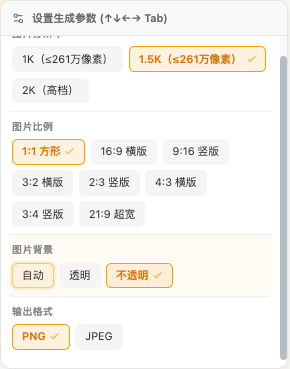

# Seedream 5.5 接入与本地验收

日期：2026-11-14。模型：`doubao-seedream-5-5-261028`。

## 使用与实现

- 在供应商设置中获取模型，选择该模型后使用图片生成入口。
- Tuzi 模型绑定使用 `POST /api/v3/images/generations`，通过 `trim-v1` 去除 API 地址末尾的 `/v1`。参考图以 JSON `image` 提交，沿用生成接口。
- Seedream 5.5 当前请求 `response_format: "url"`，优先读取返回的 URL，再由现有远程图片缓存流程处理；服务商意外返回 base64 时仍兼容解析。下文初次接入及页面模拟记录中的 `b64_json` 为切换前的历史请求。
- Tuzi v3 提交携带同一任务的 `X-Request-Id`；网络失败或 2xx 响应读取中断时，接入现有结果恢复流程，使用 `GET /v1/images/generations/result?request_id=...` 查询已有结果，沿用 15 分钟恢复期限、并发与缓存规则，不重发生成 POST。
- 分辨率档位为 `1K`、`1.5K`、`2K`，默认 `2K`；独立比例支持 `1:1`（默认）、`16:9`、`9:16`、`3:2`、`2:3`、`4:3`、`3:4`、`21:9`。普通生图菜单不再显示拆图专用 `auto`。
- UI 分辨率保存在 `size`、比例保存在 `aspect_ratio`，适配器组合为 v3 的像素 `size`，不发送额外的 `aspect_ratio` 字段。沿用现有 2K 比例尺寸，1K/1.5K 分别按宽高 0.5/0.75 缩放；例如 `1.5K + 16:9` 为 `1920x1080`，`2K + 9:16` 为 `1440x2560`。
- 未传独立比例的旧调用仍保留原生档位；旧比例输入仍映射为 2K 像素尺寸，明确像素尺寸优先且不被独立比例覆盖。拆图仍支持程序化 `auto`；已保存的普通生图 `auto` 偏好恢复为 `2K + 1:1`。
- 支持透明/不透明背景、PNG/JPEG 输出、最多 10 张参考图。透明背景应使用 PNG；该模型不提供 OpenAI mask 编辑能力。
- 图片水印支持“无水印”（默认）和“有水印”；偏好以字符串 `false`/`true` 保存，v3 请求转换为布尔值 `watermark`。即使调用方没有设置该参数，也明确发送 `watermark: false`；已保存的主动开启设置保留。
- 原生图层 Provider 识别 5.5，并提交 `layer_decomposition_options.max_images`，兼容不含质量评分的原生响应。本次没有切换现有固定分层模型，没有新增 OCR 排版或 99 层编辑界面。
- 模型目录和参数位于 `model-config.ts`；路由由 `binding-inference.ts` 产生；请求由 `seedream-adapter.ts` 构造。
- MCP 图片工具保留该模型的原生尺寸，避免把 `1.5K` 转成通用 `1x1`。
- 不硬编码价格；价格依赖供应商目录及实际账单。比例组合中 1K/1.5K 不超过 261 万像素，2K 大于 261 万且不超过 463 万像素；拆图不按各图层实际像素逐张定档。

## 初次接入验证环境与结果

本地 checkout：`opentu5`，`develop`，Node 26.8.1，ego-browser 技能指南 2.2.1。
启动命令：`OPENTU_PORT=7205 pnpm start`，页面 `http://localhost:7205`。
浏览器已有供应商配置，本轮没有读取或输出 API Key。

| 检查 | 结果 |
| --- | --- |
| 模型选择与参数控件 | 页面可选择 5.5，显示原生尺寸、透明背景和 PNG/JPEG |
| 首次模拟提交 | 发现 1.5K 被转换为 1x1；修复 MCP 尺寸归一化及适配器比例解析顺序 |
| 文字生图复测 | 拦截请求为 `https://api.tu-zi.com/api/v3/images/generations?ch=2`，`model` 精确 ID、`size: 1.5K`、`background: transparent`、`output_format: png`、`response_format: b64_json` |
| 参考图复测 | 本地产生测试 PNG 并上传；模拟请求含 JSON `image`，路径和参数保持一致 |
| 结果展示 | 模拟任务完成；本地产生的 512×512 PNG 可打开预览并显示，文件标有 LOCAL MOCK QA |
| 刷新恢复 | 页面仍选择 5.5、1.5K、透明、PNG |
| 单元测试 | 下述 5 个文件共 230 项通过，覆盖旧模型参数/路由、原生尺寸、超量参考图拒绝和现有异常响应 |
| 类型检查 | `pnpm exec tsc -p packages/drawnix/tsconfig.lib.json --noEmit` 通过 |
| 差异检查 | `git diff --check` 通过 |

```sh
pnpm exec vitest run \
  packages/drawnix/src/constants/__tests__/model-config.test.ts \
  packages/drawnix/src/services/__tests__/provider-routing.test.ts \
  packages/drawnix/src/services/layer-decomposition/provider.test.ts \
  packages/drawnix/src/services/model-adapters/__tests__/seedream-response.test.ts \
  packages/drawnix/src/mcp/tools/__tests__/image-generation.test.ts
```

## 边界与未执行项

- 浏览器生成请求在发送前被 fetch 模拟和网络阻断保护拦截，没有真实生成费用；模拟只能验证页面、请求构造、缓存与展示，不能证明真实上游生成、收费或图层响应可用。
- 测试结束前移除模拟与网络阻断，并刷新页面。浏览器保留 3 条以“本地模拟测试”标记的完成任务及测试产物。
- 未执行真实 v3 生图/拆图、OCR、mask、生产部署或远程 CI；未修改服务端。真实图层响应仍受既有解析与质量门禁约束。
- 模拟结果在队列中显示“未知尺寸”，但预览可以解码显示；尺寸元数据展示尚未单独补齐。
- 先前执行的全量测试存在失败，尚未通过干净基线逐项对照归因，不将其报告为本次全量通过。
- 回退时撤回本任务的模型、路由、适配器、MCP 尺寸及对应测试改动，保留其他工作。Git 提交和 PR 状态以仓库记录为准。

接口依据：[Tuzi 模型说明](https://api.tu-zi.com/pricing?model=doubao-seedream-5-5-261028)；实际可用性以所选服务商为准。

## PR 前最终验证

- 功能分支：`codex/seedream-55-v3`；目标：`develop`。
- 已显式 `git fetch origin develop` 并合并 `origin/develop` 的 `73f6e925`（1.2.10），自动合并完成，无冲突。
- 合并后再次执行上述 5 个文件的 230 项测试，全部通过；补充覆盖 5.5 不含质量评分字段的原生图层响应。
- Drawnix 与 Web TypeScript 检查通过：`pnpm exec tsc -p packages/drawnix/tsconfig.lib.json --noEmit`、`pnpm exec tsc -p apps/web/tsconfig.app.json --noEmit`。
- Web 主应用构建通过：在 `apps/web` 运行 `node ../../node_modules/vite/bin/vite.js build --outDir /tmp/opentu5-seedream55-pr-build`，耗时 41.99 秒；保留现有大 chunk 等构建提示。本次未另外执行生产 SW 构建。
- 10 个修改的 TS 文件分别通过 stdin 与 `origin/develop` 同路径版本对照 ESLint，诊断完全一致、无新增；原有 module-boundaries 错误及 warning 未在本任务中修改。
- 原始 `pnpm check:cycles` 和 `pnpm check:cycles:types` 因脚本直接 `JSON.parse` 读取含尾逗号的 `tsconfig.base.json` 失败。用临时内存脚本改为 TypeScript JSONC 解析后，当前与 `origin/develop` 对比结果完全一致：2 组运行时循环、3 组含类型循环，无新增。未修改仓库检查脚本或配置。
- QA 与接入说明合并记录在本文；无新增依赖、环境变量或迁移。未进行真实收费接口验证，未部署。

## 比例选择补充验收（2026-11-14）

- 环境：`codex/seedream-55-v3`，基于 `432b2006` 本地修改；Node 26.8.1，沿用现有依赖。
- 执行前述 5 个 Vitest 文件，并增加 `packages/drawnix/src/components/ai-input-bar/ParametersDropdown.test.tsx` 和 `packages/drawnix/src/services/__tests__/ai-generation-preferences-service.test.ts`：共 328 项，327 通过、1 失败。
- 本次相关测试全部通过：24 种档位/比例组合的整数尺寸、准确比例和像素档位范围；v3 路径；不发送独立比例字段；冒号比例兼容；明确像素尺寸与拆图 auto 兼容；无效比例在发送前拒绝；菜单比例与分辨率独立选择；偏好恢复；异步/队列保留比例参数。
- 唯一失败为“迁移 Seedance 2.5 的旧组合偏好时移除不受支持的分辨率”：预期空尺寸，实际 `1080p`。在临时目录解压干净 `git archive 432b2006`、复用当前依赖后，以相同测试名运行，复现相同断言失败；未修改视频偏好逻辑或测试预期。
- Drawnix/Web 类型检查（沿用上文两个 `tsc --noEmit` 命令）通过；`git diff --check` 通过。
- 本次未新增依赖或配置；QA 与使用说明更新本文，无需单独新增 DOC。未做页面交互测试、真实接口生成、生产构建或部署；以上像素组合仅经本地请求构造验证，真实上游尺寸接受情况尚未验证。
- 人工验收：刷新页面，选择 Seedream 5.5，在参数菜单分别选择分辨率和图片比例，确认两者可以独立设置并在刷新后恢复。真实提交可能计费，本轮未执行。

## 水印参数补充验收（2026-11-14）

- 参数菜单新增“图片水印”：默认“无水印”，允许主动切换“有水印”并保存。仅作用于 Seedream 5.5，旧模型请求不新增水印字段。
- 执行 `pnpm exec vitest run packages/drawnix/src/constants/__tests__/model-config.test.ts packages/drawnix/src/services/model-adapters/__tests__/seedream-response.test.ts packages/drawnix/src/components/ai-input-bar/ParametersDropdown.test.tsx`：140 项通过。
- 执行 `pnpm exec vitest run packages/drawnix/src/services/__tests__/ai-generation-preferences-service.test.ts -t 'Seedream 5.5'`：2 项通过、50 项不在筛选范围。本次未重跑上文已确认的 Seedance 既有失败。
- 覆盖缺省关闭、字符串/布尔开关值、无效值回退关闭、菜单切换、偏好默认及恢复、旧模型不新增字段；Drawnix TypeScript 检查与 `git diff --check` 通过。
- 更新本文作为 QA/使用说明，无新增独立 DOC、依赖或环境配置。未进行页面测试或真实收费接口验证；本次改动未提交、未推送。

## 比例与水印页面复测（2026-11-14）

- 按用户要求使用 ego-browser 2.2.1，复用 TaskSpace 2、`http://localhost:7205` 的原画板；本轮未改动实现代码。
- 页面可切换“有水印”和“无水印”，最终恢复无水印。水印位于参数菜单底部，需要向下滚动；普通菜单不显示拆图专用 auto。
- 设置 `1.5K + 16:9 + 不透明 + PNG + 无水印`，刷新后能够恢复；本轮末次等待画板完整加载后再次确认同一设置。模拟结果自动插入后、后续刷新时曾观察到比例摘要恢复为 1:1；重新选择 16:9 后刷新正常，生成完成与选择联动下的比例恢复仍需进一步确认，不据此宣称全流程偏好始终保持。
- 新建 1 条“本地模拟测试-比例水印”任务：使用页面 fetch 模拟，并通过 CDP 阻断生成/编辑 URL 作为保护；捕获且仅捕获 1 次请求，未发送真实生图请求。
- 捕获 `POST https://api.tu-zi.com/api/v3/images/generations?ch=2`，精确模型 ID，`size: "1920x1080"`、`watermark: false`（布尔值）、`background: "opaque"`、`output_format: "png"`、`response_format: "b64_json"`。认证仅检查 header 名称，未读取或输出密钥。
- 模拟任务约 5 秒完成，自动插入本地生成的 1920×1080 PNG，预览正常显示 `LOCAL MOCK QA 16:9`。截图：`/tmp/opentu5-seedream55-ratio-watermark-preview.png`。队列仍显示“未知尺寸”，沿用此前已记录问题。
- 检查用户截图对应的两条实际失败任务：路由为 v3，已标记尝试提交；耗时分别约 152 秒、145 秒，日志只有 `Failed to fetch`，没有 HTTP 状态或响应内容。不能凭此确定 CORS、网络或上游连接原因，也不能确定上游是否接受；本轮未重试原任务。
- 测试结束已移除 fetch 模拟、清空 CDP URL 阻断并刷新确认无残留模拟，保留原页面和标注的模拟任务供用户查看。未进行真实收费验证、提交、推送或部署；真实失败原因仍未解决。

## 切换 URL 返回格式（2026-11-14）

- 按用户要求，Seedream 5.5 的 `response_format` 从固定 `b64_json` 改为 `url`，以减小生成接口响应体；同时返回两种字段时优先 URL。仅有 base64 的响应仍兼容，旧 Seedream 模型保持原有请求格式与解析优先级；图层 Provider 本来已请求 URL。
- URL 原样交给现有缓存流程，包含签名查询参数；不新增请求或重试生图。签名 URL 的有效期、可访问性和 CORS 仍取决于图片服务，不能据此宣称此前 `Failed to fetch` 已解决。
- 本地验证：`pnpm exec vitest run --environment jsdom packages/drawnix/src/services/model-adapters/__tests__/seedream-response.test.ts packages/drawnix/src/services/media-executor/fallback-utils.test.ts`，2 个文件共 74 项通过。覆盖多图 URL/签名保留、URL 优先、base64 回退、旧模型格式、异常响应，以及现有远程缓存与失败警告流程。
- 首次用根目录默认 Node 环境执行时，缓存测试因缺少 `FileReader` 失败；改用与 Drawnix 项目配置一致的 jsdom 环境后全部通过，未修改测试预期或浏览器 API 实现。
- Drawnix `tsc --noEmit` 与 `git diff --check` 通过。QA 与使用说明更新本文，无需新增独立 DOC；本次未做浏览器测试或真实收费生图，尚未提交、推送或部署。

## v3 结果查询恢复补充验收（2026-11-14）

- 根因：传输层同步图片提交路径匹配未包含 `/api/v3/images/generations`，导致该路径不带 `X-Request-Id`，网络/响应流中断也不进入“提交结果未知”的既有恢复分支。修复仅在该匹配中增加原生 v3 generations 路径；查询器、恢复期限和任务并发均复用已有实现。
- 新增适配器到恢复服务的本地集成用例：模拟 Seedream 5.5 原生 v3 POST 断线，随后通过 v1 结果 GET 返回成功及带签名的图片 URL。确认仅 1 次 POST、1 次 GET，两个请求 ID 一致，回调成功且没有重复生图；补充 v3 2xx 响应流中断分类覆盖。
- 执行 `pnpm exec vitest run --environment jsdom packages/drawnix/src/services/__tests__/provider-routing.test.ts packages/drawnix/src/services/__tests__/image-generation-recovery-service.test.ts packages/drawnix/src/services/model-adapters/__tests__/seedream-response.test.ts packages/drawnix/src/hooks/__tests__/useTaskExecutor-image-recovery.test.ts`：4 个文件共 222 项全部通过。首次根目录默认 Node 环境运行有 3 项失败；使用与项目配置一致的 jsdom 后全部通过，未修改原有断言预期。
- Drawnix `tsc --noEmit` 与 `git diff --check` 通过。
- 只读线上检查：对 v3 generations 发送 OPTIONS，本地 `http://localhost:7205` 和正式 `https://opentu.ai` 两种 Origin 均返回 HTTP 200，允许相应 Origin 和 `X-Request-Id`、Authorization、Content-Type 等请求头。没有发送真实生成 POST。
- 用本地测试凭据按用户提供的后台请求 ID 查询 v1 结果接口，返回 HTTP 200、`processing_or_not_found`、空 data；未把它解释为生成失败，未修改旧任务状态。旧请求缺失客户端请求 ID 的情况不会因本次改动自动补齐。
- 查询成功只表示获得已有图片 URL，不会绕过原图站点的 CORS。火山直链的显示、缓存和导出限制仍需单独处理；本轮未重新生图、做页面测试、修改服务端、推送或部署。QA 与使用说明统一更新本文，无需单独新增 DOC。

## 比例菜单截图

取自用户提供的本地页面截图，仅保留参数菜单区域；展示比例与分辨率的独立选择。截图拍摄时水印选项尚未补齐，最终水印选项已通过后续页面操作与组件测试验证。



## 本次 PR 更新最终验收（2026-11-14）

- PR：`#334`，功能分支 `codex/seedream-55-v3`，目标 `develop`。新增功能先提交为 `d889ea8e`，再显式 fetch 并 merge `origin/develop`；上游最新为 `73f6e925`，已经包含，merge 返回 `Already up to date`，无冲突、未改写历史。
- 同步后在 jsdom 环境重跑 9 个完整测试文件（模型配置、参数菜单、分层 Provider、传输路由、恢复服务、Seedream 适配器、MCP、任务执行恢复、远程缓存）共 403 项，以及 Seedream 5.5 偏好筛选测试 2 项，共 405 项全部通过。筛选外的 50 项偏好测试未在本次最终验证重跑；前文记录的 Seedance 既有失败未修改。
- 清理新增测试中的非空断言警告后，重跑对应 2 个文件共 79 项通过，Drawnix 类型检查再次通过。没有修改测试预期或生产行为。
- Drawnix/Web `tsc --noEmit` 通过；Web 主应用构建通过，输出至 `/tmp/opentu5-seedream55-pr-update-build`，耗时 43.05 秒，保留现有大 chunk 提示。本轮未单独构建生产 SW。
- 对 PR 全部 14 个 TS/TSX 修改文件，以同一路径 stdin 内容分别对照最新 `origin/develop` 做 ESLint：当前和基线均为 3 个错误、15 个警告，无新增诊断。未宣称仓库 ESLint 全量通过；`git diff --check` 通过。
- 对用户提供的已有火山图片链接做读取测试：服务器 HTTP 200、PNG、5433857 字节，普通图片元素加载为 1728×1296；响应缺少 `Access-Control-Allow-Origin`，页面 fetch 失败、Canvas 导出报 `SecurityError`。没有重生图，未将签名 URL 或用户任务 ID 写入提交。该限制未在本 PR 修复。
- 最终效果与兼容方式见本文“使用与实现”。QA 与 DOC 采用此已有文件统一维护，不新增依赖、配置、迁移或服务端变更；比例菜单截图仅含控件区域。分阶段段落中的“未提交/未推送”仅描述当时状态，最终提交与远程状态以 Git/PR 为准。
- 仍未执行真实收费生图、真实断线恢复或生产部署；页面所见比例恢复偶发现象、队列“未知尺寸”和原图 CORS 限制继续作为已知边界披露。回滚可撤回本 PR，旧任务及已有产物不删除。
