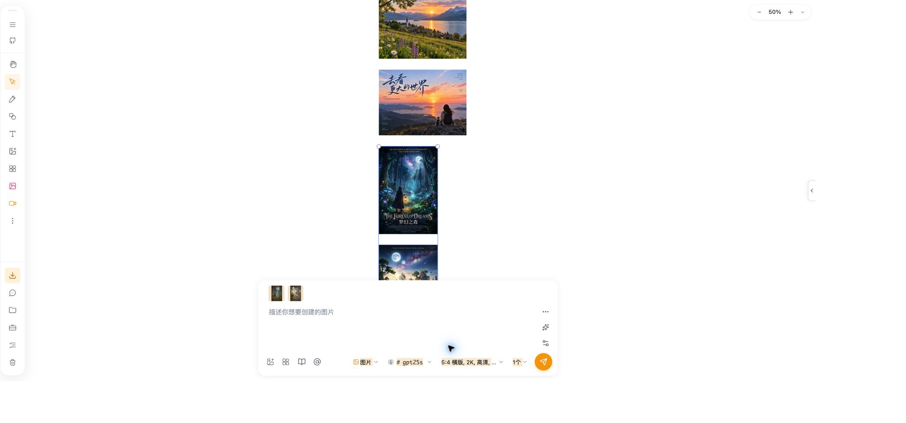

# 选中内容缩略图加载恢复 QA

## 2026-10-23：已选中但整行预览未显示

目录 `/Users/lkj/Desktop/working/opentu1`，分支 `dev/fix-selected-previews-and-model-discovery`，起点 `b8e36274`。环境 macOS、Node v26.8.1、pnpm 10.21.0、Vitest 3.2.4。以下是 PR 创建后的本地补充修复，尚未提交、推送或部署。

### 根因与修复范围

当前 7201 原画板复现：两张海报有画布选框，但 `.selected-content-preview__item` 数量为 0，尚未进入图片加载组件。选择监听器把异步内容提取与鼠标移动、wheel、keyup、resize 的位置刷新共用 `selectionRunIdRef`；位置刷新推进编号后，正在处理的选中内容被当成旧结果丢弃，位置刷新本身又不发布选中内容。

仅修改 `AIInputBar.tsx` 的 SelectionWatcher：选择内容保持自己的版本，绑定目标/位置刷新使用独立版本；最新选择继续发布内容，旧位置结果不得覆盖新结果。单图提示词变化沿用完整选择刷新，避免只更新绑定信息却取消尚未发布的图片内容。取消选中、切换画板及卸载继续使旧异步结果失效。没有改变图片解码、生成接口、选择规则、模型或持久化数据。

### 自动化验证

新增 `AIInputBar.selection.test.tsx`，沿用项目已有的 TypeScript AST 声明测试方式，运行实际 SelectionWatcher 与真实 React effects、document 事件订阅，不导入生图运行时。先在旧实现复现 5 项失败：内容提取中发生 pointermove、wheel、keyup、resize，以及绑定目标查询未完成时发生移动，均未发布双图内容。修复后新增 12 项测试全部通过，另覆盖真实 pointerup 延迟、同一选择的多次位置更新、取消选择、画板切换、卸载及提示词更新时的旧结果隔离。

从 `packages/drawnix` 执行：

```sh
NODE_OPTIONS=--no-experimental-webstorage pnpm exec vitest run --config vitest.config.ts \
  src/components/ai-input-bar/AIInputBar.selection.test.tsx \
  src/components/ai-input-bar/AIInputBar.prompt-history.test.tsx \
  src/components/ai-input-bar/AIInputBar.image-lineage.test.ts \
  src/components/ai-input-bar/target-bound-taskbar-state.test.ts \
  src/components/ai-input-bar/canvas-association-picking.test.ts \
  src/components/ai-input-bar/__tests__/bound-taskbar-layout.test.ts \
  src/components/retry-image.test.tsx \
  src/components/shared/SelectedContentPreview.test.tsx \
  src/components/ai-input-bar/BoundImageContentPreview.test.tsx \
  src/components/chat-drawer/__tests__/EnhancedChatInput.test.tsx \
  src/utils/__tests__/selection-utils.test.ts --silent
```

最终 11 个文件、136 项全部通过。根目录 Drawnix TypeScript 检查、Vite 生产构建及 `git diff --check` 通过，最终构建 35.55 秒；相关两个文件 ESLint 0 errors、18 warnings，未修改的 HEAD 源码也为 18 warnings。既有 Sass、Browserslist、混合导入、大 chunk、sourcemap 与 `.npmrc` 占位提示保留，没有扩大整理范围。

### 经授权的原页面回归

沿用此前同一选图问题的页面排查授权，通过浏览器扩展连接当前 Chrome 的 7201 画板；CLI 自动连接未发现 CDP 实例，没有重启用户 Chrome。最终代码热更新后连续 5 轮“取消选择 → 框选原来的两张海报”，每轮主输入与聊天输入的四个预览实例均存在，`complete=true`、`naturalWidth>0`、`visibility=visible`，失败重试按钮为 0；两张原图宽度分别为 3392 和 1696。检查只选择既有图片，没有发送生成、修改/删除原图或提交表单。画布跟随布局改变了可见区域，未额外调整缩放。



本次未执行完整仓库测试、Windows/Safari/Firefox、真实供应商生成、线上验证或部署。原有 `data/image.test.ts` 修改与备份哈希一致，未修改。复用本 QA 和既有维护说明，不新建重复 DOC。手工验收：在 7201 框选两张图后移动鼠标到输入栏，再滚动或缩放，底部应继续显示两张缩略图；取消选择后应清空，快速换图不应显示上一选区。回滚仅需撤销本次选择监听器改动，不需清理画板、配置或缓存。

## 2026-10-21：图片加载与缓存 Blob 恢复

日期：2026-10-21。目录：`/Users/lkj/Desktop/working/opentu1`，分支 `develop`，基线 `7b3aa15e`。环境：macOS、Node 26.8.1、pnpm 10.21.0、Vitest 3.2.4、Vite 6.4.1。

## 范围与实现

修复通用图片组件首次缓存未命中后不再读取缓存的恢复缺口，以及缓存 Blob 刚被采用时原地址迟到的加载事件破坏新请求的竞态；选中内容预览增加加载状态、20 秒总加载期限及失败重试按钮。普通图片、图形预览和原图/蒙版使用同一逻辑，AI 输入栏及聊天输入复用该预览组件。

缓存重试仍受既有次数及超时约束。坏缓存 Blob 不重复读取；旧 source、成功后或卸载后的迟到读取不覆盖当前图片。回调核对当前实际加载地址，原请求的迟到事件不能释放或提前结束刚采用的缓存请求。重试只读取已有结果，不发生成请求，不修改持久化图片地址。

## 实际验证

从 `packages/drawnix` 执行：

```sh
NODE_OPTIONS=--no-experimental-webstorage pnpm exec vitest run --config vitest.config.ts \
  src/components/retry-image.test.tsx \
  src/components/shared/SelectedContentPreview.test.tsx \
  src/components/ai-input-bar/BoundImageContentPreview.test.tsx \
  src/components/chat-drawer/__tests__/EnhancedChatInput.test.tsx \
  src/services/unified-cache-service.test.ts \
  src/utils/image-operation-timeout.test.ts --silent
```

结果：6 个文件、61 项测试全部通过。缓存延迟就绪测试以及“采用新 Blob 后原请求迟到的 error/load”两项时序测试，均先验证修复前失败，再验证修复后通过。

| 场景 | 预期与实际结果 |
| --- | --- |
| 首次缓存未命中，后续可读 | 后续有限重试采用新就绪 Blob，成功回调触发，通过 |
| 缓存持续缺失 | 达到重试次数后结束，不继续读取，通过 |
| 缓存 Blob 解码失败 | 改读原地址，后续错误不反复读取坏缓存，通过 |
| 采用 Blob 后原地址迟到的 error/load | 不释放新 Blob、不提前触发成功回调；新 Blob 自己加载成功后才通知，通过 |
| 同时显示两张图，只有一张超时 | 已成功图片保持原节点；失败图片独立显示重试，通过 |
| 点击失败图片重试 | 重新读取缓存并恢复可见，不提交表单，通过 |
| 快速切换选中图片 | 重置状态，忽略旧图片迟到结果并释放 Blob，通过 |
| 蒙版失败及悬停浮层 | 原图保持显示，蒙版独立失败；非交互浮层没有重试按钮，通过 |
| 既有恢复逻辑 | 签名 URL、超时、卸载、成功后丢弃迟到读取及聊天输入回归，通过 |

从根目录执行 `pnpm exec tsc -p packages/drawnix/tsconfig.lib.json --noEmit`、`pnpm exec vite build --config apps/web/vite.config.ts`：均通过。最终复核修正了蒙版配对中失败占位的网格位置和窄列最小尺寸，并重新执行相同测试、类型检查和构建。

对本次 4 个 TS/TSX 文件执行 ESLint，完整规则发现 `retry-image.tsx` 原有的 `@aitu/utils` 静态导入触发 `@nx/enforce-module-boundaries` 错误，该导入在基线中已存在，本次未修改。仅临时关闭该规则重跑，0 errors、1 条该文件原有的单子节点 Fragment warning。未修改仓库 ESLint 配置，不声称完整 lint 通过。

构建及工具仍有既有 Sass 弃用、大 chunk、Browserslist 数据过旧、依赖 sourcemap 和 `.npmrc` 环境占位符提示，未在本次扩大修复。

## 启动与人工验收

在本目录执行 `OPENTU_PORT=7201 NX_DAEMON=false pnpm start`，前端与 Service Worker watch 均启动成功。入口为 `http://localhost:7201/`（按用户要求由 7200 切换到 7201）。通过端口与进程 cwd 核对本目录归属，并以 HTTP 核验首页、修复后的预览/重试源模块和 Service Worker；这属于服务检查，不等同浏览器交互验收。

人工验收：打开上述本地入口，选中两张图片，检查两个缩略图；反复切换单选和多选；临时加载失败时应显示占位，最终失败后点击重试应只恢复对应图片，不触发生图或提交。

## 经授权的真实页面回归

用户反馈仍有概率发生后，明确授权检查 7201 页面并做少量选图操作。使用当前 Chrome 的现有画板及截图中的两张海报，没有新建数据或调用生图接口。

- 修复前复现：同一选区中一张缩略图 `complete=true`、`naturalWidth=0`、处于隐藏状态；另一张正常。同一资源在隐藏聊天输入的另一个预览实例中能成功解码。
- 网络证据：失败 Blob 请求为 `net::ERR_FILE_NOT_FOUND`。临时记录 `revokeObjectURL` 调用栈，准确对应到错误处理器释放正在采用的新 Blob 的代码。说明问题来自旧原地址的错误事件处理，与图片内容损坏无关。
- 修复后：连续 20 轮“取消选择 → 单选第一张 → Shift 加选第二张”。每轮主输入栏和隐藏聊天输入的四个图片实例均为 `complete=true`、`naturalWidth>0`、`visibility=visible`，占位及重试按钮均为 0。两张原图尺寸分别为 3392×5056 和 1696×2528。
- 为避免浮动输入框遮挡选图位置，排查时将画布缩放至 88%。没有移动、替换或删除图片。临时 URL 追踪已移除，网络诊断已关闭。


未执行像素级视觉对比、完整仓库测试、Windows/Safari/Firefox、真实供应商调用或线上部署。线上尚未应用本次修改。原有 `src/data/image.test.ts` 工作区修改保留，本次不提交、不推送、不创建 PR。

无需配置、依赖或数据迁移。维护说明更新到现有 `RETRY_IMAGE_COMPONENT_LESSONS.md`，不另建 DOC。回滚只需撤回本次预览和重试组件改动。
