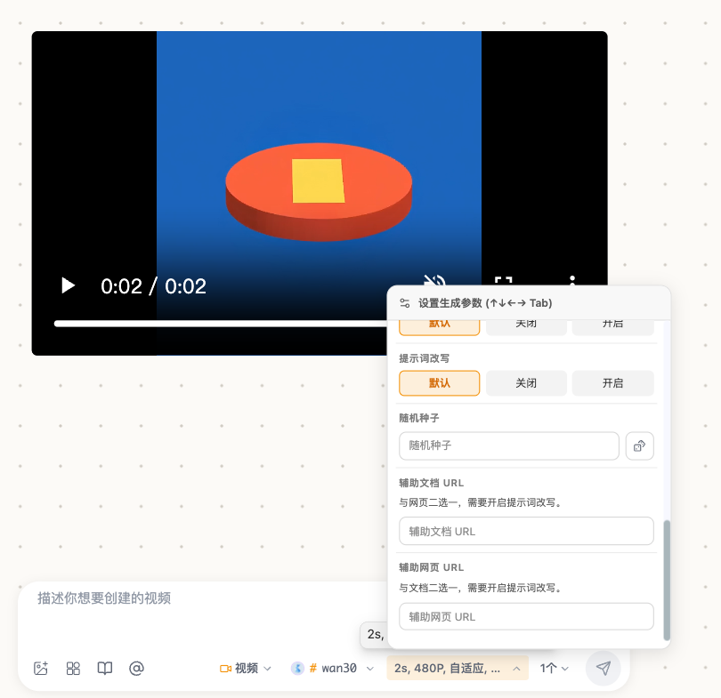

# Tuzi 新版视频模型参数 QA

日期：2026-11-14。基线：`73f6e925`。分支：`codex/adapt-tuzi-video-model-parameters`。效果及参数映射见 [使用说明](./tuzi-video-model-parameters.md)。

## 环境与范围

- macOS，Node v26.8.1，pnpm 10.21.0，Vitest 3.2.4；使用仓库锁文件安装依赖，没有修改依赖或锁文件。
- Gemini Omni 1.2 Flash、Wan 3.0、HappyHorse 1.1 T2V/I2V/R2V、Kling 4.0；覆盖配置、路由、主线程与共享 JSON 提交、HappyHorse 专用适配器和内容恢复判断。
- 初始代码验证使用模拟 fetch/transport；后续用户明确授权有限真实生成，实际结果见下方“Ego 浏览器真实抽样”。未执行全量参数组合。
- 本次属于现有模型发现/视频生成能力的参数配置和请求修正，未新增独立编辑流程；按 OpenSpec 配置修正例外直接实施。涉及接口与回归风险，因此新增 DOC 和本 QA。

## 实际结果

| 检查 | 结果 |
| --- | --- |
| 新模型请求专项 | 36 项通过 |
| PR 前最终 10 文件联合回归 | 349 项通过，2 项原有失败；没有跳过或修改失败断言 |
| drawnix TypeScript | 通过 |
| Web 构建 | 通过，含应用、Web 类型检查和 Service Worker |
| 修改文件 ESLint | 1 个原有错误、29 warnings；无新增 lint error |
| 差异检查 | `git diff --check` 通过 |

构建存在既有 Sass 弃用、sourcemap、动态/静态混合导入及 bundle 大小警告。模拟测试存在 IndexedDB 未提供的环境日志，不代表真实浏览器缓存验收通过。

## 成功、异常与兼容性

- 六个模型的菜单时长/尺寸与默认值一致；Gemini 不显示/发送水印，HappyHorse I2V 不显示/发送 ratio。
- HappyHorse 480P、seed=0、watermark=false 保留；T2V 无图片字段，I2V 使用单数 image，R2V 使用有序 images；9 张可提交，10 张在提交前拒绝。
- Wan 使用 duration/resolution/ratio 和 first_frame/last_frame；主线程与共享入口拒绝单独尾帧。共享入口的本地图片转换使用 Response.arrayBuffer，不依赖 FileReader 或 DOM。
- Kling 4.0 使用统一 `/v1/videos`，已有 Kling 标准版继续走其专用协议；无 4K 档位。根地址和带 /v1 的地址不会漏掉或重复 /v1。
- 超范围时长、小数时长、非法种子/水印、缺少必需图片、T2V 带图片、空首帧及不支持的尺寸会在请求前拒绝。
- 不改写模型 ID，不把未知预览后缀或 HappyHorse 1.1 Video Edit 当作已适配型号；HappyHorse 1.0 不新增 480P。
- 完成任务缺少内联视频 URL 时启用内容下载判断；已有内联 URL 可直接使用。

## 基线失败与证据

在 `/tmp/opentu-video-baseline.OnRUkL` 从 `git archive 73f6e925` 隔离出的修改前代码中，以相同依赖复现两项失败（17 通过、2 失败）。临时环境补充相同测试 setup 和 utils 源码别名，仅用于包解析，没有改动被测业务代码。

1. `video binding utils > keeps sora frontend durations on web mode when selected`：旧断言期望 10/15 秒，原实现实际只返回 10 秒。
2. `video binding utils > routes Seedance 2.0 with official IDs and confirmed controls`：旧断言期望 Seedance 2.5 无分辨率，原实现已有 1080p/720p/480p。

ESLint 错误为 `default-adapters.ts` 原有 `@aitu/utils` 静态导入触发 Nx 的 lazy library 规则。对 `git show 73f6e925:packages/drawnix/src/services/model-adapters/default-adapters.ts` 使用相同文件名运行 stdin lint，复现同一错误；该导入未改动。

日志：`/tmp/opentu-tuzi-video-final-tests.log`、`/tmp/opentu-tuzi-video-new-tests.log`、`/tmp/opentu-tuzi-video-baseline-tests.log`、`/tmp/opentu-tuzi-video-final-types.log`、`/tmp/opentu-tuzi-video-final-build.log`、`/tmp/opentu-tuzi-video-final-lint.log`、`/tmp/opentu-tuzi-video-baseline-lint.log`。临时日志可能被系统清理，事实摘要以本文件为准。

## 复验命令

```bash
NODE_OPTIONS=--no-experimental-webstorage NPM_TOKEN=dummy pnpm --dir packages/drawnix exec vitest run --config vitest.config.ts \
  src/services/tuzi-video-request.test.ts src/services/__tests__/happyhorse-adapter.test.ts \
  src/services/__tests__/kling-adapter.test.ts src/services/__tests__/media-api-routing.test.ts \
  src/services/video-api-service.test.ts src/services/__tests__/provider-routing.test.ts \
  src/services/__tests__/model-adapter-registry.test.ts src/constants/__tests__/model-config.test.ts \
  src/services/__tests__/video-binding-utils.test.ts src/utils/__tests__/runtime-model-discovery.test.ts
NPM_TOKEN=dummy pnpm exec tsc --noEmit --incremental false -p packages/drawnix/tsconfig.lib.json
NPM_TOKEN=dummy NX_DAEMON=false pnpm exec nx run web:build
git diff --check
```

`NPM_TOKEN=dummy` 仅用于读取本地 npm 配置，不是真实认证凭据。

## 未执行与后续

初始开发阶段未做页面测试；本轮用户明确要求后已使用 Ego 浏览器执行下面的真实抽样。未验证其他分辨率/时长组合、声音、计费账单、生产部署或远程 CI。Tuzi 目录当日标注 Gemini Omni 1.2 与 Wan 3.0 尚未开放，但后续实测 Wan 已可提交并完成，目录状态不能代替调用结果。

本次不包含复杂编辑、延展、参考视频、主体或音色流程；Gemini 本地参考图暂不支持。无新增环境变量或迁移，无需清理用户数据。实现及真实抽样阶段尚未本地提交、推送或创建 PR；后续交付状态见文末记录。未部署。


## Ego 浏览器真实抽样（2026-11-14 11:13–11:19，Asia/Shanghai）

用户授权“真实，多个测试，测试一下参数，但是不要全量测试”。使用 ego-browser 2.2.1 在 `http://localhost:7204/` 操作真实模型菜单、参数菜单、图片上传与发送按钮，六个型号各 1 次生成 POST，共 6 次，无生成重试、无追加请求。已受理任务持续查询到完成。页面为开发环境跳过离线缓存模式，测试的是主线程执行入口，不宣称 SW 真实执行覆盖。

| 模型 | 本次请求 | 结果 | 文件实际元数据 |
| --- | --- | --- | --- |
| happyhorse-1.1-t2v | 3 秒、480P、1:1、seed=0、水印 false，无图 | HTTP 200，完成并入画布 | 640×640，3.162667 秒，699855 bytes，video/mp4 |
| happyhorse-1.1-i2v | 3 秒、480P、水印 false，单张 image，不传 ratio | HTTP 200，完成并入画布 | 640×640，3.162667 秒，395527 bytes，video/mp4 |
| happyhorse-1.1-r2v | 3 秒、480P、9:16、seed=2147483647、水印 true，2 张有序 images | HTTP 200，完成并入画布 | 480×848，3.16 秒，291876 bytes，video/mp4 |
| wan3.0-video | 2 秒、480P、adaptive、水印 false，first_frame/last_frame 两张 | HTTP 200，完成并入画布 | 640×640，2.066009 秒，632755 bytes，video/mp4 |
| gemini-omni-1.2-flash | 3 秒、360×640，无水印，无图 | HTTP 400，`unsupported video model` | 未生成，不重提 |
| kling-4.0 | 3 秒、1680×720（720p · 21:9）、水印 false，单图 input_reference | HTTP 400，`unsupported EPhone Kling field input_reference` | 未生成，不重提；确认参考图字段不兼容 |

图片由本地绘制的 768×768 PNG 玩具帆船提供，不使用用户私人素材。T2V 为文字提示，I2V 使用单图，Wan 使用两个不同位置的首尾帧，R2V 使用这两张图与 `[Image 1]`/`[Image 2]` 指代。实际请求 JSON 的图像字段与选参记录一致。

四个成功任务均从本地媒体缓存 Blob 建立 object URL，通过浏览器视频解码核验像素、时长和文件大小。T2V、Wan、R2V 还各解码第 1 秒画面并检查：主体为帆船，R2V 竖屏且右下角出现 Happy Horse 水印。没有用任务成功状态或响应中的 size 代替实际文件检查。480P 方形输出实际为 640×640，不能把档位名称解释为每条边固定 480 像素；3 秒输出容器约多 0.16 秒，不代表计费时长。

密钥从既定 secrets 路径读入，仅在浏览器内存中临时注入所选 Tuzi 路由；没有修改浏览器持久凭据。结束时恢复临时方法并确认原有持久配置仍无测试密钥。仅向 `api.tu-zi.com` 发送测试认证，不记录请求头、密钥或远程结果签名 URL。生成结果和任务保留在测试画板，供用户查看。

脱敏摘要 `/tmp/opentu-video-real-qa-20261114.json`；抽帧对照 `/tmp/opentu-video-results.png`。这些临时文件可能被系统清理。该抽样轮未调整生产代码，未重提 Kling；后续本地修复见下节。Kling 文生视频、其他比例/水印和所有复杂素材输入仍未验证，不能宣称已完整可用。Gemini 的最低参数已正确从页面发出，但服务端拒绝型号，因此无法验证输出。未查看真实扣费账单，也未用本次样本证明 seed 可重复性、首尾帧像素级遵循或所有参数组合兼容。


## Kling 4.0 参考图字段修复

用户随后明确要求“修复”。修正范围仅为 `services/tuzi-video-request.ts` 的 Kling 4.0 分支及相关测试和 DOC；保留其他型号、菜单、偏好和先前真实任务，不追加收费请求。

根因：实际 Tuzi EPhone 适配器的顶层字段白名单不包含 `input_reference`；图片应位于 `contents`，类型 `refer_image`，通过 `url` 提供图片，每张有唯一 `id`。同一请求不能同时带 `contents` 和顶层 `prompt`。本地只读核对来源为另一 Tuzi API checkout 的 `relay/channel/task/ephonekling/adaptor.go`（字段白名单、内容验证）、`adaptor_test.go` 和 `docs/kling-ephone.md`；JieAPI Kling 分支也接受相同的 refer_image 内容结构。未修改 Tuzi API checkout，也未以源码合同替代真实复测。

最终请求示例（使用测试 URL，无认证）：

```json
{
  "model": "kling-4.0",
  "contents": [
    { "type": "prompt", "text": "animate" },
    { "type": "refer_image", "url": "https://example.test/a.png", "id": "image_1" }
  ],
  "settings": { "duration": 3, "resolution": "720p", "aspect_ratio": "21:9" },
  "options": { "watermark_info": { "enabled": false } }
}
```

保持 UI 的 size 选值，提交时映射为 settings.resolution/aspect_ratio；不混发通用顶层字段。未设水印时省略 options，显式 false 保留。所有图片均有稳定顺序的唯一 ID，支持 HTTP(S) 和本地解析后的 PNG/JPEG data URI；不新增视频、主体或音色输入。

修复回归：8 文件 310 项通过，其中新模型专项 52 项、主线程提交 23 项；覆盖无图、1 图、10 图、11 图拒绝、10 组尺寸/比例映射、水印 true/false/缺省、本地图片、WebP 拒绝及主线程图片 slot 排序。共享路径断言完整最终 JSON，防止再次把界面选参通过误当作请求合同正确。drawnix TypeScript、Web 类型检查、应用与 Service Worker 构建均通过（沿用既有构建警告）；本次增量三个代码/测试文件 ESLint 0 errors、3 个既有非空断言 warnings；差异检查通过。

日志：`/tmp/opentu-kling-fix-tests.log`、`/tmp/opentu-kling-fix-types.log`、`/tmp/opentu-kling-fix-lint.log`、`/tmp/opentu-kling-fix-build.log`。本轮不包含此前已隔离确认的 Sora/Seedance 基线失败测试文件；没有修改或跳过其中断言。未追加页面测试、真实请求、提交、推送或部署；Gemini 型号服务端未开放的问题不属于这次字段修复。


## Kling 修复后真实复测（2026-11-14 11:30–11:33，Asia/Shanghai）

用户明确要求“继续测试一下这个”后，以 ego-browser 恢复同一测试页面并刷新到最新本地代码。沿用失败样本条件：3 秒、720p、21:9、水印关闭、1 张本地 PNG。只发送 1 次生成 POST，不重试、不遍历其他组合。

捕获的实际请求仅包含 `model/contents/settings/options`；提示词在 `contents[type=prompt].text`，图片在 `contents[type=refer_image]`，ID 为 `image_1`，图片为 PNG data URI。`settings={duration:3,resolution:"720p",aspect_ratio:"21:9"}`，`options.watermark_info.enabled=false`，没有顶层 input_reference。

- 提交时间 11:30:08，HTTP 200，queued；约 11:31:19 查询到 completed，此前的字段拒绝未再出现。
- 应用存储记录为 completed，结果已缓存并进入画布；浏览器结果视频可加载和解码。
- 从本地缓存 Blob 核验：video/mp4，734939 bytes，实际 **1460×624**，**3.041995 秒**；解码第 1 秒可见参考帆船主体与宽屏构图，没有看到水印。
- **分辨率边界**：实际比例约 21:9，但短边 624，不是请求档位字面上的 720。不能以返回 completed 宣称像素精确满足 720p；本次只能确认该渠道接受 720p 请求并给出上述实际文件。没有用重提、更高分辨率或修改比例尝试消除差异，也未核对账单、音轨及其他组合。
- 新任务保留在测试画板；旧失败样本保留。本次没有改生产代码、提交、推送或部署。

密钥仅临时用于浏览器内存中的 Tuzi 路由，生成结束后已恢复临时方法，确认持久设置未写入测试密钥。脱敏请求/状态摘要在 `/tmp/opentu-kling4-fixed-real-qa.json`，第 1 秒抽帧在 `/tmp/opentu-kling4-fixed-frame.png`；没有保存认证头、密钥或结果签名 URL。核验应用任务终态使用持久任务读取器；活动队列会在完成后移除任务，活动队列为空不代表结果缺失。


## PR 前交付检查

功能提交 `07dca30d`（`feat(video): 适配 Tuzi 新版视频模型参数与 Kling 4.0 请求`）后显式执行 `git fetch upstream develop` 与 `git merge --no-edit upstream/develop`，目标仍为 `73f6e925`，结果 Already up to date。没有内容冲突、合并提交或历史改写。

最终本地验证：

- 10 文件联合回归 349 通过、2 个与上文隔离基线相同的 Sora/Seedance 失败；本次核心 8 文件 310 项通过，没有跳过测试。
- drawnix TypeScript、Web 类型检查、应用与 Service Worker 构建通过。
- 13 个变更代码/测试文件 ESLint 为 1 个原有 Nx lazy-library 错误、29 warnings；错误与先前同一基线导入一致，没有新增 error。
- `pnpm check:cycles` 未能扫描：仓库脚本使用 JSON.parse，无法解析 tsconfig.base.json 的既有尾逗号（line 25）；将上游原脚本和原配置导出到临时目录得到相同异常。脚本及配置不在本次差异中，未为通过检查改动它们。类型检查和构建通过不等价于循环依赖扫描通过。
- `git diff --check` 通过，无未合并文件；没有夹带凭据、生成产物、私有素材、依赖或锁文件。
- 按贡献指南附参数页面裁剪截图 [Kling 参数与生成结果](./images/tuzi-video-model-parameters.png)，只记录已有页面状态，没有再生成视频。

日志：`/tmp/opentu-video-pr-basic-tests.log`、`/tmp/opentu-video-pr-final-tests.log`、`/tmp/opentu-video-pr-final-types.log`、`/tmp/opentu-video-pr-final-build.log`、`/tmp/opentu-video-pr-final-lint.log`、`/tmp/opentu-video-pr-final-cycles.log`、`/tmp/opentu-video-pr-baseline-cycles.log`。上述是本地结果；远程 CI、PR 合并与部署状态不能由本地结果推定。


## Kling 尺寸与比例分组选择（2026-11-14）

按用户截图要求，将 Kling 4.0 的组合按钮拆成独立两组：视频尺寸为 1080P/720P；视频比例为自适应、16:9、9:16、1:1、21:9。使用既有按钮组件及 aria-pressed 选中状态，切换一项保留另一项。保持接口支持范围，不添加不支持的 480P、4:3 或 3:4。

请求使用 size（720p/1080p）和 ratio 两个参数，分别写入 settings.resolution/aspect_ratio。旧版八种像素组合在参数展示、输入栏与视频工具偏好恢复、尺寸校验和旧任务请求构造时兼容转换；例如 1680x720 转成 720p + 21:9，已有显式 ratio 优先，未知尺寸仍拒绝。不改变其他型号或增加收费请求。

验证：11 文件 402 项通过，1 项原有 Seedance 2.5 偏好断言失败（期望清空 size，原实现保留 1080p）。从修改前 HEAD=f0cb1fac 隔离导出代码后，同一偏好测试文件 49 通过、1 项相同失败，没有修改或跳过断言。新增两项组件测试验证分组按钮内容、独立选值与旧值选中态；请求测试覆盖两档尺寸与五种比例的十种组合、旧任务尺寸兼容、显式比例优先及非法比例；偏好测试覆盖输入栏及按供应商隔离的视频工具恢复。

drawnix TypeScript、Web 类型检查、应用和 Service Worker 构建通过；本次 11 个变更代码/测试文件 ESLint 0 errors、26 warnings；差异检查通过。没有新增页面测试或真实生成，本次分组交互由组件逻辑测试验证。日志：`/tmp/opentu-kling-split-final-tests.log`、`/tmp/opentu-kling-split-baseline-tests.log`、`/tmp/opentu-kling-split-final-types.log`、`/tmp/opentu-kling-split-lint.log`、`/tmp/opentu-kling-split-final-build.log`。以上为提交前验证结果；本轮按用户要求纳入本地提交，未推送或更新远程 PR。


## 视频模型按钮误显 img 修复

新增六个视频模型缺少 shortCode，模型按钮又把所有缺省情况回退为 img，造成截图中的误导显示。为六个精确模型补齐 omni12、wan30、k40、h11t、h11i、h11r；组件对旧目录先补内置短代码，自定义模型回退到名称/ID，不变更请求模型 ID。已有分辨率与比例拆分改动保留。

专项 5 文件 181 项通过，包含六个型号旧目录显示、无短代码自定义视频模型、模型配置/发现、请求参数和分组控件回归。drawnix TypeScript、变更四文件 ESLint 和差异检查通过。没有新增页面测试、收费请求或远程 PR 更新；这是本地展示修复，未重复构建。日志 `/tmp/opentu-video-label-tests.log`、`/tmp/opentu-video-label-types.log`、`/tmp/opentu-video-label-lint.log`。


本轮本地提交范围：Kling 尺寸/比例独立选择、旧组合参数恢复、六个视频模型短代码及名称回退、对应测试和文档。仅本地提交，远程 PR 未更新；NEW 标签的缺失已定位，本轮未增加该标签。

## 全部高级参数与素材输入补齐（2026-11-14，提案确认后）

本节为最新本地实施结果；前文的“本轮提交/推送”与真实测试记录分别属于当时的历史批次。本轮基线为 `f8ff9cd6`，工作分支为 `codex/adapt-tuzi-video-model-parameters`。用户确认 OpenSpec 提案后实施，范围为 OpenTu 客户端；没有修改 Tuzi 后端或渠道配置。

### 环境与前置条件

macOS，Node.js v26.8.1、pnpm 10.21.0，使用已安装依赖。构建/测试命令通过占位的 `NPM_TOKEN=dummy` 满足本地 npmrc 变量解析，不使用真实包服务令牌。单元与组件测试使用模拟的素材地址、内存请求与缓存替身；未读取 Tuzi 密钥文件，未调用真实生成或上传接口。

### 实际验证

| 范围 | 预期 | 结果 |
| --- | --- | --- |
| Gemini 图片/视频多模态 | 本地/缓存输入转原始 Base64，保留 MIME；公网输入使用 URI；不混发 prompt/input_reference | 通过主线程和共享路径的实际请求正文断言 |
| Gemini 输出与续接 | 尺寸/比例独立选择、旧像素尺寸恢复；编辑/延展携带本站 task_ ID，延展不超过 10 秒 | 组件、MCP、请求模拟通过；不代表 1.2 服务已开放 |
| Gemini 数量及错误 | 10 个媒体可构造，第 11 个、错误 MIME、uri/data 同时填写、非法前序 ID 等拒绝 | 通过；非法请求不发送生成 POST |
| Wan 全部扩展字段 | 保留混合图/视频/音频、音轨、改写、seed、file/link、时长 -1，保留 false 和 0 | 工作流/MCP/绑定/任务清洗及共享请求断言通过 |
| Wan 互斥与边界 | 首尾帧完整、两种模式不混用，10 图/5 视频/5 音频边界、file/link 互斥、改写依赖、已知时长预算 | 通过；URL 专属媒体拒绝 blob、缓存和鉴权 content 地址 |
| Kling 全部素材角色 | 首/中/尾帧、参考图、两种视频、已有主体/音色 ID，唯一素材 ID，输出参数保持原生合同 | 通过；自动 ID 与手工 ID 均进入 contents |
| Kling 数量与时长 | 10 图/5 视频/7 主体/3 音色及 15 总素材限制，base_video 最多 1，已知输入视频时长合计不超 30 秒 | 上限成功及超限失败通过；未知媒体属性由渠道验证 |
| HappyHorse I2V | 无文本且有图片时，输入解析、工作流、MCP async/queue、通用任务校验及请求层全部允许 | 通过；T2V 仍要求提示词 |
| HappyHorse 本地图像 | PNG/JPEG/WebP 格式与大小检查；I2V 300 像素和比例限制；R2V 短边 400 | 用真实 PNG 边界样本验证 299/300、399/400 及非法比例；通用图片头解析未做完整图片解码验收 |
| 素材表单与偏好 | 可增删角色、地址、ID、本地文件；草稿只保存缓存引用；切换型号/供应商不继承其他素材和前序身份 | 组件和偏好测试通过；缓存失败保留输入并显示错误 |
| 服务失败 | 保留提供方错误，不自动换型号、静默删参或重复创建生成 | 通过拒绝请求的一次提交模拟 |
| 旧功能回归 | 既有参数控件、Kling 组合尺寸、工作流、普通视频提交/轮询等 | 见下方联合回归和基线说明 |

最终联合回归命令（11 文件）：

```bash
NPM_TOKEN=dummy pnpm exec vitest run --config packages/drawnix/vite.config.ts \
  packages/drawnix/src/components/ai-input-bar/__tests__/tuzi-video-workflow.test.ts \
  packages/drawnix/src/mcp/tools/tuzi-video-generation.test.ts \
  packages/drawnix/src/services/video-api-service.test.ts \
  packages/drawnix/src/services/tuzi-video-advanced.test.ts \
  packages/drawnix/src/services/tuzi-video-request.test.ts \
  packages/drawnix/src/services/__tests__/ai-generation-preferences-service.test.ts \
  packages/drawnix/src/services/__tests__/video-binding-utils.test.ts \
  packages/drawnix/src/components/ai-input-bar/ParametersDropdown.test.tsx \
  packages/drawnix/src/components/ai-input-bar/ParametersDropdown.kling.test.tsx \
  packages/drawnix/src/components/ai-input-bar/__tests__/workflow-converter.test.ts
```

结果 **333 通过、3 个原有失败，共 336 项**。失败为：Seedance 2.5 旧偏好期望清空 size、Sora web 时长选择、Seedance 2.0 官方 ID/参数预期。从修改前 HEAD 隔离导出到 `/tmp`，使用相同依赖执行，三项均以相同断言失败；没有修改或跳过这些断言。本轮新增的请求、组件、工作流、MCP 与偏好测试全部通过。

调查中还运行过原 `utils/__tests__/ai-input-parser.test.ts`，其中 22 项旧标记解析/旧快照断言失败；与修改前 HEAD 的 22 项逐一匹配。该文件未修改；本次新增的 Tuzi 输入解析用例放在独立 `tuzi-video-workflow.test.ts`，使用实际设置模块，避免原测试不完整的路由 mock 干扰。本次早期新用例暴露的偏好串用与测试 mock 问题已修正，不纳入“原有失败”。

以下检查实际通过：

```bash
NPM_TOKEN=dummy pnpm exec tsc --noEmit -p packages/drawnix/tsconfig.lib.json
NPM_TOKEN=dummy pnpm exec tsc --noEmit -p apps/web/tsconfig.app.json
NPM_TOKEN=dummy pnpm exec vite build --config apps/web/vite.config.ts
npx --yes @fission-ai/openspec validate complete-tuzi-video-model-inputs --strict
git diff --check
```

本轮变更的 TS/TSX 文件执行 ESLint：0 errors、64 warnings，包含已有 any、非空断言、未使用变量及 hook 依赖警告；新请求构造、媒体解析和素材控件没有 lint error。生产构建包含应用和 Service Worker，保留既有 Sass/Browserslist/大 chunk 等警告。未运行整库全量测试或依赖审计，也未为消除原有警告修改无关代码。

本地日志：`/tmp/opentu-video-final-tests.log`、`/tmp/opentu-video-final-typecheck.log`、`/tmp/opentu-video-web-typecheck.log`、`/tmp/opentu-video-production-build.log`、`/tmp/opentu-video-full-lint.log`。基线证据：`/tmp/opentu-video-baseline-tests.log`、`/tmp/opentu-video-baseline-binding.log`。

### 未执行项与限制

- 未做页面交互、视觉回归或浏览器端到端测试；表单通过组件逻辑验证，不将其写成页面验收。
- 未发起真实上传或收费生成，未验证账单、实际分辨率、音轨、真实远程素材时长、主体类型或完整格式矩阵；不复用早先的收费授权扩大本轮测试。
- Gemini 1.2 公开说明仍标记未开放，研究用后端源码仍只识别 1.1；本地多模态/编辑/延展构造通过不代表生产端已接受该型号或动作。
- 未确认普通模型密钥可用的通用图片转公网 URL API；Gemini 本地媒体通过文档声明的 Base64 input 接入。Wan/Kling 的视频/音频 URL 要求仍由其合同决定。
- Wan 智能时长和参考视频需要渠道启用相应计费用量能力；远程图片像素/大小、未知视频时长和权限由后端或上游最终检查。
- 已更新现有 DOC 和本 QA；无新增依赖、环境变量、迁移、凭据持久化或第三方图床上传。回滚撤回本次客户端功能改动即可，不清理既有素材或任务。
- 本轮未提交、推送、更新远程 PR 或部署，也未执行上游同步/合并操作。

## 用户要求的本地复测（2026-11-14）

在上一节相同未提交代码上重新执行本地验证，额外加入旧 HappyHorse 适配器和视频参考图片处理测试。本轮仅更新验收记录，没有修改产品代码。

- 13 文件、347 项：**344 通过、3 个原有失败**。覆盖上节的 11 文件，并追加 `services/__tests__/happyhorse-adapter.test.ts`（7 项通过）和 `services/video-reference-image-utils.test.ts`（4 项通过）。新增高级参数相关测试全部通过；三项失败名称与修改前 HEAD 的基线逐项匹配，没有新增失败或跳过断言。
- drawnix 和 Web TypeScript 检查均通过，日志为空；Vite 生产构建成功，包含应用与 Service Worker，保留已有构建警告。
- 本任务变更的 TS/TSX 文件 ESLint：0 errors、64 warnings。
- 额外运行项目 lint 中的 `node packages/drawnix/scripts/check-hover-usage.mjs`：发现 8 个既有原生 title 用法。对隔离基线执行同一脚本，输出完全一致，无新增项。因此不能把本轮所有规范检查统称为全绿。
- `git diff --check` 通过；本任务变更文件未发现密钥格式字符串。未运行覆盖率统计、整库全量测试或依赖审计。
- 未执行页面/浏览器端到端测试、真实上传、收费请求、提交、推送或部署；本地测试不证明线上供应商能力已开放。

命令沿用上一节；联合 Vitest 命令末尾追加两个测试路径。复测日志：`/tmp/opentu-video-local-retest-tests.log`、`/tmp/opentu-video-local-retest-drawnix-types.log`、`/tmp/opentu-video-local-retest-web-types.log`、`/tmp/opentu-video-local-retest-build.log`、`/tmp/opentu-video-local-retest-lint.log`、`/tmp/opentu-video-local-retest-hover.log`；hover 基线：`/tmp/opentu-video-local-retest-hover-baseline.log`。

## 浏览器页面与参数验收（2026-11-14，Asia/Shanghai）

用户进一步确认“页面测试和参数测试”，本轮使用 ego-browser 操作实际 `http://localhost:7204`，没有取得额外收费生成授权。新建独立画板“视频参数页面测试（模拟，无费用）”，保留原画板及此前的真实结果。

### 测试方法

通过页面模型选择、参数按钮、素材角色下拉、文件选择器、输入框和发送按钮走真实输入栏/工作流/任务/请求构造链路。在浏览器内存临时强制主线程回退执行，并拦截远程生成 POST：读取最终 JSON 后返回标记为 `LOCAL_PAGE_QA` 的模拟 HTTP 400，避免上传素材或创建收费任务。其他远程 POST 也有阻断。没有读取密钥文件或输出认证头，没有修改持久供应商凭据。初次探测只被阻断未留请求正文，修正捕获方式后完成请求核对；这不是供应商返回的错误。

因开发服务器 HMR 刷新，Gemini 初始单图捕获在刷新前单独核验；刷新后的 **8 份脱敏请求正文**保存在 `/tmp/opentu-video-page-captures.json`，覆盖全部六个型号，另外包含 Gemini 编辑、延展与多模态输入。测试时间/型号摘要在 `/tmp/opentu-video-page-result.json`。Base64 内容只记录长度，示例地址/主体 ID 均为测试占位；不保存密钥或私有素材。

### 页面与实际请求结果

| 场景 | 实际页面操作与检查 | 结果 |
| --- | --- | --- |
| Gemini 本地单图 | 通过文件选择器载入真实 400×400 PNG，选择 3 秒/360p/9:16，再点发送 | 最终 JSON 为 input 的 text+image 项，MIME=image/png，原始 Base64 长 1848；size=360x640，无顶层 prompt/input_reference 混发 |
| Gemini 编辑/延展 | 切换动作，填写测试 task_ ID，点发送 | generation_config.video_config.task 分别为 edit/extend，previous_interaction_id 保留；3 秒延展可构造 |
| Gemini 多模态 | 页面添加本地图片与公网视频 URL，选择多模态参考 | input 按顺序包含 text、image/png data、video/mp4 uri；不丢素材或 MIME |
| Wan 高级参数 | 选择智能时长、480P、混合参考，关闭音轨、开启改写，seed=0，填写参考视频和已知时长 | 最终 JSON 包含 duration=-1、audio=false、prompt_extend=true、seed=0、reference_videos；reference_mode 等 UI 字段不混入接口 |
| Kling 主体/音色 | 选择 720P、21:9，新增 element/voice，填写独立 ID | 最终 contents 包含 prompt、element_id、voice_id 和独立 id；settings 和 watermark options 正确；未带入 Wan 视频素材 |
| HappyHorse I2V | 上传本地 PNG，清空提示词，选择 3 秒/480P，点发送 | 按钮可用，最终 prompt 为空、单数 image 为 data URI，parameters 不带 ratio |
| HappyHorse R2V | 上传本地 PNG，选 3 秒/480P/9:16，seed=0 | 最终 images 数组、parameters.ratio/seed 正确 |
| HappyHorse T2V | 无图选择 3 秒/480P，填写文本后发送 | 最终参数进 parameters，无 image/images |
| 型号偏好 | Gemini → Wan → Kling → HappyHorse → Gemini 切换 | 无跨型号素材串用；返回 Gemini 可恢复原本地素材的缓存地址和 MIME；Kling 退出重载后仍为 720P/21:9 |
| 校验失败 | Kling 两条素材填写相同 id；Gemini 延展选 11 秒；Wan 首尾帧模式保留参考视频 | 分别显示唯一 ID、最多 10 秒、请切换混合参考的错误；三次均未新增捕获到的生成 POST |

本轮发现并修复一个实际页面问题：Wan 绑定推导的智能时长显示为“-1秒”，参数摘要也显示为“-1s”。现由时长推导层保留“智能时长”标签，摘要使用该标签；实际发送仍为 duration=-1。已在页面选择并确认新标签，也在推导绑定的现有测试中新增断言。

页面观察：高级菜单可滚动到素材条目；角色、ID、本地文件、MIME 和移除控件可操作。完成截图观察，但没有做移动端、全视口或像素级视觉矩阵。阶段截图保存在 `/tmp/opentu-video-page-gemini-advanced.png`、`/tmp/opentu-video-page-kling-elements.png`；截图中的失败卡片属于本地拦截返回的预期结果，不是远程接口真实失败或生成成功凭据。

### 清理与回归

删除本轮填入的 Gemini/Wan/Kling 测试素材条目和前序占位 ID，恢复 Gemini 自动动作和 Wan 固定 2 秒。保留明确标为模拟的独立验收画板与测试失败记录；不删除已有用户素材或原画板。撤除临时 getter、执行器和 fetch 替换并刷新，确认临时测试 Hook 不存在、活动任务数为 0、供应商设置没有写入占位密钥，然后关闭本轮浏览器任务空间。

修复后本地回归：Tuzi 高级请求、素材组件、参数组件及 Kling 分组选值共 **4 文件 88 项全部通过**；drawnix TypeScript 通过；三个受影响文件 ESLint 0 errors、7 个既有 warnings；`git diff --check` 通过。日志 `/tmp/opentu-video-page-regression.log`、`/tmp/opentu-video-page-types.log`、`/tmp/opentu-video-page-lint.log`。仅修改显示文案与对应断言，未重复生产构建。

本轮 **真实收费生成 0 次、真实素材上传 0 次**。没有验证真实生成、账单、远程 task_ 权限、轮询到成功、结果下载/播放或画布插入；服务端可用性限制仍见上文。代码未提交、推送、更新 PR 或部署。

## 输入栏素材复用修复（2026-11-14）

参考素材不再作为高级参数让用户重复填写。视频生成直接读取输入栏已有的图片、视频和音频：有素材时自动按模型映射为参考输入，没有素材时直接走纯文本生成；输入栏的 Base64 图片仍按请求层规则处理，模型不支持的媒体由提交校验提示。

本地验证：

- `ParametersDropdown.test.tsx`：37 项通过，确认参考素材不再出现在高级参数菜单，其他高级参数仍正常渲染。
- `pnpm nx run drawnix:typecheck`：通过。
- 受影响文件 ESLint：0 errors；仅保留仓库既有 warnings。

本次没有页面测试、真实素材上传或收费生成；输入栏素材来自现有前端状态，公网 URL 的可访问性仍由对应 Tuzi 渠道最终校验。

## 自动参考素材页面复测（2026-11-14）

使用本地 `http://localhost:7204` 页面复测最新行为，临时拦截视频生成 POST 并返回 `LOCAL_PAGE_QA_BLOCKED`，未创建真实任务：

- 无素材时，Kling 请求仅包含 `contents[].type=prompt`、`settings` 和 `options`，没有 `video_media` 或参考素材字段。
- 从输入栏上传 PNG 后，Kling 请求自动包含 `contents[].type=refer_image`，不需要打开高级参数或填写“素材 1”。
- 打开参数菜单后未发现“参考素材”“添加参考素材”或参考素材高级表单；时长、尺寸、比例和水印仍可用。
- 临时 fetch 拦截已撤除，页面刷新后确认 Hook 不存在；本地测试失败卡片已删除，未清空素材库或用户数据。

本次页面验证未执行真实上传到供应商、收费生成、轮询或结果下载；请求中的本地图片内容只用于内存验证，未写入仓库或 QA 文档。

## 真实自动参考素材生成（2026-11-14）

用户明确授权后，在 7204 页面使用 Wan 3.0 做 1 次真实生成，验证输入栏素材自动进入参考生成流程。页面基础参数为 2 秒、480P、自适应比例、水印关闭，上传 768×768 PNG，提示词为“让图案缓慢旋转并保持镜头稳定”。未打开高级参数，未手动填写参考素材，未自动重试。

结果：Tuzi 任务完成并插入画布；结果 MP4 可解码，`readyState=4`，视频尺寸 640×640，时长约 2.02 秒，未发现媒体错误。页面任务队列回到 0，临时测试 Hook 不存在。该结果确认输入栏素材可以直接触发 Wan 参考生成；清晰度档位不等同于固定输出像素。

本次点击提交 1 次，未核对账单金额；未留存这次实际请求正文或解析音轨，不能据基础参数摘要中的“关闭”断言 audio=false（该摘要表示水印关闭）。结果页面保留在 7204，未继续提交其他模型或参数组合。

## 三次真实生成验收（2026-11-14，17:32 起，Asia/Shanghai）

用户在页面模拟验收后明确要求“发起真实”。本轮限定 Wan 3.0、Kling 4.0、HappyHorse 1.1 I2V 各一次，使用各自最低时长及清晰度，不自动重试、不扩大到其他型号。使用 ego-browser 实际操作 7204，独立画板为“视频真实验收（3次，不重试）”，原画板与模拟验收画板均保留。

请求使用 Tuzi API Key 文件，密钥只在浏览器内存临时使用，认证仅交给 `https://api.tu-zi.com`。设置了每型号最多一次生成 POST、指定型号与最低参数检查；未使用前一轮模拟返回。实际 **3 次生成 POST 均 HTTP 200、queued 后 completed，无重提**。全部通过应用自身查询流程等待终态、下载缓存、插入画布；未为恢复轮询再次创建生成。

| 型号 | 实际请求 | 结果文件核验 |
| --- | --- | --- |
| kling-4.0 | 17:32:44，3 秒/720p/21:9、水印关闭；本地 PNG 经 contents 的 first_frame 角色提交，提示词为独立 prompt 项 | completed；MP4，624052 bytes；1460×624、3.041995 秒；1 条音轨 |
| wan3.0-video | 17:33:26，2 秒/480P/adaptive；文生视频，audio=false、prompt_extend=false、seed=0、水印关闭 | completed；MP4，1152996 bytes；854×480、2 秒；**0 条音轨**，本样本符合关闭音轨 |
| happyhorse-1.1-i2v | 17:33:45，3 秒/480P、水印关闭；单张 768×768 本地 PNG、**空提示词**，不传 ratio | completed；MP4，460475 bytes；640×640、3.162667 秒；1 条音轨 |

三项本地持久任务都为 completed，结果 Blob 可从应用缓存读取；浏览器播放器 readyState=4，三个视频均实际启动静音播放并推进超过 0.3 秒，无媒体解码错误。还定位至第 1 秒观察内容：Wan 生成红帆船海面场景，Kling 和 HappyHorse 保留参考图的红船、浅色帆与蓝色海面。随后刷新应用，三个播放器再次加载到有效宽高，活动任务数为 0。

**像素边界**：Kling 的 720p 档位仍返回 1460×624，而不是短边 720；21:9 比例基本吻合。本轮确认 first_frame 原生字段可用，但不能声称像素精确满足 720p。HappyHorse 480P 方形样本返回 640×640，清晰度档位同样不应等同于固定像素。未为了改变像素结果追加生成。

远程任务 ID（仅用于后续同凭据查询）：

- Kling：`task_wxOht7B8iniC3ypfj6aYGVNHStjDYnYv`
- Wan：`task_N9TkgcTPIOvJE2Kck9X8yq7g6b8aZUv4`
- HappyHorse：`task_PO4EdpuDUzhCgOz0mNKQc7q4gcLVFXr9`

脱敏提交/状态/媒体摘要：`/tmp/opentu-video-real-advanced-qa-20261114.json`；结果截图：`/tmp/opentu-video-real-advanced-results.png`。音轨数由缓存 MP4 的 moov/trak/mdia/hdlr 解析取得，宽高/时长由浏览器解析缓存 Blob 取得，没有把上游返回的档位当成实际像素。未将密钥、认证头、图片 Base64、结果签名 URL 或账号数据写入该记录。

生成结束后恢复临时 getter、执行器和 fetch 方法，再刷新确认临时测试 Hook 不存在、活动任务为 0。保留结果页面供用户查看。本轮没有产品代码改动、提交、推送、PR 更新或部署。

本次三个样本通过不代表全部参数组合、主体/音色/混合参考视频、智能时长、Gemini 编辑/延展或整个模型目录已真实验证。Wan 的 seed=0 和关闭改写确认已发送并被受理，未通过对照生成证明可复现性或内部改写行为；账单及实际扣费金额未核对。Kling/HappyHorse 的音轨仅核验存在，未验证声音内容。


## PR #336 最终交付验证（2026-11-14）

此节描述最终实现，前文素材表单及测试数量属于历史批次。功能提交 `84ad6d83`；显式 `git fetch upstream develop codex/adapt-tuzi-video-model-parameters` 后 `git merge upstream/develop` 显示已同步，上游目标 `develop` 为 `73f6e925`，无内容冲突。

- 普通输入栏直接使用当前图片/视频/音频，忽略保存的 `video_media`；没有素材时，支持文本输入的型号走文生视频。HappyHorse I2V/R2V 缺图仍报错，不自动换型号。
- Wan 输入栏模式自动确定：一/两张图片为首帧/首尾帧，超过两图或含视频/音频为混合参考；辅助文档/网页与图片组合亦走混合参考。移除输入栏手动参考模式选项，保存过的首尾帧模式不会阻挡视频输入。MCP 明确模式仍保留互斥校验。
- 高级素材表单已移除。Kling 主体/音色、复杂帧角色通过 MCP/程序调用传入；不宣称这些角色仍有独立页面表单。
- 合并后 12 文件共 350 项回归：**347 通过、3 个既有失败**。失败为 Seedance 2.5 旧尺寸偏好、Sora web 时长、Seedance 2.0 参数预期，与基线 `f8ff9cd6` 的隔离测试日志一致；未跳过或修改断言。新增 Wan 自动模式的 6 个实际请求断言及 4 个参数菜单/恢复断言全部通过。
- drawnix 和 Web TypeScript 均通过；应用与 Service Worker 生产构建通过（保留 Sass/Browserslist、动态导入和大 chunk 警告）；本次更新的 TS/TSX 文件 ESLint 为 0 errors、64 warnings；OpenSpec 严格校验与 `git diff --check` 通过。
- 实际命令：`pnpm exec vitest run --config packages/drawnix/vite.config.ts` 加前述 12 个回归文件；`pnpm exec tsc --noEmit -p packages/drawnix/tsconfig.lib.json`；`pnpm exec tsc --noEmit -p apps/web/tsconfig.app.json`；`pnpm exec vite build --config apps/web/vite.config.ts`；`pnpm exec eslint` 加本次变更 TS/TSX；`npx --yes @fission-ai/openspec validate complete-tuzi-video-model-inputs --strict`。均使用本地占位 `NPM_TOKEN=dummy`。
- 日志：`/tmp/opentu-pr336-final-tests.log`、`/tmp/opentu-pr336-drawnix-types.log`、`/tmp/opentu-pr336-web-types.log`、`/tmp/opentu-pr336-build.log`、`/tmp/opentu-pr336-lint.log`。
- PR 准备阶段再次检查 7204 当前 Wan 菜单：无参考素材/参考模式控件，其余高级项可见；截图包含此前生成的测试图案视频。本阶段未新增生成请求。

### 真实测试覆盖边界

最新输入栏自动引用版本仅真实复测 Wan 单图（2 秒/480P，结果 640×640、2.02 秒），Kling 有图/无图完成页面 POST 拦截核对。此前 Kling、Wan、HappyHorse 三型号有成功样本，具体批次见上文；不是全部型号对最新版本的完整真实回归。Gemini 1.2 只有本地/页面模拟参数结果，之前真实接口拒绝型号；没有成功证据。新增 Wan 多图/混合自动判断只完成本地请求回归，未追加收费测试。最新 Wan 单图样本未核验音轨或账单；页面测试曾使用的占位 PNG 预览失败，不能据那次断言图片预览通过，后续真实 PNG 已正常显示。

无新依赖、环境变量、迁移或后端部署；需要在供应商目录启用目标模型。Wan/Kling 视频/音频的公网 URL 要求仍存在，无普通密钥通用上传转换接口证据。PR 未合并、未部署；回滚客户端功能提交即可，不清理用户素材和任务。


