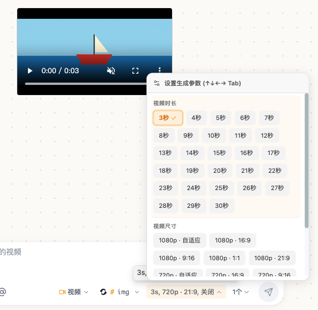
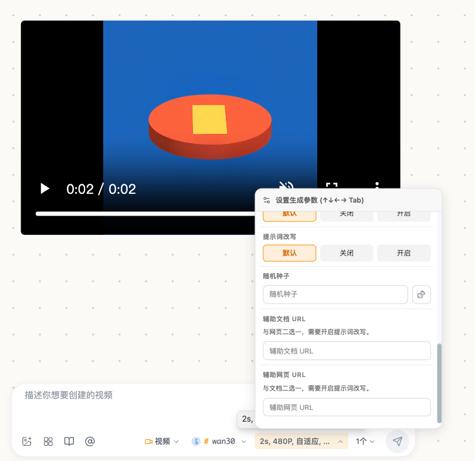
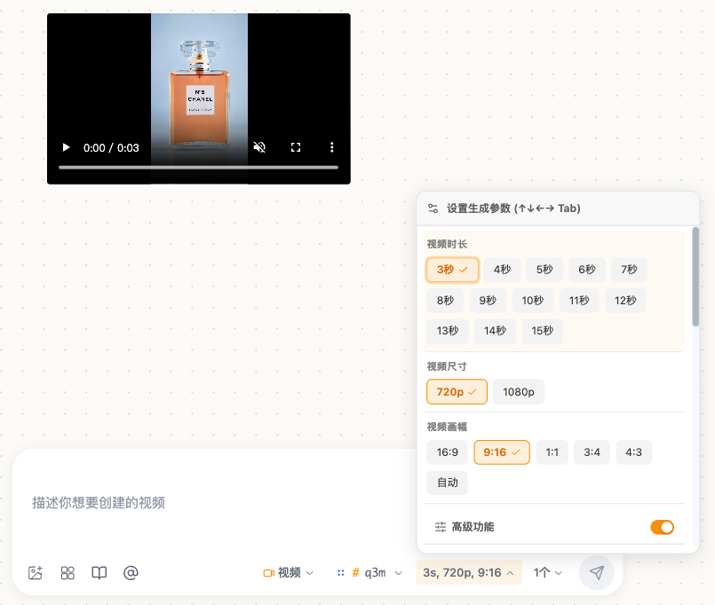

# Tuzi 新版视频模型参数

核对日期：原六型号为 2026-11-14，Vidu 为 2026-11-17。依据 Tuzi 定价页及其公开 `/api/pricing` 返回的模型描述和 endpoint；Vidu 以 [apioss 节点目录](https://apioss.tu-zi.com/pricing?search=vidu)为准。支持参考输入的型号从输入栏自动接收素材；Gemini 包含编辑/延展，Kling 支持使用已有主体/音色 ID，不新增主体训练或账号管理服务。

## 参数与使用

在供应商模型列表刷新并勾选相应模型，然后在视频生成参数菜单选择时长和尺寸。保留完整请求模型 ID 和供应商身份，不映射成旧型号。模型按钮短代码分别为 omni12、wan30、k40、h11t、h11i、h11r；旧目录缺少短代码时复用对应内置短代码，自定义模型则显示名称，不再回退为 img。

| 模型 | 时长及默认值 | 分辨率 | 图片输入及参数 |
| --- | --- | --- | --- |
| gemini-omni-1.2-flash | 3–15 秒，默认 10 | 360p / 720p / 1080p / 4K，横竖屏，默认 720p 横屏 | 最多 10 个图片/视频素材；公网 URI 或带 MIME 的原始 Base64 input；生成、编辑、延展；不发送 watermark |
| wan3.0-video | 2–30 秒，默认 5 | 480P / 720P / 1080P，默认 1080P | 首尾两帧或混合参考：10 图/5 视频/5 音频；音轨、改写、seed、文档/网页和智能时长；默认 adaptive 比例 |
| happyhorse-1.1-t2v | 3–15 秒，默认 5 | 480P / 720P / 1080P，默认 1080P | 无图片；`parameters.duration/resolution/ratio/watermark/seed` |
| happyhorse-1.1-i2v | 同上 | 同上 | 必需 1 张 `image`，提示词可空；比例跟随首帧，不发送 ratio |
| happyhorse-1.1-r2v | 同上 | 同上 | 必需 1–9 张有序 `images`；可用 `[Image 1]` 等指代图片 |
| kling-4.0 | 3–30 秒，默认 10 | 720p / 1080p，默认 1080p 自适应；21:9、16:9、9:16、1:1、adaptive | 首/中/尾帧、参考图、参考/待编辑视频、主体和音色；`contents/settings/options`，不走旧 Kling 接口 |

HappyHorse 的 ratio 提供 16:9、9:16、1:1、4:3、3:4；seed 为 0–2147483647 的整数，0 和显式 false 保留。Wan 提供上述比例、21:9 和 adaptive。Kling 4.0 的“视频尺寸”单独选择 1080P/720P，“视频比例”单独选择自适应、16:9、9:16、1:1、21:9；修改任意一项会保留另一项，默认 1080P + 自适应。尺寸保存在 size，比例保存在 ratio，提交时分别映射为 settings.resolution/aspect_ratio。旧组合尺寸（如 1680x720）在偏好恢复及旧任务提交时兼容转换为 720p + 21:9，显式 ratio 优先。Gemini 也拆成独立清晰度与横/竖比例，旧像素尺寸兼容还原；提交时重新生成 size 像素字符串。Wan 和 Kling 提供水印开关，HappyHorse 沿用现有水印与种子控件；Gemini 不显示水印。

本地或缓存媒体由调用入口读取原始 Blob/字节，不经缩略图压缩；请求构造模块不依赖主线程缓存、FileReader 或 DOM。Gemini 本地媒体写入 input 的 type/mime_type/data，data 去掉 data URI 前缀；多模态文本作为 text 项，不与顶层 prompt/input_reference 混发。只有普通单张、可识别格式的公网图片继续沿用 input_reference。

## 实现与兼容性

- `constants/tuzi-video-models.ts`：六个原有型号和下述八个 Vidu 型号的参数与图片数量配置；未知后缀不继承合同，不推定存在 HappyHorse 1.1 Video Edit。
- `constants/model-config.ts`、`video-model-config.ts`：模型目录、默认值和参数菜单；保留已有模型和通用参数的顺序与默认值。
- `services/tuzi-video-request.ts`：统一 JSON 构造及参数校验；主线程、共享提交和 HappyHorse 适配器均消费同一实现。
- `provider-routing/binding-inference.ts`：Kling 4.0 使用统一异步视频协议；JSON 合同使用 `tuzi.video.generation-json`，HappyHorse 沿用其专用 JSON 协议。
- `video-binding-utils.ts`：完成任务没有内联 URL 时可通过 `/v1/videos/{id}/content` 取回；保留已有任务和素材。

旧 HappyHorse 1.0 和标准 Kling 的参数、接口保持各自合同。无需新依赖、环境变量、数据库迁移或用户数据清理。撤回本次文件改动即可回滚本地适配。

## 服务状态与限制

2026-11-14 的 Tuzi 目录标注 Gemini Omni 1.2 Flash 和 Wan 3.0 尚未开放调用。当天后续通过 Ego 浏览器实测：Wan 3.0 的 2 秒/480P/双帧已完成，HappyHorse 1.1 三型号的 3 秒/480P 也完成；Gemini 仍返回 `unsupported video model`。公开目录状态可能落后于渠道实际状态。

**Kling 4.0 参考图字段已本地修正**：先前真实请求的顶层 `input_reference` 被 EPhone 接口拒绝。依据 Tuzi API `ephonekling` 适配器及 `docs/kling-ephone.md` 的实际合同，当前请求使用 `contents`（提示词与 refer_image 数组）、`settings` 与 `options`，不再发送顶层 `prompt/seconds/size/watermark/input_reference`。图片依序分配 `image_1` 等唯一 ID；原有参数菜单和偏好不变。主线程、共享入口和默认适配器均使用该构造函数。修复后已完成本地模拟请求回归，并经用户授权追加 1 次 Ego 浏览器真实单图复测：3 秒、720p、21:9、水印关闭，返回 HTTP 200 并完成、缓存及入画布。实际 MP4 为 1460×624、3.041995 秒，比例约 21:9，但短边不是 720；本次确认请求字段修复有效，不保证渠道分辨率档位等于固定输出像素。详见 QA。

## 高级参数与素材使用

参考素材直接使用输入栏上传或选中的内容，不需要打开高级功能重复添加。输入栏有图片、视频或音频时，提交会自动按当前模型映射为参考输入；没有素材时，支持文生视频的型号直接按提示词生成；HappyHorse I2V/R2V 仍需图片，不自动换型号。高级参数只保留模型本身的动作、时长、清晰度、比例和其他控制项。Wan/Kling 需要公网 URL 的视频或音频仍由请求层校验，HappyHorse 和 Gemini 按各自图片/多模态合同处理。

- **Gemini**：基本参数选清晰度、比例和视频动作。多张图片、视频或本地图片使用多模态 input，最多 10 个媒体；程序调用的远程地址没有可识别文件后缀时，需显式传入 MIME。支持 JPEG/PNG/WebP 与 MP4/MOV/WebM；本地单个素材限 20 MB，更大文件使用公网 URI。编辑/延展填写同一路由本人可访问的已完成本站 task_ ID，分别发送 video_config.task 和 previous_interaction_id，每次延展最多 10 秒。权限、完成状态和渠道凭据由服务端最终检查。
- **Wan**：输入栏单图/双图按首帧/首尾帧映射，超过两图或包含视频/音频时自动使用混合参考；辅助文档/网页与图片组合也使用混合参考。旧模式偏好不会阻挡自动判断。程序调用仍可指定模式；尾帧必须有首帧，首尾帧与混合参考互斥。音轨和改写提供默认/关闭/开启；默认交给服务。seed 为 -1–2147483647；智能时长发送 duration=-1。辅助文档 file 与网页 link 都填写公网 URL，两者互斥，不能关闭改写。参考视频和智能时长受渠道计费用量能力开关约束，客户端不修改渠道开关。已知输入视频时长可填写用于检查输入与输出的 30 秒预算；未知时长和实际素材约束由渠道最终验证。
- **Kling**：输入栏图片自动作为参考图，视频作为参考视频；程序调用可指定首帧、中间帧、尾帧、待编辑视频、主体和音色。图片最多 10、视频最多 5、主体最多 7、音色最多 3，总素材最多 15，待编辑视频最多 1。图片支持 PNG/JPEG URL 或 Base64；视频只接受公网 URL，已知输入视频总时长不得超过 30 秒。程序调用的主体使用已有 element_id，音色使用已有 voice_id；全局素材 ID 唯一，多张中间帧/参考图带 ID。视频主体实际类型和未知时长由渠道验证。不添加服务明确拒绝的 settings.audio/settings.multi_shot。
- **HappyHorse**：I2V 在输入栏、MCP、任务队列和请求层都允许不填提示词，仍必须有单张图片。原始本地 PNG/JPEG/WebP 检查每张不超过 20 MB；I2V 宽高至少 300，比例 1:2.5–2.5:1；R2V 短边至少 400。远程 URL 不额外下载探测尺寸、大小或可访问性，交由服务端检查。

Gemini 多模态 input 与 Kling 原生 contents 同样可通过 MCP 的 params 传入；与普通提示词/参考素材输入互斥。Wan 的原生 reference_images/reference_videos/reference_audio 和首尾帧也可通过 params 使用。主线程、共享提交、工作流与 MCP 使用同一构造合同；布尔 false、seed=0 和智能时长 -1 会保留。

**转换接口边界**：核查的 Tuzi 源码中，content-assets 上传属于管理员接口，Suno 文件上传依赖 Suno 渠道，MiniMax 视频暂存也不是通用图床。没有为普通模型密钥猜测通用转换接口，也不自动上传到其他服务。Gemini 的本地图片通过已声明的 Base64 多模态合同解决，不要求用户先转公网 URL。Wan/Kling 需要 URL 的视频/音频仍必须提供可公开读取的地址；缓存地址、blob 和鉴权 content 下载地址不冒充公网资源。

**服务状态**：公开 1.2 指南和本地仍识别 1.1 的后端源码存在版本差异，不能据此声称 Gemini 1.2 已开放。编辑/延展动作以研究到的现有 video_config 合同实现，尚未获得 1.2 的真实成功结果。服务未开放、参数不接受、权限或计费用量能力拒绝时，保留错误，不静默换模型、丢字段或重复创建任务。

2026-11-14 追加经授权的 3 次真实页面验收：Kling 首帧 3 秒/720p/21:9、Wan 文生 2 秒/480P（音轨关闭、改写关闭、seed=0）、HappyHorse I2V 单图无提示词 3 秒/480P 均 completed、缓存、入画布并播放。Wan 文件无音轨；Kling 实际为 1460×624，HappyHorse 方形结果为 640×640，均不能把档位当成固定输出像素。未扩大验证其他高级组合或 Gemini 服务状态。

验证结果与未执行范围见 [QA 记录](./qa-tuzi-video-model-parameters.md)。

拆分前的历史真实验收截图（当前已改为尺寸、比例分组选择）：

当前输入栏自动引用版本的菜单及已有 Wan 真实结果（素材表单和参考模式手动选项已移除）：

2026-11-14 新增真实组合验证：Wan 三图自动混合参考（2 秒/480P、audio=false、prompt_extend=false、seed=0）、Kling 双图参考（3 秒/720p/21:9）、HappyHorse R2V 双图（3 秒/480P/9:16、seed=0）均成功，结果已缓存并入画布。Wan 确认无音轨；HappyHorse 开启水印后可见水印。Kling 开启水印字段被受理，但三帧抽查未见可见水印，按用户要求仅记录不处理。单次样本不证明种子复现性，也不代表其他高级组合全部真实验证，详见 QA 最新章节。

## Vidu Q3 / Q4 系列（2026-11-17）

新增八个精确型号，按钮短代码与厂商归类保持 Vidu。先刷新并勾选对应供应商模型，再从输入栏选择视频型号；时长、清晰度和可用模式由当前型号决定。

| 模型 | 短代码 | 模式 | 时长 | 清晰度 | 默认值 |
| --- | --- | --- | --- | --- | --- |
| viduq3-ad | q3ad | 参考 | 3–15 秒 | 720p / 1080p | 5 秒 / 720p |
| viduq3-drama | q3dr | 参考 | 2–16 秒 | 720p / 1080p | 8 秒 / 1080p |
| viduq3 | q3 | 参考 | 3–16 秒 | 540p / 720p / 1080p | 5 秒 / 720p |
| viduq3-turbo | q3t | 文生、图生、首尾帧、参考 | 普通 1–16 秒；参考 3–15 秒 | 540p / 720p / 1080p | 5 秒 / 720p |
| viduq3-pro-fast | q3pf | 图生、首尾帧 | 1–16 秒 | 720p / 1080p | 5 秒 / 720p |
| viduq3-pro | q3p | 文生、图生、首尾帧 | 1–16 秒 | 540p / 720p / 1080p | 5 秒 / 720p |
| viduq4-preview | q4p | 图生、参考 | 3–16 秒 | 540p / 720p / 1080p / 2K / 4K | 5 秒 / 720p |
| viduq3-mix | q3m | 参考 | 3–15 秒 | 720p / 1080p | 5 秒 / 720p |

默认值采用 Tuzi 模型表单的显式值；部分说明文字记载的“省略参数默认值”为 1080p，两者不同，客户端会明确发送所选规格。清晰度是服务档位，不保证输出恰好等于标准像素尺寸。

支持多个模式的型号提供“视频模式”：默认按图片判断，只使用该型号支持的动作。无图可文生，单图可图生，两图优先首尾帧，多图使用参考；参考专用型号始终使用参考模式并要求图片。选择明确模式后不会按图片数量覆盖模式；例如 Turbo 的两图参考需明确选择“参考生视频”，否则两图自动采用首尾帧。图生要求 1 张、首尾帧要求 2 张；Q3 参考最多 7 张，Q4 参考最多 15 张。Turbo 显式参考模式只显示 3–15 秒，自动模式根据实际附件在提交时复核范围。

参考图继续从输入栏附件进入；公网 HTTP(S) URL 保留，本地或缓存图片读取原始 Blob 并编码为 PNG/JPEG/WebP data URI，不自动上传到其他服务。请求总大小须小于 20 MiB，过大时需减少本地图片或使用公网 URL。未知远程图片的格式、尺寸、大小和实际可访问性由供应商最终验证。

**Q3 Mix 参数**（2026-11-18）：选择 `#q3m viduq3-mix` 后，在参数菜单选择时长、清晰度和画幅。画幅可选 16:9、9:16、1:1、3:4、4:3 或自动。默认 5 秒、720p、16:9。生成需要提示词和 1–7 张参考图，输出为视频。Tuzi 主域名模型目录为此 ID 列出的接口类型为 `openai-video`。

展开“高级功能”可以设置随机种子、水印开关与位置、自定义水印图片 URL、JSON 元数据、透传文本及任务回调地址。

要添加参考音频，可以将一个公网 MP3 链接单独粘贴到 Mix 提示词输入框。链接会变成音频附件，提交时自动进入 `sounds`，无需在高级功能中再填一遍。也可以在高级功能中每行填写一个音频 URL。附件和手填地址合计最多 3 段，供应商需要能直接读取这些地址。本地音频文件需要先取得公网地址。

Mix 请求将清晰度写入 `resolution`，画幅写入 `aspect_ratio`，固定使用 `metadata.action=referenceGenerate`。程序调用可通过 `params` 提供这些字段及 `seed/watermark/wm_position/wm_url/meta_data/payload/callback_url/sounds`。`metadata` 内的同名控制参数优先。提示词最多 5000 个字符，JSON 请求最多 20 MiB；省略可选参数时使用渠道默认行为，显式的种子 0 和水印 false 会被保留。

除上述 Mix 专用字段外，其他七个 Vidu 型号在主线程、共享提交、工作流、任务队列和 MCP 共用原生 JSON 构造：`POST /v1/videos`，顶层 `model/prompt/images/duration/size`，`metadata.action` 为 `textGenerate/generate/firstTailGenerate/referenceGenerate`。内部参数 `vidu_action` 保存模式，程序调用也可传 `params.action` 或仅含 action 的 `params.metadata`；UI 的 `vidu_action` 优先。不透传能覆盖规格的 metadata.duration/resolution；请使用 duration/size。无图文生请求不发送 images，不使用通用视频 multipart 的 input_reference/seconds。

完成任务从 `metadata.url` 提取成片；保留原有任务查询、下载回退、缓存和画布插入。非终态的 completed_at 不作为完成依据；失败保留原错误，恢复结果不创建新的生成任务。

实现由 `constants/vidu-video-models.ts` 定义精确合同，`tuzi-video-models.ts` 汇入已有视频目录，`tuzi-video-request.ts` 构造和校验请求，`video-binding-utils.ts` 提供有效参数及结果 URL 提取。未知 Vidu 后缀可作为运行时视频模型展示，但不继承这八个型号的参数合同。

2026-11-17 的系列接口验收使用 `https://apioss.tu-zi.com/v1`。2026-11-18 的 Mix 参考音频验收从本地 7205 页面向 `https://api.tu-zi.com/v1` 提交，已取得成片并核对账单。详见 [QA 记录](./qa-tuzi-video-model-parameters.md)。
