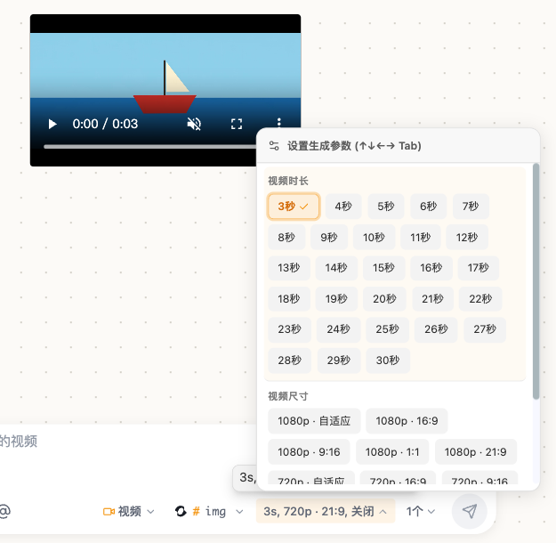

# Tuzi 新版视频模型参数

核对日期：2026-11-14。依据 [Tuzi 定价页](https://api.tu-zi.com/pricing)及其公开 `/api/pricing` 返回的模型描述和 endpoint。仅适配现有视频生成入口，不新增编辑、延展、主体或音色管理流程。

## 参数与使用

在供应商模型列表刷新并勾选相应模型，然后在视频生成参数菜单选择时长和尺寸。保留完整请求模型 ID 和供应商身份，不映射成旧型号。模型按钮短代码分别为 omni12、wan30、k40、h11t、h11i、h11r；旧目录缺少短代码时复用对应内置短代码，自定义模型则显示名称，不再回退为 img。

| 模型 | 时长及默认值 | 分辨率 | 图片输入及参数 |
| --- | --- | --- | --- |
| gemini-omni-1.2-flash | 3–15 秒，默认 10 | 360p / 720p / 1080p / 4K，横竖屏，默认 720p 横屏 | 最多 1 张公网 URL 参考图；`prompt/seconds/size/input_reference`；不发送 watermark |
| wan3.0-video | 2–30 秒，默认 5 | 480P / 720P / 1080P，默认 1080P | 最多首尾两帧；`duration/resolution/ratio/first_frame/last_frame`；尾帧必须同时提供首帧，默认 adaptive 比例 |
| happyhorse-1.1-t2v | 3–15 秒，默认 5 | 480P / 720P / 1080P，默认 1080P | 无图片；`parameters.duration/resolution/ratio/watermark/seed` |
| happyhorse-1.1-i2v | 同上 | 同上 | 必需 1 张 `image`；比例跟随首帧，不发送 ratio |
| happyhorse-1.1-r2v | 同上 | 同上 | 必需 1–9 张有序 `images`；可用 `[Image 1]` 等指代图片 |
| kling-4.0 | 3–30 秒，默认 10 | 720p / 1080p，默认 1080p 自适应；21:9、16:9、9:16、1:1、adaptive | 最多 10 张 `contents[].type=refer_image` 参考图，每张带唯一 ID；时长/清晰度/比例使用 `settings`，水印使用 `options.watermark_info.enabled`；不走旧 Kling 接口 |

HappyHorse 的 ratio 提供 16:9、9:16、1:1、4:3、3:4；seed 为 0–2147483647 的整数，0 和显式 false 保留。Wan 提供上述比例和 adaptive。Kling 4.0 的“视频尺寸”单独选择 1080P/720P，“视频比例”单独选择自适应、16:9、9:16、1:1、21:9；修改任意一项会保留另一项，默认 1080P + 自适应。尺寸保存在 size，比例保存在 ratio，提交时分别映射为 settings.resolution/aspect_ratio。旧组合尺寸（如 1680x720）在偏好恢复及旧任务提交时兼容转换为 720p + 21:9，显式 ratio 优先。Gemini 仍沿用组合尺寸选项。Wan 和 Kling 提供水印开关，HappyHorse 沿用现有水印与种子控件；Gemini 不显示水印。

本地或缓存图片由调用入口读取为 data URI；请求构造模块不依赖主线程缓存、FileReader 或 DOM。Gemini 本次仅接通文生视频与公网参考图 URL；本地图片需要后续按多模态 input 合同适配，当前会在提交前提示。

## 实现与兼容性

- `constants/tuzi-video-models.ts`：六个精确 ID 的参数与图片数量配置；未知后缀不继承合同，不推定存在 HappyHorse 1.1 Video Edit。
- `constants/model-config.ts`、`video-model-config.ts`：模型目录、默认值和参数菜单；保留已有模型和通用参数的顺序与默认值。
- `services/tuzi-video-request.ts`：统一 JSON 构造及参数校验；主线程、共享提交和 HappyHorse 适配器均消费同一实现。
- `provider-routing/binding-inference.ts`：Kling 4.0 使用统一异步视频协议；JSON 合同使用 `tuzi.video.generation-json`，HappyHorse 沿用其专用 JSON 协议。
- `video-binding-utils.ts`：完成任务没有内联 URL 时可通过 `/v1/videos/{id}/content` 取回；保留已有任务和素材。

旧 HappyHorse 1.0 和标准 Kling 的参数、接口保持各自合同。无需新依赖、环境变量、数据库迁移或用户数据清理。撤回本次文件改动即可回滚本地适配。

## 服务状态与限制

2026-11-14 的 Tuzi 目录标注 Gemini Omni 1.2 Flash 和 Wan 3.0 尚未开放调用。当天后续通过 Ego 浏览器实测：Wan 3.0 的 2 秒/480P/双帧已完成，HappyHorse 1.1 三型号的 3 秒/480P 也完成；Gemini 仍返回 `unsupported video model`。公开目录状态可能落后于渠道实际状态。

**Kling 4.0 参考图字段已本地修正**：先前真实请求的顶层 `input_reference` 被 EPhone 接口拒绝。依据 Tuzi API `ephonekling` 适配器及 `docs/kling-ephone.md` 的实际合同，当前请求使用 `contents`（提示词与 refer_image 数组）、`settings` 与 `options`，不再发送顶层 `prompt/seconds/size/watermark/input_reference`。图片依序分配 `image_1` 等唯一 ID；原有参数菜单和偏好不变。主线程、共享入口和默认适配器均使用该构造函数。修复后已完成本地模拟请求回归，并经用户授权追加 1 次 Ego 浏览器真实单图复测：3 秒、720p、21:9、水印关闭，返回 HTTP 200 并完成、缓存及入画布。实际 MP4 为 1460×624、3.041995 秒，比例约 21:9，但短边不是 720；本次确认请求字段修复有效，不保证渠道分辨率档位等于固定输出像素。详见 QA。

本次不处理 Gemini 多模态 input、任务编辑/延展，Wan 参考视频混合输入，Kling 复杂 contents 输入（首尾帧、参考视频）、视频角色、主体及音色。Wan 音轨、提示词改写沿用服务默认，没有猜测额外请求字段。HappyHorse 图片像素、文件大小与远程图片格式仍由服务端校验；本地构造校验时长、尺寸、比例、种子、水印、图片数量及必需图片。

验证结果与未执行范围见 [QA 记录](./qa-tuzi-video-model-parameters.md)。

拆分前的历史真实验收截图（当前已改为尺寸、比例分组选择）：

